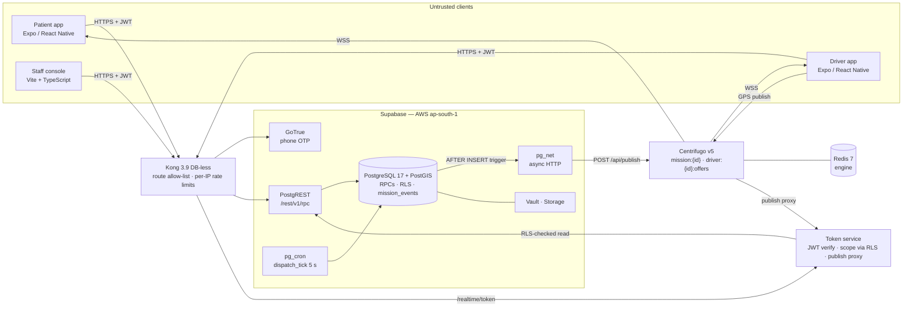
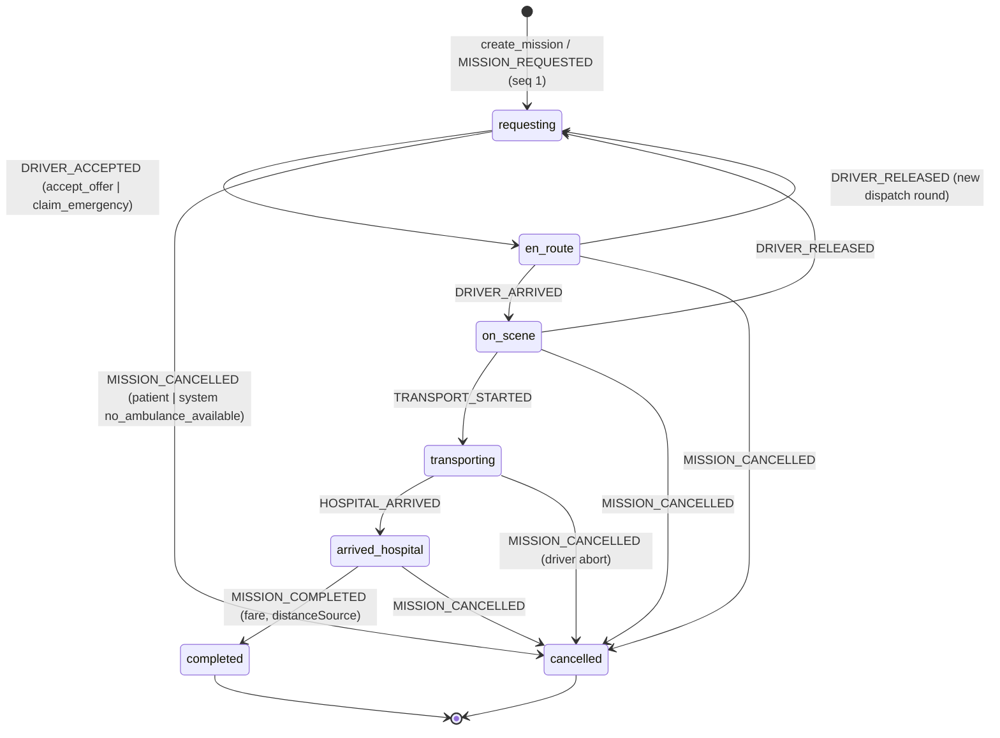
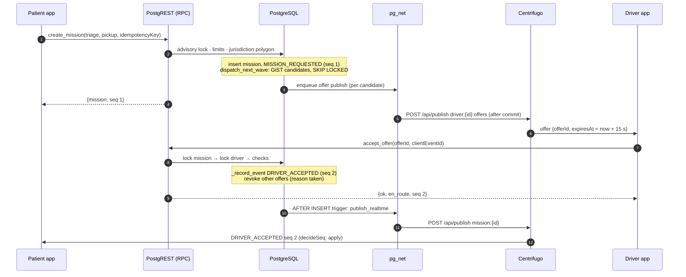
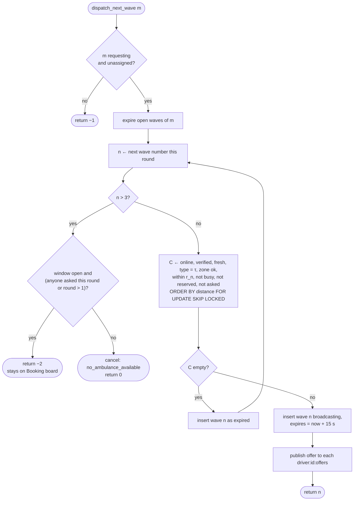
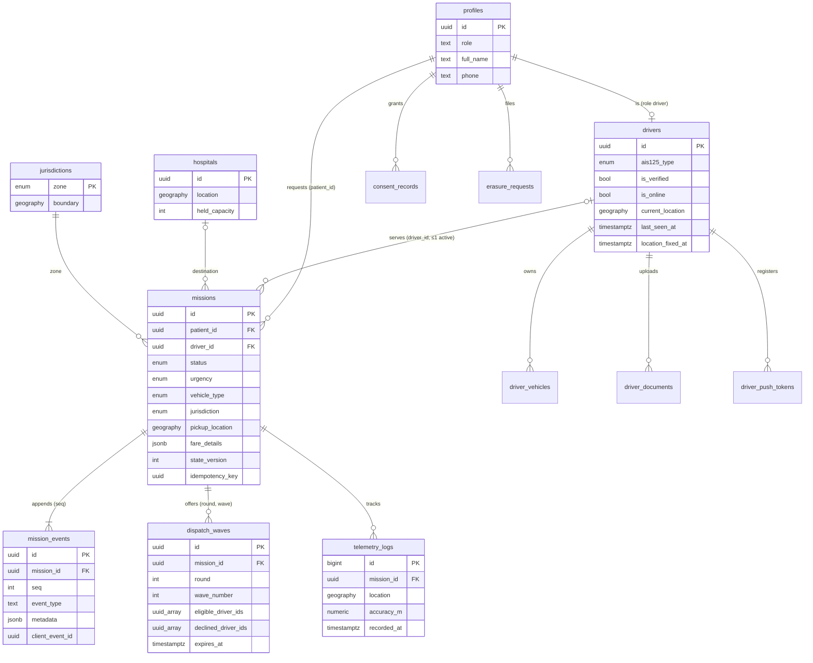
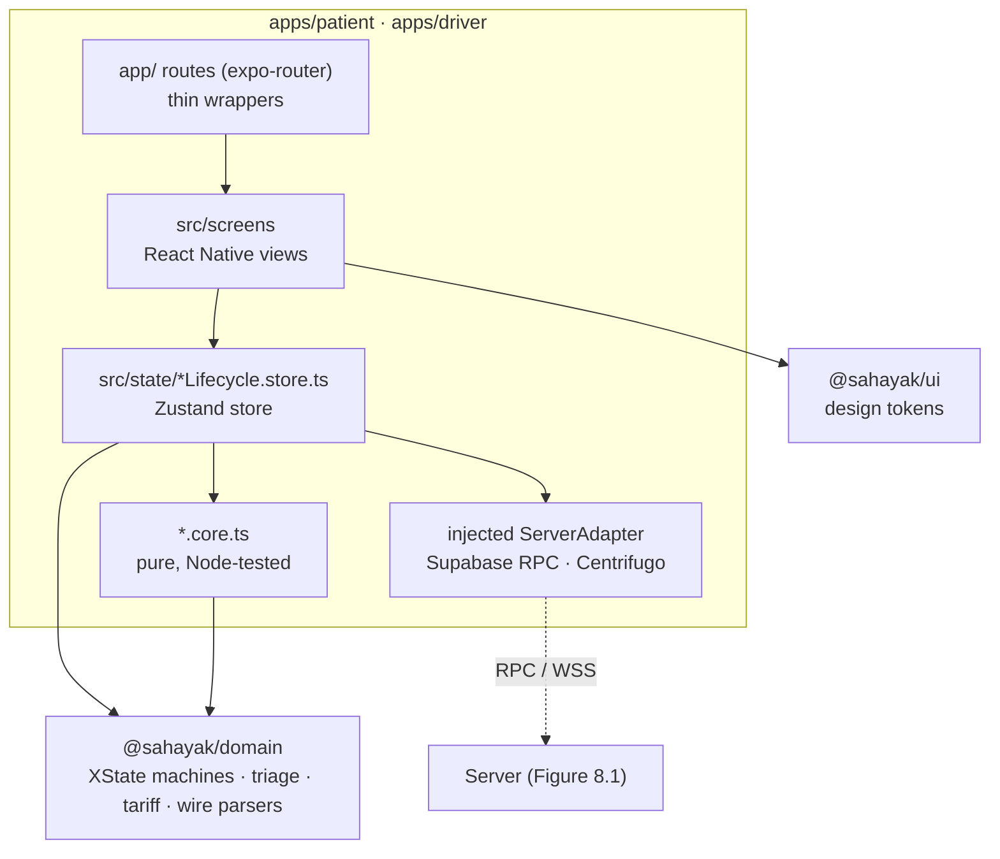

# 8. Diagrams and Visual Models

Each figure is given twice, in two forms.

- **Mermaid**, rendered inline by GitHub, GitLab and most Markdown viewers. draw.io can also import it through
  *Arrange → Insert → Advanced → Mermaid*.
- **draw.io XML** (`mxfile`), fully editable. Import it with *File → Import from → Device* after saving the block as a
  `.drawio` file, or paste it into *Extras → Edit Diagram*. `node report_source/assemble.mjs` also writes every XML block
  to `report_source/diagrams/<name>.drawio` automatically.

The diagrams describe the system as implemented. Section and algorithm numbers refer to Sections 5 and 6.

## Figure 8.1. Deployment and Trust-Boundary Architecture



<!-- drawio:fig8-1-architecture -->
```xml
<mxfile host="app.diagrams.net">
  <diagram id="fig81" name="Fig 8.1 Architecture">
    <mxGraphModel dx="1200" dy="800" grid="1" gridSize="10" guides="1" tooltips="1" connect="1" arrows="1" fold="1" page="1" pageScale="1" pageWidth="1169" pageHeight="827" math="0" shadow="0">
      <root>
        <mxCell id="0"/>
        <mxCell id="1" parent="0"/>
        <mxCell id="zoneClients" value="Untrusted clients" style="rounded=1;dashed=1;fillColor=#FEF2F2;strokeColor=#DC2626;verticalAlign=top;fontStyle=1;html=1;" vertex="1" parent="1">
          <mxGeometry x="10" y="10" width="190" height="330" as="geometry"/>
        </mxCell>
        <mxCell id="patient" value="Patient app&lt;br&gt;Expo / React Native" style="rounded=1;whiteSpace=wrap;html=1;fillColor=#FFFFFF;" vertex="1" parent="1">
          <mxGeometry x="30" y="50" width="150" height="60" as="geometry"/>
        </mxCell>
        <mxCell id="driver" value="Driver app&lt;br&gt;Expo / React Native" style="rounded=1;whiteSpace=wrap;html=1;fillColor=#FFFFFF;" vertex="1" parent="1">
          <mxGeometry x="30" y="150" width="150" height="60" as="geometry"/>
        </mxCell>
        <mxCell id="staff" value="Staff console&lt;br&gt;Vite + TypeScript" style="rounded=1;whiteSpace=wrap;html=1;fillColor=#FFFFFF;" vertex="1" parent="1">
          <mxGeometry x="30" y="250" width="150" height="60" as="geometry"/>
        </mxCell>
        <mxCell id="kong" value="&lt;b&gt;Kong 3.9&lt;/b&gt; (DB-less)&lt;br&gt;route allow-list&lt;br&gt;per-IP rate limits" style="rounded=1;whiteSpace=wrap;html=1;fillColor=#E0F2FE;strokeColor=#0369A1;" vertex="1" parent="1">
          <mxGeometry x="270" y="140" width="160" height="80" as="geometry"/>
        </mxCell>
        <mxCell id="token" value="&lt;b&gt;Token service&lt;/b&gt;&lt;br&gt;JWT verify · scope via RLS&lt;br&gt;publish proxy" style="rounded=1;whiteSpace=wrap;html=1;fillColor=#E0F2FE;strokeColor=#0369A1;" vertex="1" parent="1">
          <mxGeometry x="270" y="300" width="160" height="80" as="geometry"/>
        </mxCell>
        <mxCell id="zoneSupabase" value="Supabase — AWS ap-south-1 (trusted)" style="rounded=1;dashed=1;fillColor=#F0FDF4;strokeColor=#15803D;verticalAlign=top;fontStyle=1;html=1;" vertex="1" parent="1">
          <mxGeometry x="490" y="10" width="340" height="320" as="geometry"/>
        </mxCell>
        <mxCell id="auth" value="GoTrue&lt;br&gt;phone OTP" style="rounded=1;whiteSpace=wrap;html=1;" vertex="1" parent="1">
          <mxGeometry x="510" y="50" width="140" height="45" as="geometry"/>
        </mxCell>
        <mxCell id="rest" value="PostgREST&lt;br&gt;/rest/v1/rpc" style="rounded=1;whiteSpace=wrap;html=1;" vertex="1" parent="1">
          <mxGeometry x="670" y="50" width="140" height="45" as="geometry"/>
        </mxCell>
        <mxCell id="pg" value="&lt;b&gt;PostgreSQL 17 + PostGIS&lt;/b&gt;&lt;br&gt;SECURITY DEFINER RPCs · RLS&lt;br&gt;missions · dispatch_waves&lt;br&gt;mission_events (append-only)" style="shape=cylinder3;whiteSpace=wrap;html=1;boundedLbl=1;size=12;fillColor=#DCFCE7;strokeColor=#15803D;" vertex="1" parent="1">
          <mxGeometry x="510" y="120" width="300" height="120" as="geometry"/>
        </mxCell>
        <mxCell id="cron" value="pg_cron&lt;br&gt;dispatch_tick 5 s" style="rounded=1;whiteSpace=wrap;html=1;" vertex="1" parent="1">
          <mxGeometry x="510" y="265" width="95" height="50" as="geometry"/>
        </mxCell>
        <mxCell id="net" value="pg_net&lt;br&gt;async HTTP" style="rounded=1;whiteSpace=wrap;html=1;" vertex="1" parent="1">
          <mxGeometry x="615" y="265" width="90" height="50" as="geometry"/>
        </mxCell>
        <mxCell id="vault" value="Vault · Storage&lt;br&gt;(private KYC bucket)" style="rounded=1;whiteSpace=wrap;html=1;" vertex="1" parent="1">
          <mxGeometry x="715" y="265" width="100" height="50" as="geometry"/>
        </mxCell>
        <mxCell id="cf" value="&lt;b&gt;Centrifugo v5&lt;/b&gt;&lt;br&gt;mission:{id} · driver:{id}:offers&lt;br&gt;history + recovery" style="rounded=1;whiteSpace=wrap;html=1;fillColor=#FEF9C3;strokeColor=#A16207;" vertex="1" parent="1">
          <mxGeometry x="510" y="400" width="210" height="70" as="geometry"/>
        </mxCell>
        <mxCell id="redis" value="Redis 7&lt;br&gt;engine" style="shape=cylinder3;whiteSpace=wrap;html=1;boundedLbl=1;size=8;" vertex="1" parent="1">
          <mxGeometry x="750" y="400" width="80" height="70" as="geometry"/>
        </mxCell>
        <mxCell id="e1" value="HTTPS + JWT" style="endArrow=block;html=1;" edge="1" parent="1" source="patient" target="kong">
          <mxGeometry relative="1" as="geometry"/>
        </mxCell>
        <mxCell id="e2" value="" style="endArrow=block;html=1;" edge="1" parent="1" source="driver" target="kong">
          <mxGeometry relative="1" as="geometry"/>
        </mxCell>
        <mxCell id="e3" value="" style="endArrow=block;html=1;" edge="1" parent="1" source="staff" target="kong">
          <mxGeometry relative="1" as="geometry"/>
        </mxCell>
        <mxCell id="e4" value="/auth/v1" style="endArrow=block;html=1;" edge="1" parent="1" source="kong" target="auth">
          <mxGeometry relative="1" as="geometry"/>
        </mxCell>
        <mxCell id="e5" value="/rest/v1" style="endArrow=block;html=1;" edge="1" parent="1" source="kong" target="rest">
          <mxGeometry relative="1" as="geometry"/>
        </mxCell>
        <mxCell id="e6" value="" style="endArrow=block;html=1;" edge="1" parent="1" source="rest" target="pg">
          <mxGeometry relative="1" as="geometry"/>
        </mxCell>
        <mxCell id="e7" value="/realtime/token" style="endArrow=block;html=1;" edge="1" parent="1" source="kong" target="token">
          <mxGeometry relative="1" as="geometry"/>
        </mxCell>
        <mxCell id="e8" value="RLS-checked read" style="endArrow=block;html=1;dashed=1;" edge="1" parent="1" source="token" target="rest">
          <mxGeometry relative="1" as="geometry"/>
        </mxCell>
        <mxCell id="e9" value="" style="endArrow=block;html=1;" edge="1" parent="1" source="cron" target="pg">
          <mxGeometry relative="1" as="geometry"/>
        </mxCell>
        <mxCell id="e10" value="trigger" style="endArrow=block;html=1;" edge="1" parent="1" source="pg" target="net">
          <mxGeometry relative="1" as="geometry"/>
        </mxCell>
        <mxCell id="e11" value="POST /api/publish" style="endArrow=block;html=1;" edge="1" parent="1" source="net" target="cf">
          <mxGeometry relative="1" as="geometry"/>
        </mxCell>
        <mxCell id="e12" value="" style="endArrow=none;html=1;" edge="1" parent="1" source="cf" target="redis">
          <mxGeometry relative="1" as="geometry"/>
        </mxCell>
        <mxCell id="e13" value="WSS: lifecycle, offers" style="endArrow=block;html=1;edgeStyle=orthogonalEdgeStyle;" edge="1" parent="1" source="cf" target="driver">
          <mxGeometry relative="1" as="geometry">
            <Array as="points">
              <mxPoint x="105" y="435"/>
            </Array>
          </mxGeometry>
        </mxCell>
        <mxCell id="e14" value="publish proxy (GPS)" style="endArrow=block;html=1;dashed=1;" edge="1" parent="1" source="cf" target="token">
          <mxGeometry relative="1" as="geometry"/>
        </mxCell>
      </root>
    </mxGraphModel>
  </diagram>
</mxfile>
```

## Figure 8.2. Server-Side Mission Lifecycle State Machine

The patient and driver statecharts (§6.8) map every server status onto their own states through the status crosswalk
(`patientStateForStatus`, `driverStateForStatus`).



<!-- drawio:fig8-2-lifecycle -->
```xml
<mxfile host="app.diagrams.net">
  <diagram id="fig82" name="Fig 8.2 Mission lifecycle">
    <mxGraphModel dx="1200" dy="800" grid="1" gridSize="10" guides="1" tooltips="1" connect="1" arrows="1" fold="1" page="1" pageScale="1" pageWidth="1400" pageHeight="600" math="0" shadow="0">
      <root>
        <mxCell id="0"/>
        <mxCell id="1" parent="0"/>
        <mxCell id="init" value="" style="ellipse;fillColor=#000000;strokeColor=#000000;" vertex="1" parent="1">
          <mxGeometry x="90" y="40" width="24" height="24" as="geometry"/>
        </mxCell>
        <mxCell id="s_req" value="requesting" style="rounded=1;arcSize=40;whiteSpace=wrap;html=1;fillColor=#FEF9C3;" vertex="1" parent="1">
          <mxGeometry x="40" y="160" width="130" height="50" as="geometry"/>
        </mxCell>
        <mxCell id="s_enr" value="en_route" style="rounded=1;arcSize=40;whiteSpace=wrap;html=1;fillColor=#E0F2FE;" vertex="1" parent="1">
          <mxGeometry x="260" y="160" width="130" height="50" as="geometry"/>
        </mxCell>
        <mxCell id="s_scene" value="on_scene" style="rounded=1;arcSize=40;whiteSpace=wrap;html=1;fillColor=#E0F2FE;" vertex="1" parent="1">
          <mxGeometry x="480" y="160" width="130" height="50" as="geometry"/>
        </mxCell>
        <mxCell id="s_trans" value="transporting" style="rounded=1;arcSize=40;whiteSpace=wrap;html=1;fillColor=#E0F2FE;" vertex="1" parent="1">
          <mxGeometry x="700" y="160" width="130" height="50" as="geometry"/>
        </mxCell>
        <mxCell id="s_arr" value="arrived_hospital" style="rounded=1;arcSize=40;whiteSpace=wrap;html=1;fillColor=#E0F2FE;" vertex="1" parent="1">
          <mxGeometry x="920" y="160" width="130" height="50" as="geometry"/>
        </mxCell>
        <mxCell id="s_done" value="completed" style="rounded=1;arcSize=40;whiteSpace=wrap;html=1;fillColor=#DCFCE7;" vertex="1" parent="1">
          <mxGeometry x="1140" y="160" width="130" height="50" as="geometry"/>
        </mxCell>
        <mxCell id="s_canc" value="cancelled" style="rounded=1;arcSize=40;whiteSpace=wrap;html=1;fillColor=#FEE2E2;" vertex="1" parent="1">
          <mxGeometry x="590" y="400" width="130" height="50" as="geometry"/>
        </mxCell>
        <mxCell id="t0" value="create_mission&lt;br&gt;MISSION_REQUESTED (seq 1)" style="endArrow=block;html=1;" edge="1" parent="1" source="init" target="s_req">
          <mxGeometry relative="1" as="geometry"/>
        </mxCell>
        <mxCell id="t1" value="DRIVER_ACCEPTED" style="endArrow=block;html=1;" edge="1" parent="1" source="s_req" target="s_enr">
          <mxGeometry relative="1" as="geometry"/>
        </mxCell>
        <mxCell id="t2" value="DRIVER_ARRIVED" style="endArrow=block;html=1;" edge="1" parent="1" source="s_enr" target="s_scene">
          <mxGeometry relative="1" as="geometry"/>
        </mxCell>
        <mxCell id="t3" value="TRANSPORT_STARTED" style="endArrow=block;html=1;" edge="1" parent="1" source="s_scene" target="s_trans">
          <mxGeometry relative="1" as="geometry"/>
        </mxCell>
        <mxCell id="t4" value="HOSPITAL_ARRIVED" style="endArrow=block;html=1;" edge="1" parent="1" source="s_trans" target="s_arr">
          <mxGeometry relative="1" as="geometry"/>
        </mxCell>
        <mxCell id="t5" value="MISSION_COMPLETED" style="endArrow=block;html=1;" edge="1" parent="1" source="s_arr" target="s_done">
          <mxGeometry relative="1" as="geometry"/>
        </mxCell>
        <mxCell id="t6" value="DRIVER_RELEASED (new round)" style="endArrow=block;html=1;edgeStyle=orthogonalEdgeStyle;dashed=1;" edge="1" parent="1" source="s_enr" target="s_req">
          <mxGeometry relative="1" as="geometry">
            <Array as="points">
              <mxPoint x="325" y="110"/>
              <mxPoint x="140" y="110"/>
            </Array>
          </mxGeometry>
        </mxCell>
        <mxCell id="t7" value="DRIVER_RELEASED" style="endArrow=block;html=1;edgeStyle=orthogonalEdgeStyle;dashed=1;" edge="1" parent="1" source="s_scene" target="s_req">
          <mxGeometry relative="1" as="geometry">
            <Array as="points">
              <mxPoint x="545" y="80"/>
              <mxPoint x="150" y="80"/>
            </Array>
          </mxGeometry>
        </mxCell>
        <mxCell id="c1" value="MISSION_CANCELLED&lt;br&gt;(patient | system)" style="endArrow=block;html=1;" edge="1" parent="1" source="s_req" target="s_canc">
          <mxGeometry relative="1" as="geometry"/>
        </mxCell>
        <mxCell id="c2" value="" style="endArrow=block;html=1;" edge="1" parent="1" source="s_enr" target="s_canc">
          <mxGeometry relative="1" as="geometry"/>
        </mxCell>
        <mxCell id="c3" value="" style="endArrow=block;html=1;" edge="1" parent="1" source="s_scene" target="s_canc">
          <mxGeometry relative="1" as="geometry"/>
        </mxCell>
        <mxCell id="c4" value="driver abort" style="endArrow=block;html=1;" edge="1" parent="1" source="s_trans" target="s_canc">
          <mxGeometry relative="1" as="geometry"/>
        </mxCell>
        <mxCell id="c5" value="" style="endArrow=block;html=1;" edge="1" parent="1" source="s_arr" target="s_canc">
          <mxGeometry relative="1" as="geometry"/>
        </mxCell>
      </root>
    </mxGraphModel>
  </diagram>
</mxfile>
```

## Figure 8.3. Sequence Diagram: Booking, Wave-1 Offer and Acceptance



<!-- drawio:fig8-3-sequence -->
```xml
<mxfile host="app.diagrams.net">
  <diagram id="fig83" name="Fig 8.3 Booking and acceptance">
    <mxGraphModel dx="1200" dy="800" grid="1" gridSize="10" guides="1" tooltips="1" connect="1" arrows="1" fold="1" page="1" pageScale="1" pageWidth="1169" pageHeight="827" math="0" shadow="0">
      <root>
        <mxCell id="0"/>
        <mxCell id="1" parent="0"/>
        <mxCell id="L1" value="Patient app" style="shape=umlLifeline;perimeter=lifelinePerimeter;whiteSpace=wrap;html=1;container=0;collapsible=0;size=40;" vertex="1" parent="1">
          <mxGeometry x="20" y="20" width="140" height="660" as="geometry"/>
        </mxCell>
        <mxCell id="L2" value="PostgREST (RPC)" style="shape=umlLifeline;perimeter=lifelinePerimeter;whiteSpace=wrap;html=1;container=0;collapsible=0;size=40;" vertex="1" parent="1">
          <mxGeometry x="200" y="20" width="140" height="660" as="geometry"/>
        </mxCell>
        <mxCell id="L3" value="PostgreSQL" style="shape=umlLifeline;perimeter=lifelinePerimeter;whiteSpace=wrap;html=1;container=0;collapsible=0;size=40;" vertex="1" parent="1">
          <mxGeometry x="380" y="20" width="140" height="660" as="geometry"/>
        </mxCell>
        <mxCell id="L4" value="pg_net" style="shape=umlLifeline;perimeter=lifelinePerimeter;whiteSpace=wrap;html=1;container=0;collapsible=0;size=40;" vertex="1" parent="1">
          <mxGeometry x="560" y="20" width="140" height="660" as="geometry"/>
        </mxCell>
        <mxCell id="L5" value="Centrifugo" style="shape=umlLifeline;perimeter=lifelinePerimeter;whiteSpace=wrap;html=1;container=0;collapsible=0;size=40;" vertex="1" parent="1">
          <mxGeometry x="740" y="20" width="140" height="660" as="geometry"/>
        </mxCell>
        <mxCell id="L6" value="Driver app" style="shape=umlLifeline;perimeter=lifelinePerimeter;whiteSpace=wrap;html=1;container=0;collapsible=0;size=40;" vertex="1" parent="1">
          <mxGeometry x="920" y="20" width="140" height="660" as="geometry"/>
        </mxCell>
        <mxCell id="m1" value="1 create_mission(triage, pickup, key)" style="endArrow=block;html=1;" edge="1" parent="1">
          <mxGeometry relative="1" as="geometry">
            <mxPoint x="90" y="100" as="sourcePoint"/>
            <mxPoint x="270" y="100" as="targetPoint"/>
          </mxGeometry>
        </mxCell>
        <mxCell id="m2" value="2 advisory lock · limits · jurisdiction" style="endArrow=block;html=1;" edge="1" parent="1">
          <mxGeometry relative="1" as="geometry">
            <mxPoint x="270" y="140" as="sourcePoint"/>
            <mxPoint x="450" y="140" as="targetPoint"/>
          </mxGeometry>
        </mxCell>
        <mxCell id="n1" value="insert mission + MISSION_REQUESTED (seq 1)&lt;br&gt;dispatch_next_wave: GiST, SKIP LOCKED" style="shape=note;whiteSpace=wrap;html=1;size=10;fillColor=#FEF9C3;" vertex="1" parent="1">
          <mxGeometry x="350" y="160" width="200" height="50" as="geometry"/>
        </mxCell>
        <mxCell id="m3" value="3 enqueue offer per candidate" style="endArrow=block;html=1;" edge="1" parent="1">
          <mxGeometry relative="1" as="geometry">
            <mxPoint x="450" y="230" as="sourcePoint"/>
            <mxPoint x="630" y="230" as="targetPoint"/>
          </mxGeometry>
        </mxCell>
        <mxCell id="m4" value="4 {mission, seq 1}" style="endArrow=open;dashed=1;html=1;" edge="1" parent="1">
          <mxGeometry relative="1" as="geometry">
            <mxPoint x="270" y="265" as="sourcePoint"/>
            <mxPoint x="90" y="265" as="targetPoint"/>
          </mxGeometry>
        </mxCell>
        <mxCell id="m5" value="5 POST /api/publish driver:{id}:offers (after commit)" style="endArrow=block;html=1;" edge="1" parent="1">
          <mxGeometry relative="1" as="geometry">
            <mxPoint x="630" y="300" as="sourcePoint"/>
            <mxPoint x="810" y="300" as="targetPoint"/>
          </mxGeometry>
        </mxCell>
        <mxCell id="m6" value="6 offer (expiresAt = now + 15 s)" style="endArrow=block;html=1;" edge="1" parent="1">
          <mxGeometry relative="1" as="geometry">
            <mxPoint x="810" y="340" as="sourcePoint"/>
            <mxPoint x="990" y="340" as="targetPoint"/>
          </mxGeometry>
        </mxCell>
        <mxCell id="m7" value="7 accept_offer(offerId, clientEventId)" style="endArrow=block;html=1;" edge="1" parent="1">
          <mxGeometry relative="1" as="geometry">
            <mxPoint x="990" y="390" as="sourcePoint"/>
            <mxPoint x="270" y="390" as="targetPoint"/>
          </mxGeometry>
        </mxCell>
        <mxCell id="m8" value="8 lock mission → lock driver → checks" style="endArrow=block;html=1;" edge="1" parent="1">
          <mxGeometry relative="1" as="geometry">
            <mxPoint x="270" y="430" as="sourcePoint"/>
            <mxPoint x="450" y="430" as="targetPoint"/>
          </mxGeometry>
        </mxCell>
        <mxCell id="n2" value="_record_event DRIVER_ACCEPTED (seq 2)&lt;br&gt;revoke other offers (taken)" style="shape=note;whiteSpace=wrap;html=1;size=10;fillColor=#FEF9C3;" vertex="1" parent="1">
          <mxGeometry x="350" y="450" width="200" height="50" as="geometry"/>
        </mxCell>
        <mxCell id="m9" value="9 {ok, en_route, seq 2}" style="endArrow=open;dashed=1;html=1;" edge="1" parent="1">
          <mxGeometry relative="1" as="geometry">
            <mxPoint x="270" y="525" as="sourcePoint"/>
            <mxPoint x="990" y="525" as="targetPoint"/>
          </mxGeometry>
        </mxCell>
        <mxCell id="m10" value="10 trigger: publish_realtime" style="endArrow=block;html=1;" edge="1" parent="1">
          <mxGeometry relative="1" as="geometry">
            <mxPoint x="450" y="565" as="sourcePoint"/>
            <mxPoint x="630" y="565" as="targetPoint"/>
          </mxGeometry>
        </mxCell>
        <mxCell id="m11" value="11 POST /api/publish mission:{id}" style="endArrow=block;html=1;" edge="1" parent="1">
          <mxGeometry relative="1" as="geometry">
            <mxPoint x="630" y="600" as="sourcePoint"/>
            <mxPoint x="810" y="600" as="targetPoint"/>
          </mxGeometry>
        </mxCell>
        <mxCell id="m12" value="12 DRIVER_ACCEPTED seq 2 (decideSeq: apply)" style="endArrow=block;html=1;" edge="1" parent="1">
          <mxGeometry relative="1" as="geometry">
            <mxPoint x="810" y="640" as="sourcePoint"/>
            <mxPoint x="90" y="640" as="targetPoint"/>
          </mxGeometry>
        </mxCell>
      </root>
    </mxGraphModel>
  </diagram>
</mxfile>
```

## Figure 8.4. Flowchart: One Call of `dispatch_next_wave` (Algorithm 2)



<!-- drawio:fig8-4-dispatch-flow -->
```xml
<mxfile host="app.diagrams.net">
  <diagram id="fig84" name="Fig 8.4 dispatch_next_wave">
    <mxGraphModel dx="1200" dy="800" grid="1" gridSize="10" guides="1" tooltips="1" connect="1" arrows="1" fold="1" page="1" pageScale="1" pageWidth="900" pageHeight="1100" math="0" shadow="0">
      <root>
        <mxCell id="0"/>
        <mxCell id="1" parent="0"/>
        <mxCell id="a" value="dispatch_next_wave(m)" style="rounded=1;arcSize=50;whiteSpace=wrap;html=1;fillColor=#E0F2FE;" vertex="1" parent="1">
          <mxGeometry x="300" y="20" width="180" height="40" as="geometry"/>
        </mxCell>
        <mxCell id="b" value="m requesting&lt;br&gt;and unassigned?" style="rhombus;whiteSpace=wrap;html=1;" vertex="1" parent="1">
          <mxGeometry x="310" y="90" width="160" height="90" as="geometry"/>
        </mxCell>
        <mxCell id="z1" value="return −1" style="rounded=1;arcSize=50;whiteSpace=wrap;html=1;fillColor=#F1F5F9;" vertex="1" parent="1">
          <mxGeometry x="560" y="115" width="120" height="40" as="geometry"/>
        </mxCell>
        <mxCell id="c" value="expire open waves of m" style="rounded=0;whiteSpace=wrap;html=1;" vertex="1" parent="1">
          <mxGeometry x="300" y="210" width="180" height="40" as="geometry"/>
        </mxCell>
        <mxCell id="d" value="n ← next wave number (this round)" style="rounded=0;whiteSpace=wrap;html=1;" vertex="1" parent="1">
          <mxGeometry x="290" y="280" width="200" height="40" as="geometry"/>
        </mxCell>
        <mxCell id="e" value="n &amp;gt; 3?" style="rhombus;whiteSpace=wrap;html=1;" vertex="1" parent="1">
          <mxGeometry x="330" y="350" width="120" height="80" as="geometry"/>
        </mxCell>
        <mxCell id="f" value="window open and&lt;br&gt;(anyone asked this round&lt;br&gt;or round &amp;gt; 1)?" style="rhombus;whiteSpace=wrap;html=1;" vertex="1" parent="1">
          <mxGeometry x="530" y="340" width="200" height="100" as="geometry"/>
        </mxCell>
        <mxCell id="z2" value="return −2&lt;br&gt;(stays on Booking board)" style="rounded=1;arcSize=50;whiteSpace=wrap;html=1;fillColor=#FEF9C3;" vertex="1" parent="1">
          <mxGeometry x="770" y="300" width="160" height="50" as="geometry"/>
        </mxCell>
        <mxCell id="z3" value="cancel: no_ambulance_available&lt;br&gt;return 0" style="rounded=1;arcSize=50;whiteSpace=wrap;html=1;fillColor=#FEE2E2;" vertex="1" parent="1">
          <mxGeometry x="770" y="430" width="180" height="50" as="geometry"/>
        </mxCell>
        <mxCell id="g" value="C ← online, verified, heartbeat and fix &amp;lt; 30 s,&lt;br&gt;type = τ, zone ok, within r&lt;sub&gt;n&lt;/sub&gt; (GiST),&lt;br&gt;not busy, not reserved, not asked&lt;br&gt;ORDER BY distance, id · FOR UPDATE SKIP LOCKED" style="rounded=0;whiteSpace=wrap;html=1;fillColor=#DCFCE7;" vertex="1" parent="1">
          <mxGeometry x="240" y="470" width="300" height="90" as="geometry"/>
        </mxCell>
        <mxCell id="h" value="C empty?" style="rhombus;whiteSpace=wrap;html=1;" vertex="1" parent="1">
          <mxGeometry x="330" y="590" width="120" height="80" as="geometry"/>
        </mxCell>
        <mxCell id="i" value="insert wave n as expired" style="rounded=0;whiteSpace=wrap;html=1;" vertex="1" parent="1">
          <mxGeometry x="60" y="610" width="170" height="40" as="geometry"/>
        </mxCell>
        <mxCell id="j" value="insert wave n broadcasting&lt;br&gt;expires = now + 15 s" style="rounded=0;whiteSpace=wrap;html=1;" vertex="1" parent="1">
          <mxGeometry x="290" y="700" width="200" height="50" as="geometry"/>
        </mxCell>
        <mxCell id="k" value="publish offer to each driver:{id}:offers&lt;br&gt;(pg_net, after commit)" style="rounded=0;whiteSpace=wrap;html=1;" vertex="1" parent="1">
          <mxGeometry x="280" y="780" width="220" height="50" as="geometry"/>
        </mxCell>
        <mxCell id="z4" value="return n" style="rounded=1;arcSize=50;whiteSpace=wrap;html=1;fillColor=#E0F2FE;" vertex="1" parent="1">
          <mxGeometry x="330" y="860" width="120" height="40" as="geometry"/>
        </mxCell>
        <mxCell id="x1" style="endArrow=block;html=1;" edge="1" parent="1" source="a" target="b">
          <mxGeometry relative="1" as="geometry"/>
        </mxCell>
        <mxCell id="x2" value="no" style="endArrow=block;html=1;" edge="1" parent="1" source="b" target="z1">
          <mxGeometry relative="1" as="geometry"/>
        </mxCell>
        <mxCell id="x3" value="yes" style="endArrow=block;html=1;" edge="1" parent="1" source="b" target="c">
          <mxGeometry relative="1" as="geometry"/>
        </mxCell>
        <mxCell id="x4" style="endArrow=block;html=1;" edge="1" parent="1" source="c" target="d">
          <mxGeometry relative="1" as="geometry"/>
        </mxCell>
        <mxCell id="x5" style="endArrow=block;html=1;" edge="1" parent="1" source="d" target="e">
          <mxGeometry relative="1" as="geometry"/>
        </mxCell>
        <mxCell id="x6" value="yes" style="endArrow=block;html=1;" edge="1" parent="1" source="e" target="f">
          <mxGeometry relative="1" as="geometry"/>
        </mxCell>
        <mxCell id="x7" value="yes" style="endArrow=block;html=1;" edge="1" parent="1" source="f" target="z2">
          <mxGeometry relative="1" as="geometry"/>
        </mxCell>
        <mxCell id="x8" value="no" style="endArrow=block;html=1;" edge="1" parent="1" source="f" target="z3">
          <mxGeometry relative="1" as="geometry"/>
        </mxCell>
        <mxCell id="x9" value="no" style="endArrow=block;html=1;" edge="1" parent="1" source="e" target="g">
          <mxGeometry relative="1" as="geometry"/>
        </mxCell>
        <mxCell id="x10" style="endArrow=block;html=1;" edge="1" parent="1" source="g" target="h">
          <mxGeometry relative="1" as="geometry"/>
        </mxCell>
        <mxCell id="x11" value="yes" style="endArrow=block;html=1;" edge="1" parent="1" source="h" target="i">
          <mxGeometry relative="1" as="geometry"/>
        </mxCell>
        <mxCell id="x12" value="next radius" style="endArrow=block;html=1;edgeStyle=orthogonalEdgeStyle;" edge="1" parent="1" source="i" target="d">
          <mxGeometry relative="1" as="geometry">
            <Array as="points">
              <mxPoint x="145" y="300"/>
            </Array>
          </mxGeometry>
        </mxCell>
        <mxCell id="x13" value="no" style="endArrow=block;html=1;" edge="1" parent="1" source="h" target="j">
          <mxGeometry relative="1" as="geometry"/>
        </mxCell>
        <mxCell id="x14" style="endArrow=block;html=1;" edge="1" parent="1" source="j" target="k">
          <mxGeometry relative="1" as="geometry"/>
        </mxCell>
        <mxCell id="x15" style="endArrow=block;html=1;" edge="1" parent="1" source="k" target="z4">
          <mxGeometry relative="1" as="geometry"/>
        </mxCell>
      </root>
    </mxGraphModel>
  </diagram>
</mxfile>
```

## Figure 8.5. Entity–Relationship Diagram

Columns are abridged to keys and the attributes the algorithms use (full list in §5.5.1).



<!-- drawio:fig8-5-erd -->
```xml
<mxfile host="app.diagrams.net">
  <diagram id="fig85" name="Fig 8.5 ERD">
    <mxGraphModel dx="1200" dy="800" grid="1" gridSize="10" guides="1" tooltips="1" connect="1" arrows="1" fold="1" page="1" pageScale="1" pageWidth="1169" pageHeight="827" math="0" shadow="0">
      <root>
        <mxCell id="0"/>
        <mxCell id="1" parent="0"/>
        <mxCell id="consent" value="&lt;b&gt;consent_records&lt;/b&gt;&lt;hr&gt;id PK&lt;br&gt;user_id FK → profiles&lt;br&gt;purpose · granted · notice_version" style="rounded=0;whiteSpace=wrap;html=1;align=left;verticalAlign=top;spacingLeft=6;" vertex="1" parent="1">
          <mxGeometry x="20" y="20" width="220" height="100" as="geometry"/>
        </mxCell>
        <mxCell id="profiles" value="&lt;b&gt;profiles&lt;/b&gt;&lt;hr&gt;id PK (= auth user)&lt;br&gt;role · full_name · phone&lt;br&gt;preferred_language" style="rounded=0;whiteSpace=wrap;html=1;align=left;verticalAlign=top;spacingLeft=6;fillColor=#F1F5F9;" vertex="1" parent="1">
          <mxGeometry x="20" y="200" width="220" height="110" as="geometry"/>
        </mxCell>
        <mxCell id="erasure" value="&lt;b&gt;erasure_requests&lt;/b&gt;&lt;hr&gt;id PK&lt;br&gt;user_id FK → profiles&lt;br&gt;status · due_at · scope" style="rounded=0;whiteSpace=wrap;html=1;align=left;verticalAlign=top;spacingLeft=6;" vertex="1" parent="1">
          <mxGeometry x="20" y="390" width="220" height="100" as="geometry"/>
        </mxCell>
        <mxCell id="missions" value="&lt;b&gt;missions&lt;/b&gt;&lt;hr&gt;id PK&lt;br&gt;patient_id FK → profiles&lt;br&gt;driver_id FK → drivers&lt;br&gt;destination_hospital_id FK&lt;br&gt;status · urgency · vehicle_type&lt;br&gt;jurisdiction · pickup_location&lt;br&gt;fare_details (surge = 1.0)&lt;br&gt;state_version · idempotency_key&lt;br&gt;dispatch_round · search_started_at" style="rounded=0;whiteSpace=wrap;html=1;align=left;verticalAlign=top;spacingLeft=6;fillColor=#FEF9C3;" vertex="1" parent="1">
          <mxGeometry x="310" y="160" width="250" height="210" as="geometry"/>
        </mxCell>
        <mxCell id="juris" value="&lt;b&gt;jurisdictions&lt;/b&gt;&lt;hr&gt;zone PK (DL | UP)&lt;br&gt;boundary · statutory_order_ref" style="rounded=0;whiteSpace=wrap;html=1;align=left;verticalAlign=top;spacingLeft=6;" vertex="1" parent="1">
          <mxGeometry x="310" y="430" width="250" height="80" as="geometry"/>
        </mxCell>
        <mxCell id="events" value="&lt;b&gt;mission_events&lt;/b&gt; (append-only)&lt;hr&gt;id PK&lt;br&gt;mission_id FK · seq&lt;br&gt;event_type · from/to_status&lt;br&gt;metadata · client_event_id" style="rounded=0;whiteSpace=wrap;html=1;align=left;verticalAlign=top;spacingLeft=6;" vertex="1" parent="1">
          <mxGeometry x="630" y="20" width="230" height="110" as="geometry"/>
        </mxCell>
        <mxCell id="waves" value="&lt;b&gt;dispatch_waves&lt;/b&gt;&lt;hr&gt;id PK (= offer id)&lt;br&gt;mission_id FK · round · wave_number&lt;br&gt;eligible / declined_driver_ids&lt;br&gt;status · expires_at · accepted_by" style="rounded=0;whiteSpace=wrap;html=1;align=left;verticalAlign=top;spacingLeft=6;" vertex="1" parent="1">
          <mxGeometry x="630" y="160" width="230" height="110" as="geometry"/>
        </mxCell>
        <mxCell id="telemetry" value="&lt;b&gt;telemetry_logs&lt;/b&gt;&lt;hr&gt;id PK&lt;br&gt;mission_id FK · driver_id&lt;br&gt;location · accuracy_m · recorded_at" style="rounded=0;whiteSpace=wrap;html=1;align=left;verticalAlign=top;spacingLeft=6;" vertex="1" parent="1">
          <mxGeometry x="630" y="300" width="230" height="90" as="geometry"/>
        </mxCell>
        <mxCell id="hospitals" value="&lt;b&gt;hospitals&lt;/b&gt;&lt;hr&gt;id PK&lt;br&gt;location · zone&lt;br&gt;total / held_capacity" style="rounded=0;whiteSpace=wrap;html=1;align=left;verticalAlign=top;spacingLeft=6;" vertex="1" parent="1">
          <mxGeometry x="630" y="420" width="230" height="90" as="geometry"/>
        </mxCell>
        <mxCell id="vehicles" value="&lt;b&gt;driver_vehicles&lt;/b&gt;&lt;hr&gt;id PK · driver_id FK&lt;br&gt;registration_number (unique, normalised)&lt;br&gt;make_model · color · crew_count" style="rounded=0;whiteSpace=wrap;html=1;align=left;verticalAlign=top;spacingLeft=6;" vertex="1" parent="1">
          <mxGeometry x="930" y="20" width="240" height="100" as="geometry"/>
        </mxCell>
        <mxCell id="drivers" value="&lt;b&gt;drivers&lt;/b&gt;&lt;hr&gt;id PK FK → profiles&lt;br&gt;ais125_type · is_verified · kyc_status&lt;br&gt;is_online · current_location&lt;br&gt;last_seen_at · location_fixed_at&lt;br&gt;service_zone" style="rounded=0;whiteSpace=wrap;html=1;align=left;verticalAlign=top;spacingLeft=6;fillColor=#F1F5F9;" vertex="1" parent="1">
          <mxGeometry x="930" y="160" width="240" height="130" as="geometry"/>
        </mxCell>
        <mxCell id="documents" value="&lt;b&gt;driver_documents&lt;/b&gt;&lt;hr&gt;id PK · driver_id FK&lt;br&gt;slot · storage_path · status" style="rounded=0;whiteSpace=wrap;html=1;align=left;verticalAlign=top;spacingLeft=6;" vertex="1" parent="1">
          <mxGeometry x="930" y="320" width="240" height="80" as="geometry"/>
        </mxCell>
        <mxCell id="push" value="&lt;b&gt;driver_push_tokens&lt;/b&gt;&lt;hr&gt;id PK · driver_id FK&lt;br&gt;token · platform" style="rounded=0;whiteSpace=wrap;html=1;align=left;verticalAlign=top;spacingLeft=6;" vertex="1" parent="1">
          <mxGeometry x="930" y="430" width="240" height="80" as="geometry"/>
        </mxCell>
        <mxCell id="r1" value="1 : N" style="endArrow=ERmany;startArrow=ERmandOne;html=1;endFill=0;startFill=0;" edge="1" parent="1" source="profiles" target="consent">
          <mxGeometry relative="1" as="geometry"/>
        </mxCell>
        <mxCell id="r2" value="1 : N" style="endArrow=ERmany;startArrow=ERmandOne;html=1;endFill=0;startFill=0;" edge="1" parent="1" source="profiles" target="erasure">
          <mxGeometry relative="1" as="geometry"/>
        </mxCell>
        <mxCell id="r3" value="patient 1 : N" style="endArrow=ERmany;startArrow=ERmandOne;html=1;endFill=0;startFill=0;" edge="1" parent="1" source="profiles" target="missions">
          <mxGeometry relative="1" as="geometry"/>
        </mxCell>
        <mxCell id="r4" value="1 : N (seq)" style="endArrow=ERoneToMany;startArrow=ERmandOne;html=1;endFill=0;startFill=0;" edge="1" parent="1" source="missions" target="events">
          <mxGeometry relative="1" as="geometry"/>
        </mxCell>
        <mxCell id="r5" value="1 : N" style="endArrow=ERmany;startArrow=ERmandOne;html=1;endFill=0;startFill=0;" edge="1" parent="1" source="missions" target="waves">
          <mxGeometry relative="1" as="geometry"/>
        </mxCell>
        <mxCell id="r6" value="1 : N" style="endArrow=ERmany;startArrow=ERmandOne;html=1;endFill=0;startFill=0;" edge="1" parent="1" source="missions" target="telemetry">
          <mxGeometry relative="1" as="geometry"/>
        </mxCell>
        <mxCell id="r7" value="destination 0..1 : N" style="endArrow=ERmany;startArrow=ERzeroToOne;html=1;endFill=0;startFill=0;" edge="1" parent="1" source="hospitals" target="missions">
          <mxGeometry relative="1" as="geometry"/>
        </mxCell>
        <mxCell id="r8" value="zone 1 : N" style="endArrow=ERmany;startArrow=ERmandOne;html=1;endFill=0;startFill=0;" edge="1" parent="1" source="juris" target="missions">
          <mxGeometry relative="1" as="geometry"/>
        </mxCell>
        <mxCell id="r9" value="serves 0..1 : N (≤ 1 active)" style="endArrow=ERmany;startArrow=ERzeroToOne;html=1;endFill=0;startFill=0;edgeStyle=orthogonalEdgeStyle;" edge="1" parent="1" source="drivers" target="missions">
          <mxGeometry relative="1" as="geometry">
            <Array as="points">
              <mxPoint x="900" y="280"/>
              <mxPoint x="590" y="280"/>
            </Array>
          </mxGeometry>
        </mxCell>
        <mxCell id="r10" value="1 : N" style="endArrow=ERmany;startArrow=ERmandOne;html=1;endFill=0;startFill=0;" edge="1" parent="1" source="drivers" target="vehicles">
          <mxGeometry relative="1" as="geometry"/>
        </mxCell>
        <mxCell id="r11" value="1 : N" style="endArrow=ERmany;startArrow=ERmandOne;html=1;endFill=0;startFill=0;" edge="1" parent="1" source="drivers" target="documents">
          <mxGeometry relative="1" as="geometry"/>
        </mxCell>
        <mxCell id="r12" value="1 : N" style="endArrow=ERmany;startArrow=ERmandOne;html=1;endFill=0;startFill=0;edgeStyle=orthogonalEdgeStyle;" edge="1" parent="1" source="drivers" target="push">
          <mxGeometry relative="1" as="geometry">
            <Array as="points">
              <mxPoint x="1190" y="225"/>
              <mxPoint x="1190" y="470"/>
            </Array>
          </mxGeometry>
        </mxCell>
        <mxCell id="r13" value="1 : 0..1" style="endArrow=ERzeroToOne;startArrow=ERmandOne;html=1;endFill=0;startFill=0;edgeStyle=orthogonalEdgeStyle;" edge="1" parent="1" source="profiles" target="drivers">
          <mxGeometry relative="1" as="geometry">
            <Array as="points">
              <mxPoint x="130" y="150"/>
              <mxPoint x="1050" y="150"/>
            </Array>
          </mxGeometry>
        </mxCell>
      </root>
    </mxGraphModel>
  </diagram>
</mxfile>
```

## Figure 8.6. Client Layering (Functional Core, Imperative Shell)


