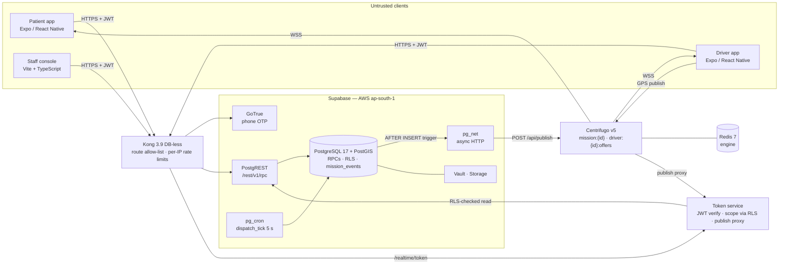
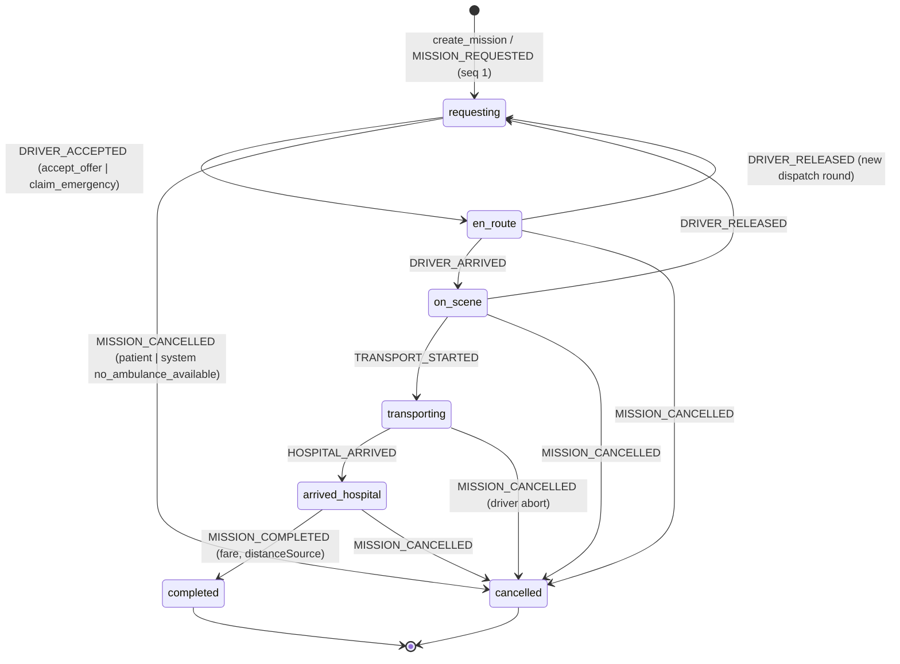
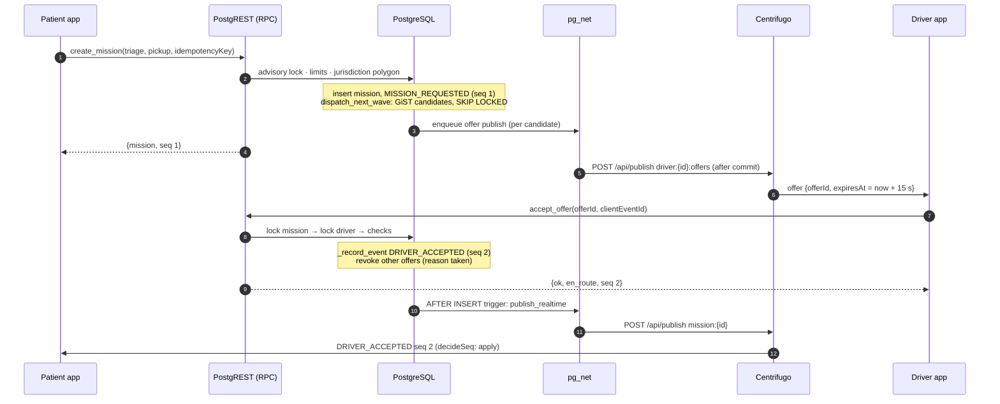
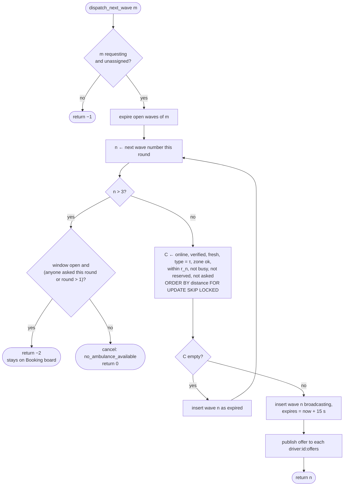
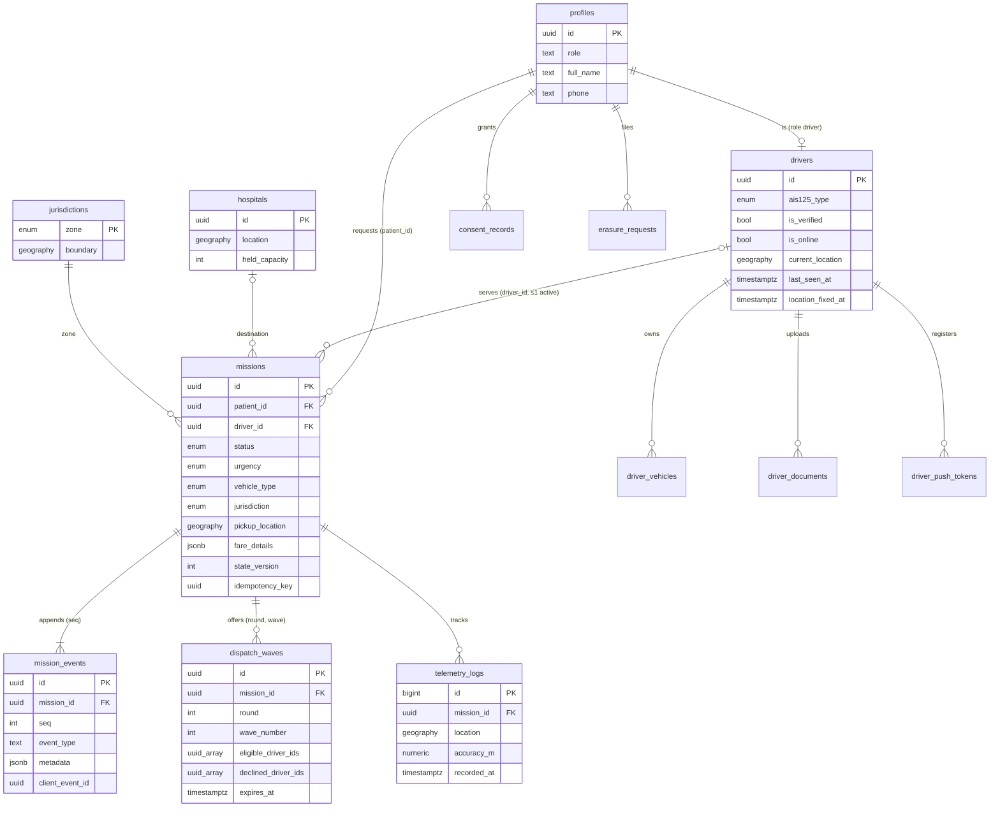
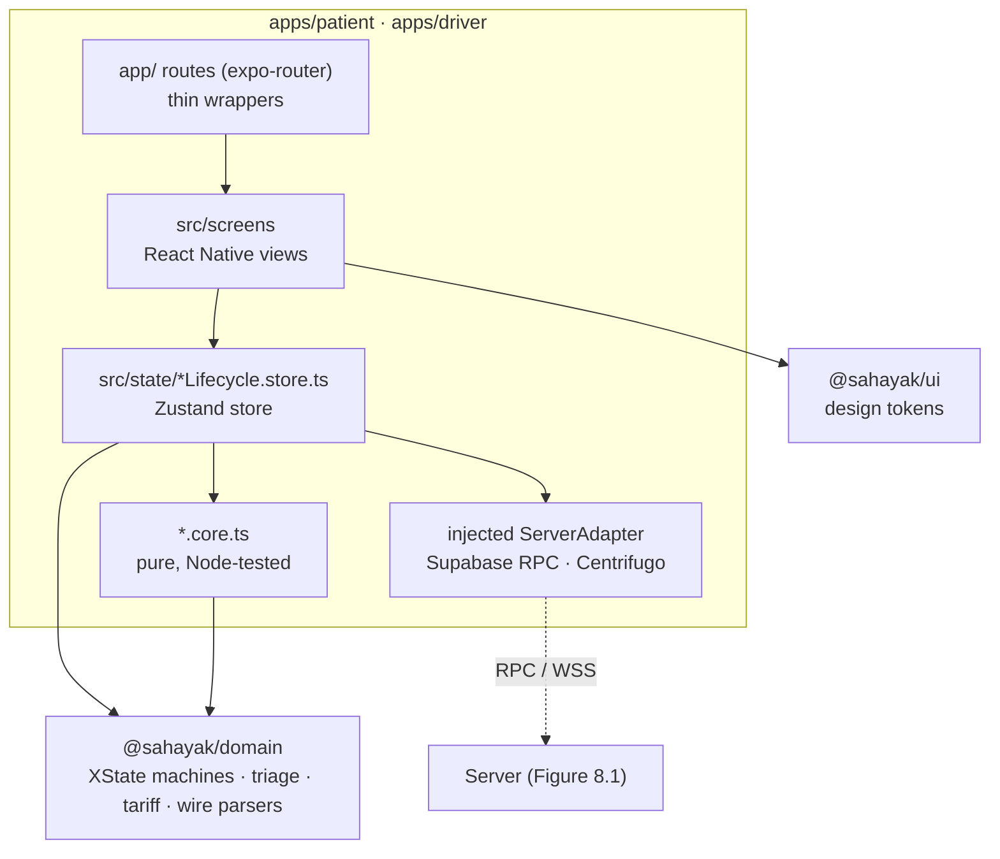

# Ek-Ambulance (SAHAYAK-EMS): A Server-Authoritative, Event-Driven Platform for On-Demand Emergency Ambulance Dispatch in Delhi and Uttar Pradesh

*Research Paper and Project Report* · October 2026

**Ny Harena RAVELOMANANTSOA**<br>Department of Computer Science and Engineering, Sharda School of Engineering and Technology (SSET), Sharda University, Greater Noida, Uttar Pradesh, India

**Yogesh Lekhra**<br>Department of Computer Science and Engineering, Sharda School of Engineering and Technology (SSET), Sharda University, Greater Noida, Uttar Pradesh, India

<!-- Generated by report_source/assemble.mjs from the files in report_source/. Edit those files, not this one. -->

## Contents

- [1. Abstract and Executive Summary](#1-abstract-and-executive-summary)
  - [1.1 Abstract](#11-abstract)
  - [1.2 Executive Summary](#12-executive-summary)
- [2. Introduction](#2-introduction)
  - [2.1 Background and Motivation](#21-background-and-motivation)
  - [2.2 Problem Statement](#22-problem-statement)
  - [2.3 Technical Challenges](#23-technical-challenges)
  - [2.4 Value Proposition](#24-value-proposition)
  - [2.5 Contributions](#25-contributions)
  - [2.6 Scope and Non-Goals](#26-scope-and-non-goals)
  - [2.7 Organisation of the Report](#27-organisation-of-the-report)
- [3. Literature Review and Technology Choice Justification](#3-literature-review-and-technology-choice-justification)
  - [3.1 Related Work](#31-related-work)
  - [3.2 Quality Attributes that Drive Technology Choice](#32-quality-attributes-that-drive-technology-choice)
  - [3.3 Mobile Front End: Expo / React Native](#33-mobile-front-end-expo--react-native)
  - [3.4 Client State: XState Statecharts inside Zustand Stores](#34-client-state-xstate-statecharts-inside-zustand-stores)
  - [3.5 Backend Logic: PostgreSQL Functions on Supabase ("Database as Application Server")](#35-backend-logic-postgresql-functions-on-supabase-database-as-application-server)
  - [3.6 Database: PostgreSQL 17 with PostGIS](#36-database-postgresql-17-with-postgis)
  - [3.7 Realtime Plane: Centrifugo v5 with a Redis Engine](#37-realtime-plane-centrifugo-v5-with-a-redis-engine)
  - [3.8 Monorepo, Build and Test Tooling](#38-monorepo-build-and-test-tooling)
  - [3.9 Other Components](#39-other-components)
  - [3.10 Consolidated Decision Record](#310-consolidated-decision-record)
- [4. UI/UX Design Philosophy, Design System and User Flows](#4-uiux-design-philosophy-design-system-and-user-flows)
  - [4.1 Design Context](#41-design-context)
  - [4.2 Design Principles](#42-design-principles)
  - [4.3 Design System (`@sahayak/ui`)](#43-design-system-sahayakui)
  - [4.4 Information Architecture](#44-information-architecture)
  - [4.5 User Flows](#45-user-flows)
  - [4.6 Wireframe Concepts](#46-wireframe-concepts)
  - [4.7 Feedback, Error and Connectivity States](#47-feedback-error-and-connectivity-states)
  - [4.8 Accessibility and Localisation Summary](#48-accessibility-and-localisation-summary)
  - [4.9 Usability Evaluation Status and Protocol](#49-usability-evaluation-status-and-protocol)
- [5. System Architecture](#5-system-architecture)
  - [5.1 Architectural Drivers and Style](#51-architectural-drivers-and-style)
  - [5.2 Logical Architecture and Trust Boundary](#52-logical-architecture-and-trust-boundary)
  - [5.3 Deployment Views](#53-deployment-views)
  - [5.4 Component Responsibilities](#54-component-responsibilities)
  - [5.5 Data Model](#55-data-model)
  - [5.6 API Design](#56-api-design)
  - [5.7 Transactions and Concurrency Control](#57-transactions-and-concurrency-control)
  - [5.8 Realtime Pipeline and Reconciliation](#58-realtime-pipeline-and-reconciliation)
  - [5.9 Security Protocols](#59-security-protocols)
  - [5.10 Observability and Operations](#510-observability-and-operations)
- [6. Algorithms and Core Logic](#6-algorithms-and-core-logic)
  - [6.1 Notation and Cost Model](#61-notation-and-cost-model)
  - [6.2 Algorithm 1: Deterministic Triage (START/ESI-derived)](#62-algorithm-1-deterministic-triage-startesi-derived)
  - [6.3 Algorithm 2: Wave Dispatch (`dispatch_next_wave`)](#63-algorithm-2-wave-dispatch-dispatchnextwave)
  - [6.4 Algorithm 3: Escalation Scheduler and Decline-Driven Escalation](#64-algorithm-3-escalation-scheduler-and-decline-driven-escalation)
  - [6.5 Algorithm 4: Exclusive Offer Acceptance (`accept_offer`)](#65-algorithm-4-exclusive-offer-acceptance-acceptoffer)
  - [6.6 Algorithm 5: Booking Board Banding and Claim](#66-algorithm-5-booking-board-banding-and-claim)
  - [6.7 Algorithm 6: Statutory Fare and Measured Transport Leg](#67-algorithm-6-statutory-fare-and-measured-transport-leg)
  - [6.8 Algorithm 7: Ordered, Idempotent Event Application on Clients](#68-algorithm-7-ordered-idempotent-event-application-on-clients)
  - [6.9 Algorithm 8: Realtime Transport Health](#69-algorithm-8-realtime-transport-health)
  - [6.10 Algorithm 9: Server-Timed Countdown with Clock-Offset Correction](#610-algorithm-9-server-timed-countdown-with-clock-offset-correction)
  - [6.11 Algorithm 10: Batched Telemetry Ingestion with Graceful Fallback](#611-algorithm-10-batched-telemetry-ingestion-with-graceful-fallback)
  - [6.12 Algorithm 11: Presence with Device-Clock-Independent Fix Age](#612-algorithm-11-presence-with-device-clock-independent-fix-age)
  - [6.13 Algorithm 12: Clamping Device-Reported Times](#613-algorithm-12-clamping-device-reported-times)
  - [6.14 Algorithm 13: Per-Patient Admission Control](#614-algorithm-13-per-patient-admission-control)
  - [6.15 Complexity Summary](#615-complexity-summary)
- [7. Experimental Evaluation, Discussion and Conclusion](#7-experimental-evaluation-discussion-and-conclusion)
  - [7.1 Research Questions](#71-research-questions)
  - [7.2 Testbed](#72-testbed)
  - [7.3 Methodology](#73-methodology)
  - [7.4 E0: Functional, Contract and Security Verification (RQ1)](#74-e0-functional-contract-and-security-verification-rq1)
  - [7.5 E1: Cost of the Shared Domain Logic (RQ2)](#75-e1-cost-of-the-shared-domain-logic-rq2)
  - [7.6 E2: Realtime Latency by Payload Size (RQ3)](#76-e2-realtime-latency-by-payload-size-rq3)
  - [7.7 E3: Fan-out (RQ3)](#77-e3-fan-out-rq3)
  - [7.8 E4: Throughput and Resource Use (RQ4)](#78-e4-throughput-and-resource-use-rq4)
  - [7.9 E5–E6: Gateway Protection and Database Query Cost (RQ5, RQ6)](#79-e5e6-gateway-protection-and-database-query-cost-rq5-rq6)
  - [7.10 E7: Simulation of Escalation Timeliness (RQ7)](#710-e7-simulation-of-escalation-timeliness-rq7)
  - [7.11 Discussion and Limitations](#711-discussion-and-limitations)
  - [7.12 Threats to Validity](#712-threats-to-validity)
  - [7.13 Conclusion and Future Work](#713-conclusion-and-future-work)
  - [7.14 Reproducibility](#714-reproducibility)
- [8. Diagrams and Visual Models](#8-diagrams-and-visual-models)
  - [Figure 8.1. Deployment and Trust-Boundary Architecture](#figure-81-deployment-and-trust-boundary-architecture)
  - [Figure 8.2. Server-Side Mission Lifecycle State Machine](#figure-82-server-side-mission-lifecycle-state-machine)
  - [Figure 8.3. Sequence Diagram: Booking, Wave-1 Offer and Acceptance](#figure-83-sequence-diagram-booking-wave-1-offer-and-acceptance)
  - [Figure 8.4. Flowchart: One Call of `dispatch_next_wave` (Algorithm 2)](#figure-84-flowchart-one-call-of-dispatchnextwave-algorithm-2)
  - [Figure 8.5. Entity–Relationship Diagram](#figure-85-entityrelationship-diagram)
  - [Figure 8.6. Client Layering (Functional Core, Imperative Shell)](#figure-86-client-layering-functional-core-imperative-shell)
- [9. References](#9-references)

---

# 1. Abstract and Executive Summary

## 1.1 Abstract

India recorded more than 480,000 road accidents and 172,000 road deaths in 2023 [1], and many victims die before
definitive care because they do not reach a hospital within the so-called golden hour [2], [3], [4].
Public emergency numbers such as 108 cover large regions, but callers cannot see where an ambulance is, what it can do
clinically, or what it will cost [5]. This paper presents **Ek-Ambulance (SAHAYAK-EMS)**, an on-demand emergency
ambulance dispatch platform for the National Capital Territory of Delhi and Uttar Pradesh. It consists of a patient
application and a driver application built with Expo and React Native, a staff console for driver verification, a pure
TypeScript domain package shared by all clients, and a *server-authoritative* backend implemented entirely as PostgreSQL
functions on Supabase, with PostGIS, Row-Level Security (RLS), pg_cron and pg_net. Every mission transition is executed by
an authenticated remote procedure under row locks and appended to an ordered, append-only event log. A database trigger
then forwards the event to a self-hosted Centrifugo realtime server. Dispatch broadcasts time-limited offers in three
expanding geographic waves (3, 6 and 10 km) to drivers who passed staff-reviewed Know-Your-Customer (KYC) checks. A
driver must be of the clinically required AIS-125 ambulance category [6] and must report a fresh presence
heartbeat and a fresh GPS fix. A deterministic triage function derived from START and ESI [7], [8] maps
caller answers to an urgency tier and a minimum care level. A regulated, surge-free tariff is computed on the server, and
a schema test keeps it identical to the client quote.

The evaluation combines correctness and performance evidence. The full regression gate (type checking, 49 Node test
files across five workspaces, schema, gateway, data-integrity and security static analysis) passed 10/10 tasks. On a
local deployment of the realtime plane, a lifecycle event travelled from the Centrifugo publish API to a WebSocket
subscriber in 1.17 ms at the median and 2.04 ms at the 99th percentile. Fan-out to 100 subscribers kept the
99th-percentile time for the last receiver below 9.4 ms. A single Centrifugo node saturated at about 12,500 publications
per second while using 1.05 CPU cores. The gateway enforced its 120-requests-per-minute limit exactly at request 121. The
client-side domain functions cost between 3 ns and 0.53 µs per call. The project's own database record shows that a
planner fix reduced the dispatch-candidate query from 69.5 ms to 1.0 ms on 6,000 drivers.

A seeded Monte Carlo model of the dispatch protocol (20,000 trials per configuration) compares the original
one-minute escalation scheduler with the hardened five-second, decline-aware scheduler. The model is labelled as a
simulation with synthetic inputs, and its spatial component agrees with the closed-form Poisson coverage to within
0.6 percentage points. Under the hardened design it predicts a 72–77 % reduction in the 90th-percentile
time-to-assignment in the 8 of 12 configurations where the first wave often fails to settle the request. In the other
4 configurations, where the first wave almost always succeeds, it predicts essentially no change. The evaluation also exposed two defects, both fixed during the
study and guarded by new tests. The Booking-board sort re-parsed timestamps inside its comparator; parsing once made it
2.8–14.5× faster in a paired benchmark. 16 of the 17 contrast ratios documented in the colour tokens were wrong, and four AAA claims
measured only 5.0–6.5:1 (AA). Physical-device GPS, mobile-network conditions, load on the hosted database and field deployment
were not evaluated.

**Index Terms**: emergency medical services, ambulance dispatch, server-authoritative architecture, PostgreSQL, PostGIS,
row-level security, event sourcing, realtime publish/subscribe, Centrifugo, statecharts, XState, React Native, clinical
triage, AIS-125, DPDP Act 2023, Monte Carlo simulation.

## 1.2 Executive Summary

**What was built.** Ek-Ambulance is a working, end-to-end dispatch platform rather than a prototype of a single
component. A patient answers at most four triage questions, chooses or accepts an AIS-125 vehicle category, confirms a
pickup point on an OpenStreetMap map, sees a statutory fare estimate before booking, and then follows the search, the
assigned ambulance and the transport leg live. A driver signs in with a phone one-time password, completes KYC with
document upload, goes online, receives offers with a 15-second server-timed countdown, and executes the mission through
navigation, on-scene care, hospital hand-off and completion. Staff review KYC applications and driver activity in a
separate web console. Section 4 describes the user experience and Section 5 the architecture.

**Key architectural decision.** No mission state lives on a phone. Mission creation, jurisdiction resolution, dispatch,
acceptance, every lifecycle transition, the fare and the receipt data are decided inside PostgreSQL by 64 SQL functions
(42 callable or trigger functions and 22 internal helpers), protected by 29 RLS policy definitions, column-level privileges and a pinned `search_path` on every
`SECURITY DEFINER` function. Clients render server state and reconcile against it after reconnection. The same
append-only `mission_events` table is the audit trail and the source of every realtime message, so the patient only ever
sees stored facts.

**Evidence of quality.** Correctness is guarded by 49 automated Node test files, nine SQL behaviour suites that exercise
RLS with forged JWT claims, static schema-drift tests and two repository-wide static analyses: one for fabricated runtime
data (28 rules over 195 files) and one for secrets (333 files). Section 7 reports seven experiments, five of them
measured on the running system and one a labelled simulation.

| Indicator (Section 7) | Result |
|---|---|
| Regression gate (`pnpm preflight`) | 10/10 tasks passed, 7.1 s wall clock |
| Lifecycle event delivery, publish API → subscriber (local) | p50 1.17 ms, p99 2.04 ms |
| Fan-out to 100 subscribers, last receiver | p50 4.15 ms, p99 9.32 ms |
| Single-node realtime saturation | ≈ 12,500 publications/s, Centrifugo 1.05 CPU cores, 88 MiB RSS |
| Gateway token rate limit | first HTTP 429 at request 121 of 140 (limit 120/min) |
| Dispatch candidate query, 6,000 drivers (project record) | 69.5 ms → 1.0 ms after index-aware rewrite |
| Simulated p90 time-to-assignment, ρ = 0.03 km⁻², p = 0.5 | 98.3 s (legacy) → 24.1 s (hardened) |

**Readiness and limitations.** The platform is suitable for a supervised pilot only after the gaps listed in Section 7.11
are closed. The most important gaps are validation of background GPS on physical devices, server-side push
notifications for offers, load testing of the hosted database and its pg_net queue, and a formal DPDP compliance
assessment [9]. The software makes no clinical claim: triage is decision support, and whether the platform
shortens real response times can only be established by a field study with ethical approval.

---

# 2. Introduction

## 2.1 Background and Motivation

Road traffic injury is one of India's largest public-health burdens. The Ministry of Road Transport and Highways
reported more than 480,000 accidents and 172,000 deaths in 2023, the highest number recorded, with young adults aged 18
to 45 most affected and Uttar Pradesh reporting the highest mortality [1]. Trauma audits at Indian centres show
that a substantial share of these deaths is potentially preventable and that prehospital delay is a recurring
contributor [3], [4]. The "golden hour" doctrine [2] condenses the clinical intuition that
outcomes worsen as definitive care is delayed. The quantitative evidence is more nuanced. Blackwell and Kaufman found a
survival benefit from very short response intervals for the most critically ill patients [10], whereas
Pons and Markovchick found no outcome difference attributable to the eight-minute guideline in a trauma population
[11]. A design that cannot shorten every response can still remove the avoidable components of delay. These are
the time spent finding an available, appropriate vehicle and the uncertainty that makes callers hesitate.

India's principal public system, the 108 Emergency Response Service, is a centralised, call-centre-driven network that
handles tens of thousands of emergencies per day [5]. Its scale is unmatched, but its interaction model has three
structural limitations. A caller cannot see the location of the assigned vehicle. The caller is not told the vehicle's
clinical capability. Private ambulance operators, who make up a large share of the urban fleet, are not aggregated.
Private bookings, in turn, are often arranged by telephone with opaque, negotiated prices. Patients in distress have no
reference against which to judge them.

The Automotive Industry Standard AIS-125 already defines four road-ambulance categories with specified equipment, from
Type A (first responder) to Type D (advanced life support) [6], [12]. The Digital Personal Data Protection
(DPDP) Act 2023 and its 2025 Rules define how health-adjacent personal data must be handled [9]. A digital
platform can therefore be designed against concrete regulatory artefacts instead of ad-hoc categories.

## 2.2 Problem Statement

We study the following problem. A patient (or bystander) at pickup location *p* inside the service region (Delhi or
Uttar Pradesh) issues an emergency request. Answers to a short triage questionnaire determine an urgency tier
*u* ∈ {CAT-1 Immediate, CAT-2 Urgent, CAT-3 Delayed} and a minimum care level, which maps to a required AIS-125 vehicle
type τ. The system must:

1. **Find a responder.** Within seconds, identify drivers who are verified, online, present, physically near *p*, of
   type exactly τ, and not already committed to another mission. Offer them the mission and assign it to *exactly one*
   who accepts.
2. **Keep everyone synchronised.** Let the patient and the assigned driver observe every subsequent state change
   (`en_route → on_scene → transporting → arrived_hospital → completed`, or a cancellation) in the same order, with low
   latency, and recover after a disconnection.
3. **Price transparently and lawfully.** Quote a statutory, surge-free fare before booking and bill a final fare whose
   distance source is disclosed.
4. **Withstand adversarial clients.** Do all of the above although any client binary may be modified: no client may
   assign itself, alter a fare, read another person's mission, or impersonate a driver's location.
5. **Respect data-protection law.** Collect only what is necessary, record consent, honour erasure, and purge personal
   data after a retention period [9].

## 2.3 Technical Challenges

The problem is hard for reasons that go beyond building a booking form. We group them into seven challenges, which the
rest of the report addresses explicitly.

| # | Challenge | Why it is difficult | Addressed in |
|---|---|---|---|
| C1 | **Trust boundary** | Mobile clients run on uncontrolled devices; any decision taken on the client can be forged. | §5.2, §5.9 |
| C2 | **Exclusive assignment under concurrency** | Several drivers accept the same offer at once; one driver may accept two offers at once; concurrent waves may target the same free driver. | §6.5, §7.4 |
| C3 | **Timeliness of escalation** | A periodic scheduler and offer expiry interact. A naïve design leaves "dead windows" in which nobody can accept and nothing escalates. | §6.4, §7.10 |
| C4 | **Location truthfulness** | A heartbeat can carry a stale fix. Phone clocks are skewed. GPS fixes are noisy, and the final fare depends on them. | §6.12, §6.13 |
| C5 | **Ordered, recoverable realtime delivery** | WebSockets drop. Messages can be duplicated or arrive out of order, and silence is not evidence of failure. | §5.8, §6.8, §6.9 |
| C6 | **Usability under acute stress** | Users are frightened, may have low literacy, and switch between English and Hindi. Timers must not lie, and colour alone must not carry meaning. | §4 |
| C7 | **Regulatory conformance** | AIS-125 categories, state tariff orders, no surge pricing, and DPDP consent, erasure and residency requirements. | §5.5, §5.9 |

## 2.4 Value Proposition

| Stakeholder | Current pain | What Ek-Ambulance provides |
|---|---|---|
| Patient or caller | Does not know when help will arrive, what kind of vehicle is coming, or what it costs. | A guided triage that recommends the right ambulance category. A pre-booking statutory fare. A live search visualisation, then a live map of the assigned ambulance with its make, colour and crew size. A receipt that states whether the billed distance was GPS-measured or estimated. |
| Ambulance driver or operator | Leads arrive by telephone, unverified and unpriced. | Verified offers matched to the driver's own vehicle category, with a server-timed countdown. A pull-based board for requests that nearby drivers did not take. One active mission at a time, enforced by the server. |
| Platform staff | Manual, paper-based verification of drivers and vehicles. | A KYC console with private document storage, signed short-lived document links, and approve, reject and revoke actions that record the reviewer. A per-driver activity history. |
| Regulator or public system | Private fleets are invisible. Prices are unregulated in practice. | AIS-125-aligned categorisation, a surge-free tariff enforced by a database constraint, an append-only audit trail of every mission transition, and DPDP-oriented consent, erasure and retention mechanisms. |

## 2.5 Contributions

This report makes the following contributions.

1. **A server-authoritative dispatch architecture with no application server.** All business rules live in
   transactional PostgreSQL functions next to the data, while clients are thin state renderers (§5). We argue
   that this choice, unusual for consumer applications, is well matched to safety-critical dispatch built by a small
   team, and we state its costs.
2. **A wave-based dispatch protocol with formal invariants.** We specify the protocol in pseudocode with its complexity
   (§6.3–6.6) and prove that no driver can hold two active missions. The invariant is enforced by lock ordering and,
   redundantly, by a partial unique index.
3. **A shared, pure domain core with drift tests.** One TypeScript package defines triage, tariff, wire contracts and
   lifecycle statecharts for three clients. Static tests fail when its constants diverge from the SQL.
4. **An empirical characterisation** of the client compute cost, the realtime plane (latency, fan-out, throughput, CPU
   and memory) and gateway protection, measured on the running system with reproducible scripts (§7).
5. **A Monte Carlo model of escalation timeliness.** It quantifies the effect of the scheduler redesign and is
   validated against the closed-form Poisson coverage probability (§7.10).
6. **An honest account of limitations and defects** found by the evaluation itself, including two new findings
   reported and fixed here for the first time: a date-parsing constant in the O(n log n) board sort, and contrast
   claims in the design tokens that did not match the colours.

## 2.6 Scope and Non-Goals

The platform is a booking, dispatch and tracking system. It is **not** a diagnostic or clinical-decision system.
Triage is a decision-support aid whose output only constrains the vehicle category. It does **not** replace the 108
service, which the patient application points to whenever no ambulance accepts. Payments, telephony masking,
server-side push notifications, SMS fallback and integration with hospital information systems are out of scope for the
version described. The evaluation is a software-engineering evaluation. It does not measure clinical outcomes and makes
no claim about real-world response times.

## 2.7 Organisation of the Report

Section 3 reviews related work and justifies each technology choice against its alternatives. Section 4 presents the
user-experience design and the design system. Section 5 describes the system architecture, data model, API and security
protocols. Section 6 gives the core algorithms in pseudocode with complexity analysis. Section 7 reports the
experiments, discusses the results and concludes. Section 8 collects the diagrams in draw.io-importable form, and
Section 9 lists the references.

---

# 3. Literature Review and Technology Choice Justification

This section first places Ek-Ambulance in the research literature (§3.1). It then derives the quality attributes that
drive technology selection (§3.2) and justifies each choice against its realistic alternatives (§3.3–3.9). A
consolidated decision record closes the section (§3.10). Ratings in the comparison tables are the authors' qualitative
assessments against the stated criteria. They are not measurements.

## 3.1 Related Work

### 3.1.1 Ambulance operations research

The operations-research literature on emergency medical services (EMS) has concentrated on *where* to station
ambulances and *which* idle ambulance to send. Brotcorne, Laporte and Semet survey static covering models (LSCM, MCLP)
and their dynamic relocation extensions [13]. Jagtenberg, Bhulai and van der Mei show that the intuitive
closest-idle dispatch policy is not always optimal once future coverage is accounted for [14]. These
models assume a centrally controlled, salaried fleet whose vehicles can be commanded. An on-demand platform that
aggregates independently operated private ambulances cannot command a driver. It can only *offer* a mission, so the
decision problem becomes one of offer sequencing under uncertain acceptance. Ek-Ambulance therefore uses closest-first
offering within expanding radii (§6.3), the offer analogue of closest-idle. It leaves coverage-aware policies to future
work once real acceptance data exist.

### 3.1.2 On-demand spatial matching

Ride-hailing platforms popularised supply-demand matching over moving fleets. Uber's H3 hierarchical hexagonal index
partitions the globe into multi-resolution cells for aggregation and nearest-supply search [15]. Ek-Ambulance
borrows the idea of *expanding search areas* but not the cell index. For a two-jurisdiction deployment with at most
thousands of online drivers, an R-tree-family index over true geodesic geometry answers radius queries directly, avoids
cell-boundary effects, and keeps location in the same transactional store as the dispatch decision (§3.5).

### 3.1.3 Spatial indexing

R-trees index rectangles hierarchically and support range and nearest-neighbour search in logarithmic expected time
[16]. PostgreSQL implements them through the Generalized Search Tree (GiST) framework [17], on
which PostGIS builds its `geography` type and its index-aware predicates such as `ST_DWithin` [18]. Published
measurements report index-assisted nearest-neighbour queries orders of magnitude faster than sequential scans
[19]. In-memory alternatives such as Redis `GEOSEARCH` trade durability and transactional coupling for speed
[20]. Section 7.9.2 reports the project's own measurement of what happens when the planner cannot use the index.

### 3.1.4 Clinical triage

START (Simple Triage and Rapid Treatment) sorts casualties by respiration, perfusion and mental status into
colour-coded priorities [7]. The Emergency Severity Index (ESI) stratifies emergency-department patients into
five levels by acuity and expected resource use [8]. The Manchester Triage System uses presentation-specific
flowcharts with maximum waiting times [21]. Ek-Ambulance adopts a deliberately reduced, deterministic subset
(§6.2). Chest pain, breathing distress and unconsciousness are always immediate. Trauma is graded by the three START
vital checkpoints. The output only constrains the ambulance category; it never makes a diagnosis.

### 3.1.5 Statecharts and lifecycle modelling

Harel's statecharts extend finite automata with hierarchy, concurrency and guarded transitions [22]. They are
well suited to user-interface flows in which ad-hoc boolean flags (`isTripActive`, `isSearching`) tend to combine into
unreachable or contradictory states. XState implements statecharts for JavaScript and TypeScript, including typed events
and actors [23]. Ek-Ambulance models both client lifecycles as XState machines and requires the server status
crosswalk to map onto them (§6.8).

### 3.1.6 Events, ordering and idempotency

Event sourcing stores state changes as an append-only sequence of events from which current state can be derived
[24]. Messaging patterns such as the idempotent receiver, the event message and the guaranteed-delivery channel
are catalogued by Hohpe and Woolf [25]. Kleppmann discusses why exactly-once delivery is usually realised as
at-least-once delivery plus idempotent processing [26]. Helland argues that idempotence must be designed into
every retried operation [27]. Lamport's logical clocks establish that per-object sequence numbers, not
wall-clock timestamps, should order causally related events [28]. Ek-Ambulance applies all four ideas. Each
mission has a gap-free sequence number, every mutating request carries an idempotency key, receivers apply, discard or
resynchronise by sequence number, and timestamps are informational only.

### 3.1.7 Gap analysis

| Concern | Public 108 service [5] | Typical private booking | Ek-Ambulance |
|---|---|---|---|
| Live vehicle location for caller | No | Rarely | Yes (Centrifugo `mission:{id}`) |
| Vehicle clinical category disclosed | No | Informal | AIS-125 Types A–D [6] |
| Structured triage → vehicle constraint | Call-taker protocol | No | START/ESI-derived function (§6.2) |
| Price disclosed before booking | Free service | Negotiated | Statutory, surge-free quote (§6.7) |
| Aggregates private fleets | No | Single operator | Yes, with staff-reviewed KYC |
| Machine-checkable audit trail | Not public | No | Append-only `mission_events` |
| DPDP consent/erasure/retention | Not documented publicly | Rare | Implemented (§5.9) [9] |

## 3.2 Quality Attributes that Drive Technology Choice

| ID | Quality attribute | Concrete requirement |
|---|---|---|
| Q1 | Integrity of decisions | Assignment, state and fare must be decided where a modified client cannot reach them (C1). |
| Q2 | Atomicity and isolation | "Exactly one driver per mission, at most one active mission per driver" must hold under concurrent requests (C2). |
| Q3 | Low-latency push | Offers and lifecycle events must reach phones within a second, with recovery after disconnection (C5). |
| Q4 | Geospatial correctness | Radius queries over geodesic distance, indexed, consistent with the decision transaction. |
| Q5 | Cross-platform mobile reach | Android first (dominant in the target market), iOS second, from one code base, with background location. |
| Q6 | Code sharing and drift control | Triage, tariff and wire contracts identical in three clients and consistent with SQL. |
| Q7 | Small-team operability | A two-person academic team must build, test and operate the system. Minimise services to deploy. |
| Q8 | Data residency and protection | Personal data pinned to India (AWS Mumbai, `ap-south-1`). Secrets never in client bundles [9]. |
| Q9 | Cost | Free or open-source tiers where possible. No mandatory per-request map or SDK fees. |

## 3.3 Mobile Front End: Expo / React Native

**Choice.** Expo SDK 57 with React Native 0.86 and React 19.2, using expo-router for file-based navigation, expo-location
and expo-task-manager for foreground and background GPS, and expo-secure-store for session storage [29], [30].

| Criterion | Expo / React Native | Flutter [31] | Native Kotlin + Swift | Progressive Web App |
|---|---|---|---|---|
| Q5 single code base | ●●● | ●●● | ● (two code bases) | ●●● |
| Q6 share TypeScript domain package with SQL tests and web console | ●●● (same language) | ● (Dart; logic duplicated) | ● | ●●● |
| Background location while screen is off | ●● (TaskManager, foreground service) | ●● (plugins) | ●●● | ● (not reliably available) |
| Team familiarity and hiring pool | ●●● | ●● | ●● | ●●● |
| Runtime performance for map-heavy screens | ●● | ●●● | ●●● | ●● |

**Justification.** The decisive criterion is Q6. Because the clients are written in TypeScript, the triage engine,
tariff, wire parsers and lifecycle statecharts exist exactly once, in `@sahayak/domain`. The same files run unchanged in
the patient app, the driver app, the Vite admin console and the Node test runner. Flutter would match React Native on
reach but would force a second implementation of every rule in Dart, which is exactly the drift Section 3.8 is designed
to prevent. A PWA cannot sustain background GPS publishing on Android, which the driver application needs while
navigating with the screen locked.

**Accepted costs.** The JavaScript thread can stall under heavy rendering, and background location on Android needs a
foreground-service notification and careful permission handling. Physical-device validation of the latter remains open
(§7.11).

## 3.4 Client State: XState Statecharts inside Zustand Stores

**Choice.** Each app runs an XState v5 machine from `@sahayak/domain` inside a Zustand store (`*Lifecycle.store.ts`)
that screens read [23], [32].

| Criterion | XState + Zustand | Redux Toolkit | Ad-hoc `useState` flags |
|---|---|---|---|
| Illegal states unrepresentable | ●●● (explicit states, guarded transitions) | ● | ✗ |
| Testable without React | ●●● (pure machine, Node tests) | ●● | ✗ |
| Server reconciliation (`HYDRATE` from server status) | ●●● (one event) | ●● | ● |
| Boilerplate | ●● | ● | ●●● |

**Justification.** The lifecycle is a statechart by nature (§6.8). Encoding it explicitly means an event that is invalid
in the current state is a no-op rather than a corruption. This property is covered by tests, for example
`REQUEST` from `idle` leaves both state and fare untouched. Zustand gives React a minimal subscription layer without
coupling the machine to the component tree. The machine also shapes the UI contract: the codebase rule is that screens
follow machine states, never booleans such as `isTripActive`.

## 3.5 Backend Logic: PostgreSQL Functions on Supabase ("Database as Application Server")

**Choice.** No bespoke application server. Business logic is 64 PL/pgSQL and SQL functions exposed as remote procedure
calls (RPCs) through Supabase's PostgREST interface, with GoTrue for authentication, Storage for KYC documents and Vault
for secrets [33], [34].

| Criterion | PostgreSQL RPCs (chosen) | Node/Fastify service + Postgres | Firebase (Firestore + Functions) [35] |
|---|---|---|---|
| Q1/Q2 decision, locks and authorisation in one transaction | ●●● | ●● (two processes; locks via DB anyway) | ● (document transactions, no row locks across collections) |
| Q4 geospatial in the same transaction | ●●● (PostGIS) | ●●● | ● (geohash workarounds) |
| Q7 services to operate | ●●● (managed DB only) | ● (service, deploys, scaling) | ●●● |
| Testability of rules in isolation | ●● (SQL behaviour suites) | ●●● | ●● |
| Language ergonomics, code review | ● (PL/pgSQL) | ●●● | ●● |
| Q8 region pinning (`ap-south-1`) | ●●● | ●●● | ●● |

**Justification.** Dispatch correctness depends on decisions that must be atomic with the data they read. One example:
"this driver is free, is in the wave and has not declined, therefore assign". With an application server, the server
must either reimplement locking or delegate it to the database anyway, and it adds a network hop and a second deployable
unit in which authorisation can drift. Placing the rule in a `SECURITY DEFINER` function makes the transaction, the row
locks, the RLS context and the audit insert a single unit. The same function is the only write path. Clients hold no
`INSERT` or `UPDATE` privilege on `missions` or `drivers`. A modified client can therefore call the procedure but cannot
bypass it. This is the principle of complete mediation [36]. Fielding's REST constraints [37] are
deliberately relaxed in favour of explicit RPC verbs (`accept_offer`, `transition_mission`), because the domain is a
command-oriented state machine rather than a collection of resources.

**Accepted costs.** PL/pgSQL is harder to structure, review and debug than application code. Some rules exist in both
TypeScript and SQL (tariff, dispatch configuration, transition table), which the drift tests in §3.8 compensate for.
The coupling to Supabase is smaller than it appears. GoTrue, PostgREST, pg_cron and pg_net are all open source, and the
business logic is plain PostgreSQL, but a migration to self-hosting has not been tested.

## 3.6 Database: PostgreSQL 17 with PostGIS

| Criterion | PostgreSQL + PostGIS | MongoDB (2dsphere) | Redis GEO only [20] | DynamoDB + geohash |
|---|---|---|---|---|
| ACID transactions across mission, wave and driver rows | ●●● | ●● | ✗ | ● |
| Row-level locks, `FOR UPDATE SKIP LOCKED`, advisory locks | ●●● | ✗ | ✗ | ✗ |
| Geodesic `geography` type, GiST index, `ST_DWithin` | ●●● | ●● | ●● (no polygons) | ● |
| Jurisdiction polygons (point-in-polygon for DL/UP boundaries) | ●●● | ●● | ✗ | ✗ |
| Declarative row security (RLS) | ●●● | ✗ | ✗ | ● (IAM conditions) |

**Justification.** Two features are decisive. The first is `SELECT … FOR UPDATE SKIP LOCKED`, which lets two
concurrent dispatch waves claim *disjoint* sets of free drivers without blocking each other (§6.3). The second is RLS,
which states "a patient reads only their own missions" once, in the database, rather than in every query. A spatial
partial GiST index on online drivers (`idx_drivers_online_location … WHERE is_online`) keeps candidate search
logarithmic. An earlier design kept live positions in Redis GEO sets and used Postgres only for durable records. It was
abandoned because it splits the dispatch decision across two stores that cannot share a transaction.

## 3.7 Realtime Plane: Centrifugo v5 with a Redis Engine

| Criterion | Centrifugo (chosen) [38] | Supabase Realtime [39] | Firebase RTDB | Self-built Socket.IO | MQTT broker |
|---|---|---|---|---|---|
| Per-channel authorisation by signed token | ●●● (HMAC JWT subscription tokens [40], [41]) | ●● (RLS-based) | ●● (rules) | ● (hand-written) | ●● (ACLs) |
| History and automatic recovery after reconnect | ●●● (`history_size`, `force_recovery`) | ● | ●● | ✗ | ●● (retained/QoS) |
| Publish proxy to authorise client publications | ●●● | ✗ | ● | ● | ● |
| Server-to-client publish from the database | ●●● (HTTP API via pg_net) | ●●● | ● | ● | ● |
| Independent of the database vendor; self-hostable | ●●● | ● | ✗ | ●●● | ●●● |
| Connection and message quotas on the managed tier | n/a (self-hosted) | constrained | metered | n/a | n/a |

**Justification.** Ek-Ambulance needs two kinds of channels: `mission:{id}` for lifecycle events and driver GPS, and
`driver:{id}:offers` for private offers. Both need authorisation at subscription time and must survive brief
disconnections without losing messages. Centrifugo provides signed per-channel subscription tokens, a bounded history
per namespace (250 messages and 600 s for missions, 5 messages and 60 s for offers) with automatic recovery, and, in
strict mode, a publish proxy. The proxy lets the gateway admit a driver's GPS publication only if that driver is
assigned to the mission in an active status. Supabase Realtime was rejected because of the connection and message limits
of the managed tier [39] and because high-frequency GPS should not flow through the primary
database's replication stream. Section 7.6–7.8 measures the chosen plane.

## 3.8 Monorepo, Build and Test Tooling

**Choice.** pnpm 9 workspaces with Turborepo 2 orchestration [42], [43]. Tests are plain `node:assert`
scripts executed by Node's built-in TypeScript type stripping (`node --experimental-strip-types`) [44],
with no test framework.

**Justification.** One repository holds three apps, two shared packages, the SQL migrations and the gateway, so a single
change can update a rule in TypeScript and SQL together and be checked atomically. pnpm's content-addressed store and
strict dependency isolation prevent phantom dependencies, which matter when the same domain package must stay free of
React Native imports. Running tests without a framework removes a transpilation and configuration layer: the full gate
of type checking and tests runs in 7.1 s (§7.4). The trade-off is the absence of watch mode, coverage reports and test
discovery. Every new test file must be appended to its package's `test` script explicitly.

**Drift tests.** Rules that must exist in two languages are checked statically. The tariff table, `dispatch_config()`
(offer TTL, wave window, radii, board radii, search window, freshness windows) and the transition table in the SQL
migrations are parsed and compared with `@sahayak/domain`. A divergence fails `pnpm test:schema`.

## 3.9 Other Components

| Component | Choice | Alternatives considered | Rationale |
|---|---|---|---|
| API gateway | Kong 3.9 OSS, DB-less declarative config [45] | Nginx, AWS API Gateway | Route allow-list and per-IP rate limits as reviewable YAML. The configuration itself is unit-tested (`pnpm test:gateway`). No database to operate. |
| TLS edge (demo deployment) | Caddy with automatic HTTPS [46] | Nginx + certbot | Zero-configuration certificates for the university demonstration host. |
| Scheduler | pg_cron, every 5 s [47] | External worker, cloud scheduler | Escalation runs next to the data under the same locks; no extra service. |
| Database → realtime bridge | pg_net asynchronous HTTP [48] | Logical replication consumer, outbox poller | A failed publish never rolls back or blocks the state change. Clients reconcile from the event log. |
| Maps | Leaflet in a WebView, OpenStreetMap tiles, loaded with Subresource Integrity [49], [50], [51] | Google Maps SDK via react-native-maps, Mapbox | Keyless and free (Q9). The native Google map rendered a black surface on test devices and needed an API key in the bundle. SRI pins the exact library bytes. |
| Routing / ETA | OSRM public demo server, with a haversine × 1.3 fallback at 30 km/h [52], [53] | Google Directions | Free and OSM-based. The fallback never rejects, so the UI degrades instead of failing. |
| Staff console | Vite + plain TypeScript DOM, no framework [54] | React/Next.js admin template | Small surface (KYC queue, activity history). Fewer dependencies to audit. The dev server refuses to start if given a service-role key. |
| Authentication | Supabase GoTrue phone OTP | Firebase Auth, custom | Phone-first users. JWTs [40] carry the role in `app_metadata`, which users cannot edit. |
| Triage text assist | LLM via a gateway relay to OpenRouter [55] | On-device model, none | Optional and suggestion-only. The gateway, not the app, fixes the model and prompt, and the deterministic function decides the tier. |

## 3.10 Consolidated Decision Record

| Decision | Primary driver | Main risk accepted | Mitigation in place |
|---|---|---|---|
| Logic in PostgreSQL functions | Q1, Q2, Q7 | PL/pgSQL maintainability | SQL behaviour suites with forged JWT claims. Static schema and drift tests. |
| PostGIS radius waves instead of a cell index | Q4, Q2 | Index misuse by the planner | Query states its index predicates explicitly (§7.9.2). |
| Centrifugo instead of database-native realtime | Q3 | One more service; delivery not transactional | pg_net is fire-and-forget. Clients reconcile by sequence number (§6.8). |
| Expo / React Native | Q5, Q6 | Background GPS on real devices | Pure `*.core.ts` logic tested in Node. Device validation pending. |
| Framework-free tests | Q7 | Manual test registration | Explicit `&&` chains reviewed per package. |

---

# 4. UI/UX Design Philosophy, Design System and User Flows

## 4.1 Design Context

The primary users are a frightened caller standing next to a casualty and an ambulance driver who is often driving.
Both have one hand free, little attention to spare, uncertain connectivity, and for a large share of users Hindi as the
preferred reading language. These conditions invert several conventions of consumer app design. Delight and
discoverability matter less than **speed, legibility and truthfulness**, and an interface that is momentarily wrong is
worse than one that is momentarily empty.

## 4.2 Design Principles

The design rests on six principles. Each is traced to a heuristic from the HCI literature [56] or to an
accessibility criterion [57], and to the mechanism that enforces it in the code base.

| # | Principle | Rationale | Enforcing mechanism |
|---|---|---|---|
| P1 | **Show only facts the system has.** Never fabricate a name, plate, phone number, ETA, fare or count to fill a layout. | Visibility of system status [56]. A fabricated reassurance in an emergency is a safety hazard. | `pnpm test:integrity` scans 195 files against 28 banned patterns (fake names, plates, ETAs, default vehicle types, hard-coded fallbacks). |
| P2 | **One primary action per screen**, placed in the thumb zone, with a destructive action never adjacent to it. | Error prevention; Fitts's law under motor stress. | Screen review. Cancellation always needs a second confirmation with a reason. |
| P3 | **Timers count to the server's clock.** | A countdown that disagrees between patient and driver destroys trust. | Offer and board timers use the server's `expiresAt` or `dueAt` corrected by a measured clock offset (§6.10). |
| P4 | **Colour is never the only cue.** | WCAG 1.4.1 Use of Color [57]. Colour-vision deficiency is common. | Triage tiers carry a word and icon. Board timers carry a sign and text (`-00:52`). Connectivity uses words ("Live", "Connecting", "Waiting for GPS", "Paused"). |
| P5 | **Bilingual parity without layout shift.** | Match between system and the real world. Users switch language mid-flow. | Every string lives in `src/i18n/*Strings.ts` with English and Hindi keys. Typography uses identical line heights for Latin and Devanagari (§4.3.2). |
| P6 | **Degrade, don't fail.** | Help users recognise and recover from errors. | Route fallback never rejects. The tracking badge distinguishes "Connecting" from "Paused". "Call 108" is always reachable while searching. |

Principle P1 shaped one visible design change. An earlier matching screen showed a "radar" whose rings filled as the
search moved from the 3 km to the 6 km and 10 km wave, and a footer that claimed "9 AIS-125 certified ambulances
contacted". The count was invented and was removed. The wave indicator was later removed as well. The patient never
receives the server's wave number, and empty waves are skipped instantly (§6.3), so any client-side estimate of the
current radius could be wrong. The current matching screen shows only what is known: when the request was created on
the server, how long ago that was, a permanent "Call 108" action, and cancellation.

## 4.3 Design System (`@sahayak/ui`)

`@sahayak/ui` is a *token-only* package. It contains no components, only typed constants for colour, typography,
spacing, radii, elevation, touch targets and triage presentation, so the three applications share a visual language
without sharing a widget library. A test suite (`designSystem.test.ts`) guards the token structure.

### 4.3.1 Colour

The palette is semantic rather than decorative. A single emergency red is reserved for the primary emergency action and
siren-active states, and three triage families map to START priorities [7].

| Token family | Base | Surface | Text on surface | Meaning |
|---|---|---|---|---|
| `emergency` | `#DC2626` | `#FEF2F2` | `#B91C1C` | Primary emergency action, siren active |
| `triage.red` | `#EF4444` | `#FEF2F2` | `#991B1B` | CAT-1 Immediate, ALS required |
| `triage.yellow` | `#F59E0B` | `#FFFBEB` | `#78350F` | CAT-2 Urgent, BLS required |
| `triage.green` | `#10B981` | `#ECFDF5` | `#065F46` | CAT-3 Delayed, patient transport |
| `triage.black` | `#1E293B` | — | — | Expectant (defined for completeness, not produced by triage) |

**Contrast audit (defect found and fixed).** We recomputed every ratio documented in the token source with the
WCAG 2.x relative-luminance formula [57] (script in §7.14). 16 of the 17 annotated values were wrong; only the amber border (3.2:1) was right. The
header called the whole palette "WCAG AAA compliant", which it is not.

| Token(s) | Colour on background | Claimed | Measured | Level |
|---|---|---|---|---|
| `triage.*.textAccessible` on own surface | red / yellow / green | 8.9 / 10.4 / 9.4 | 7.60 / 8.75 / 7.29 | AAA |
| `emergency.dark`, `triage.red.textOnWhite` | `#B91C1C` on white | 7.1 (AAA) | 6.47 | AA |
| `triage.yellow.textOnWhite`, `status.caution` | `#B45309` on white | 7.0 (AAA) | 5.02 | AA |
| `triage.green.textOnWhite` | `#047857` on white | 7.2 (AAA) | 5.48 | AA |
| `status.verified` | `#15803D` on white | 7.1 | 5.02 | AA |
| `status.statutory` | `#1D4ED8` on white | 7.3 | 6.70 | AA |
| `clinicalSurface.slate600` (captions) | `#475569` on white | 7.0 | 7.58 | AAA |
| `clinicalSurface.slate300` (dividers) | `#CBD5E1` on white | 3.1 (non-text) | 1.48 | below 1.4.11 |
| White label on the emergency button | `#FFFFFF` on `#DC2626` | — | 4.83 | AA |

The fix corrects every comment to the measured value without changing any colour, so nothing renders differently. A new
test in `designSystem.test.ts` recomputes the ratios and fails if a `textAccessible` token drops below 7:1 or a
text-on-white token below 4.5:1, so documentation and colour can no longer drift apart. Every text token passes AA. The
three surface-text tokens and the caption colour pass AAA.

**Control boundaries (defect found and fixed).** `slate300` (1.48:1 on white) was used in 138 places across both
apps. WCAG 1.4.11 requires 3:1 only for "visual information required to identify user interface components and
states" [57]. Each use was therefore classified rather than darkened wholesale, which would have made every card in
the app heavier without an accessibility gain.

| Use | Count | WCAG 1.4.11 | Action |
|---|---|---|---|
| Text inputs and OTP cells (phone, OTP, search, profile, KYC, vitals, hand-off) | 11 | Required: the edge is the only cue that a field exists | → `controlBorder` |
| Checkbox outline (driver onboarding) | 1 | Required | → `controlBorder` |
| Switch "off" track (receipt deletion toggle, on-scene care) | 2 | Required: identifies the off state | → `controlBorder` |
| Card, badge and panel edges; dividers; drag handles | 78 | Not required: decorative grouping | unchanged |
| Buttons, chips and toggles with a text label or icon | 39 | Not required: the label or icon identifies the control | unchanged |
| Disabled button fills | 5 | Exempt: inactive components | unchanged |
| `slate300` as text colour (2 places) | 2 | 1.4.3 applies, but both sit on `slate900` (≈ 12:1) | unchanged |

A new semantic token, `colors.controlBorder` (= `slate500`), records the intent. It measures 4.76:1 on white and 4.55:1 on
`slate50`. The contrast test asserts that it stays at or above 3:1 on both surfaces, and that `slate300` stays below 3:1,
so the two roles cannot be swapped by accident. The change was checked in the browser at a 375 px mobile width. The
sign-in phone field computes `rgb(100, 116, 139)` at rest, and the console shows no errors. The other 13 changed
boundaries sit behind sign-in or an active mission and were verified by code review and the type checker, not
rendered.

### 4.3.2 Typography

Inter is used for Latin script and Noto Sans Devanagari for Hindi, with system fallbacks. The scale runs from 11 to
34 pt in ten steps. Line heights are 1.42–1.57× the font size and are *identical for both scripts*. This clears
Devanagari's upper vowel signs (e.g. े, ी, ं) and lower conjunct marks (e.g. ु, ृ, ्) without clipping, and it means
that switching EN ↔ हिन्दी does not move any container. Devanagari text uses neutral letter spacing because wide
tracking breaks conjunct shaping.

### 4.3.3 Space, shape, elevation and touch

| Token | Values |
|---|---|
| Spacing (4-pt base) | 4, 8, 12, 16, 20, 24, 32, 40, 48 |
| Radii | 0, 6, 10, 16, 20, 24, full |
| Elevation | `sm` (2), `md` (4), `lg` (8), plus a red-tinted `emergency` shadow reserved for the primary call to action |
| Minimum touch target | 48 dp, above WCAG 2.5.5 [57] and the 44 pt of Apple's guidelines [58] |

### 4.3.4 Iconography and motion

Icons are typed vector components (`AppIcon`). A refactoring pass replaced 425 raw emoji and glyph usages with 309
typed vector icons so that icons render identically across Android OEM fonts. Motion is used for one purpose only: to
indicate that something is live, for example the pulsing marker of the moving ambulance. It is suppressed when the
operating system's reduced-motion setting is on.

## 4.4 Information Architecture

```
Patient app (expo-router)                     Driver app (expo-router)
/                       entry, session check  /                         entry, session + KYC routing
/(auth)/phone-entry     phone OTP sign-in     /(auth)/phone-entry       phone OTP
/(tabs)/home            emergency CTA, map    /(auth)/otp-verify
/booking/triage         4 questions max       /(auth)/consent           DPDP notice + consent
/booking/category-select AIS-125 A–D          /(auth)/onboarding        KYC wizard + documents
/booking/location-entry pickup pin, search    /(auth)/verification      pending / rejected status
/booking/confirm        statutory fare sheet  /(shift)/standby          go online, GPS health, board card
/booking/matching       search status, 108    /(shift)/offer            incoming offer, 15 s countdown
/booking/[id]           tracking → transport  /(shift)/booking          Booking board (pull)
                        → completion/receipt  /(shift)/profile          vehicle, crew, zone (locked on mission)
/profile                language, consent,    /mission/[id]             navigation → on-scene → hospital
                        erasure request                                  → completion
```

The staff console (`apps/admin`) has two views, the KYC review queue and driver activity history, with no client-side
router.

## 4.5 User Flows

### 4.5.1 Patient booking flow

```
[Home] --"Emergency"--> [Triage Q1: primary complaint]
     chest pain | breathing distress | unconscious ──────────────► CAT-1, ALS (Type D)
     severe trauma ─► [Q2 respiration] ─► [Q3 bleeding] ─► [Q4 responsiveness]
                        any abnormal ─────────────────────────────► CAT-1, ALS (Type D)
                        all normal ───────────────────────────────► CAT-2, BLS (Type C)
     minor injury ────────────────────────────────────────────────► CAT-3, PTA (Type B)
  ─► [Category]  only clinically safe types are live: ALS → D only (screen skipped, 3 steps instead of 4);
                 BLS → C or D; PTA → B, C or D (Type A has no stretcher)
  ─► [Pickup]    GPS fix or search; jurisdiction badge (Delhi / Uttar Pradesh / out of zone)
  ─► [Confirm]   itemised statutory fare: base incl. 5 km + per-km; "no surge" declaration
  ─► create_mission (idempotent) ─► [Matching] elapsed time since server creation, Call 108, Cancel
        ├─ DRIVER_ACCEPTED ─► [Tracking] driver make/colour/crew, live marker, connectivity badge
        │     ├─ DRIVER_ARRIVED ─► on scene
        │     ├─ TRANSPORT_STARTED ─► [Transporting] destination hospital, ETA
        │     ├─ HOSPITAL_ARRIVED / MISSION_COMPLETED ─► [Completion] fare + distance source ("GPS-measured" or "estimate")
        │     └─ DRIVER_RELEASED ─► back to [Matching] (new dispatch round)
        └─ MISSION_CANCELLED(system: no_ambulance_available) ─► [Cancelled] "Call 108 now"
```

The flow is the patient statechart (§6.8, Figure 8.2). The app moves forward only on a server event or a successful RPC
response, never on a local timer.

### 4.5.2 Driver flow

```
[Phone] ─► [OTP] ─► [Consent (DPDP)] ─► [KYC wizard: licence, EMT level, AIS-125 type, vehicle, 3 documents]
  ─► [Verification pending] ──(staff approves)──► [Standby: offline]
[Standby] "Go online" ─► needs: verified + location permission + services on + a real GPS fix
     ├─ refused → specific reason (permission off / location off / waiting for fix) + Settings shortcut
     └─ online: 10 s presence heartbeat with fix age
  ─► offer arrives on driver:{id}:offers ─► [Incoming offer] urgency, type, pickup distance, statutory estimate,
        countdown to server expiresAt (15 s); Accept | Decline
        ├─ accept_offer ok ─► [Navigate to pickup] (OSM map, hand-off to Google Maps)
        │     ─► Arrived ─► [On-scene care] vitals, hospital selection with capacity
        │     ─► Transport ─► [In transit] high-accuracy GPS (3 s / 5 m), background task
        │     ─► At hospital ─► hand-off sign-off ─► Complete ─► [Standby]
        ├─ offer_taken / offer_expired / mission_cancelled ─► message, back to [Standby]
        └─ Decline ─► recorded; next wave opens at once if everyone declined
[Standby] Booking card ─► [Booking board] open requests nearby: green ≤ 4 km, red 4–7 km after 45 s,
        home-screen fallback 7–10 km after 90 s; "Accept and go" ─► claim_emergency
```

### 4.5.3 Staff flow

```
[Sign in (staff role)] ─► [KYC queue: pending first] ─► [Application]
   documents opened via short-lived signed URLs ─► Approve | Reject (reason required) | Revoke
   ─► decision recorded with reviewer id; regulated vehicle fields locked after approval
[Driver activity] ─► per-driver missions and outcomes over a date range
```

## 4.6 Wireframe Concepts

The low-fidelity wireframes below fix layout, hierarchy and the placement of the primary action. They are the design
intent the implemented screens follow.

**W1. Triage (patient), question 1**

```
┌──────────────────────────────────────┐
│ ←  What is the emergency?   EN | हिं │
│──────────────────────────────────────│
│ ┌──────────────────────────────────┐ │
│ │ ♥  Chest pain                    │ │  each option ≥ 48 dp tall,
│ └──────────────────────────────────┘ │  icon + word, no colour coding
│ ┌──────────────────────────────────┐ │  before the answer
│ │ 🫁 Breathing difficulty           │ │
│ └──────────────────────────────────┘ │
│ ┌──────────────────────────────────┐ │
│ │ ⊘  Unconscious / not responding  │ │
│ └──────────────────────────────────┘ │
│ ┌──────────────────────────────────┐ │
│ │ ✚  Severe injury / accident      │ │
│ └──────────────────────────────────┘ │
│ ┌──────────────────────────────────┐ │
│ │ ▢  Minor injury                  │ │
│ └──────────────────────────────────┘ │
│  Describe in your own words (optional)│  → LLM suggestion, never decides
│──────────────────────────────────────│
│        [  CALL 108 INSTEAD  ]        │  secondary, always visible
└──────────────────────────────────────┘
```

**W2. Fare confirmation (patient)**

```
┌──────────────────────────────────────┐
│  Type D · Advanced Life Support      │
│  CAT-1 · Red · Immediate             │  tier = word + colour
│──────────────────────────────────────│
│  Base fare (incl. first 5 km)  ₹500  │
│  Additional 7.7 km × ₹25       ₹193  │
│  EMT / paramedic charges         ₹0  │
│  Surge                       1.0× ₹0 │
│  Estimated total               ₹693  │
│  Regulated non-surge emergency pricing│
│  (statutory order cited after booking)│
│──────────────────────────────────────│
│  [██████ REQUEST AMBULANCE ██████]   │  primary action, thumb zone
└──────────────────────────────────────┘
```

**W3. Matching (patient)**

```
┌──────────────────────────────────────┐
│  Finding an ambulance                │
│  Requested 14:02 · 00:41 elapsed     │  server creation time only
│                                      │
│        (pickup pin on map)           │
│                                      │
│  We will show the ambulance as soon  │
│  as a driver accepts.                │
│──────────────────────────────────────│
│  [   📞  CALL 108   ]   [ Cancel ]   │  cancel asks for a reason
└──────────────────────────────────────┘
```

**W4. Incoming offer (driver)**

```
┌──────────────────────────────────────┐
│  NEW EMERGENCY          ⏱ 00:12      │  counts to server expiresAt
│  CAT-1 · Immediate · Type D (ALS)    │
│  Chest pain · cardiac risk           │  only clinical content shown
│  Pickup 2.4 km · near Ring Road      │
│  Statutory estimate ₹535             │
│──────────────────────────────────────│
│  [  Decline  ]   [████ ACCEPT ████]  │  accept on the thumb side
└──────────────────────────────────────┘
```

**W5. Tracking (patient)**

```
┌──────────────────────────────────────┐
│ ● Live              EN | हिं         │  Live | Connecting | Waiting for GPS | Paused
│ ┌──────────────────────────────────┐ │
│ │   map: ambulance ▲ → ● pickup    │ │  marker glides between pings
│ └──────────────────────────────────┘ │
│  White Force Traveller · 2 crew      │  from DRIVER_ACCEPTED payload
│  Plate shown as registered           │
│  [ 📞 Call driver ]                  │  only if a masked number exists
│  [ Cancel request ]                  │  allowed until transport starts
└──────────────────────────────────────┘
```

**W6. Standby and Booking board (driver)**

```
┌──────────────────────────────────────┐
│  You are OFFLINE                     │
│  GPS: waiting for first fix          │  specific blocker, not generic
│  [ Open Settings ]                   │
│  [████████ GO ONLINE ████████]       │
│──────────────────────────────────────│
│  Booking (3 nearby)          ›       │
│  ┌ green ─ 1.8 km  CAT-2  -00:52 ─┐  │  signed timer: overdue is negative
│  └ red ── 5.1 km  CAT-1   00:07 ──┘  │  tone green/yellow/orange/red + text
└──────────────────────────────────────┘
```

## 4.7 Feedback, Error and Connectivity States

Three kinds of health are kept apart on purpose, so the interface never infers one from another.

1. **Transport health** (socket and subscription): `healthy`, `degraded` (a blip under 10 s), `reconnecting`, and
   `disconnected` (down 30 s or three failed attempts).
2. **GPS health**: `none`, `stale` or `fresh`, with fresh meaning under 30 s, the same window the server uses.
3. **Business state**: driver online or offline, and the mission state, which neither of the above may change.

The patient's tracking badge is derived as `paused` only when the transport is really `disconnected`. Silence on a
channel is never treated as failure, because a mission that is still searching can legitimately be quiet for minutes
(§6.9). Server error codes such as `offer_taken`, `offer_expired`, `already_on_mission`, `not_in_range`,
`active_mission_exists` and `too_many_requests` each map to a specific bilingual message rather than a generic
"something went wrong".

## 4.8 Accessibility and Localisation Summary

- Every interactive element declares an accessibility role and label. A repository search finds 209 uses of
  accessibility roles, live regions and reduced-motion checks across the two mobile apps.
- Status changes that the user did not initiate (a driver accepted, the connection paused) are announced through polite
  live regions.
- The language toggle is available on every screen of the booking flow. Triage rationale, fare declarations and DPDP
  notices are translated, not only the button labels.

## 4.9 Usability Evaluation Status and Protocol

No formal usability study has been conducted. The screens were rendered and checked in React Native Web at 320 px and
360 px widths in both languages, and on an Android device during development, but there has been no study with
representative users. We propose the following protocol as future work. Twelve participants (six Hindi-preferring) will
perform four tasks: book for a chest-pain scenario, cancel during the search, accept an offer as a driver, and recover
from airplane mode during tracking. The protocol measures task success, time on task and errors, followed by the System
Usability Scale [59]. Driver tasks must be run in a stationary vehicle for safety.

---

# 5. System Architecture

## 5.1 Architectural Drivers and Style

The architecture follows from quality attributes Q1–Q9 (§3.2) and challenges C1–C7 (§2.3). Its style can be summarised
in four rules, which hold throughout the code base.

1. **Server authority.** The database is the only component that decides. Clients *request* (call an RPC) and
   *render* (show server state). A modified client can call procedures but cannot write mission, dispatch, fare or
   location rows directly.
2. **Event-carried state transfer.** Every accepted state change appends one row to an ordered, append-only event log.
   The realtime message is a projection of that stored row, so a client never sees a transition that did not commit
   [24], [25].
3. **Functional core, imperative shell.** Pure logic is separated from framework code. In `@sahayak/domain` and in every
   `*.core.ts` file it has no I/O, so it runs in Node tests. React Native, Expo and Supabase wrappers form a thin shell
   around it, and stores receive server access through an injected adapter. This is a ports-and-adapters arrangement
   [60].
4. **Reconcile, don't trust the wire.** Realtime delivery is an optimisation. Correctness comes from sequence numbers
   and snapshot reads, so a lost or duplicated message is detected and repaired (§6.8).

## 5.2 Logical Architecture and Trust Boundary

```
 UNTRUSTED                                    │ TRUSTED (server side)
                                              │
 Patient app ─┐   HTTPS (JWT)   ┌────────────┐│  ┌──────────────────────── PostgreSQL 17 (Supabase) ───────┐
 Driver app ──┼────────────────►│ Kong 3.9   ││  │ PostgREST → RPCs (SECURITY DEFINER, search_path='')      │
 Staff console┘                 │ DB-less    │├─►│ RLS + column privileges   PostGIS   pg_cron (5 s tick)   │
      │  ▲                      │ rate limits││  │ missions · dispatch_waves · mission_events (append-only) │
      │  │ WSS (HMAC JWT)       └─────┬──────┘│  │ trigger → publish_realtime() → pg_net (async HTTP)       │
      │  │                            │       │  └───────────────────────────────┬─────────────────────────┘
      │  │                    /realtime/token │                                  │ HTTP /api/publish (API key)
      │  │                            ▼       │                                  ▼
      │  │                    ┌──────────────┐│       ┌──────────────────────────────────────────┐
      │  └────────────────────│ token service ││──────►│ Centrifugo v5  (engine: Redis 7)          │
      └──────── subscribe ───►│ (mock-gateway)││ proxy │ mission:{id}   driver:{id}:offers         │
            GPS publish ─────►│ publish proxy ││◄──────│ history + recovery                        │
                              └──────────────┘│       └──────────────────────────────────────────┘
```

The trust boundary runs between the clients and everything to their right. Three properties hold at the boundary.
**Authentication**: every request carries a Supabase-issued JWT [40], and realtime connections carry a short-lived
Centrifugo token minted only after that JWT is verified (strict mode). **Authorisation**: decisions are taken by RLS and
by checks inside procedures, never by the gateway alone. **Integrity**: clients hold no write privilege on authoritative
tables. Figure 8.1 gives the deployment-level view in draw.io form.

## 5.3 Deployment Views

| Environment | Database and auth | Gateway and realtime | Purpose |
|---|---|---|---|
| Local development | Supabase CLI stack (`supabase start`, port 54321) or the hosted project | `docker compose`: Kong :8000, Centrifugo :8001, Redis :6379, token service, `AUTH_MODE=dev` | Development, SQL behaviour suites, local end-to-end tests |
| Demonstration (university PBL) | Hosted Supabase project, AWS Mumbai `ap-south-1` | Oracle Cloud VM: Caddy (TLS) → Kong, token service, Centrifugo + Redis; `AUTH_MODE=strict` | Hosted end-to-end scenario with real phone OTP |
| Production (target) | Hosted Supabase in `ap-south-1` | Same images, `docker-compose.prod.yml` (strict mode, secure Centrifugo config, restricted origins) | Not yet deployed |

`docker-compose.prod.yml` refuses to start in a permissive configuration, and the secure Centrifugo configuration
disables anonymous connections and client publishing except through the proxy. Both properties are asserted by
`pnpm test:gateway`.

## 5.4 Component Responsibilities

| Component | Responsibility | Must never |
|---|---|---|
| `apps/patient` | Triage UI, pickup, quote display, booking RPC, tracking, receipt, consent and erasure requests | Decide jurisdiction, fare or assignment; publish lifecycle events |
| `apps/driver` | Presence heartbeat, GPS (foreground and background), offers, acceptance, mission transitions, telemetry upload, KYC | Write its own location row directly; accept outside a wave; hold two missions |
| `apps/admin` | KYC queue, document inspection via signed URLs, approve, reject and revoke, activity history | Hold a service-role key (the dev server refuses to start with one) |
| `@sahayak/domain` | Triage, tariff, dispatch constants, wire parsers, transition table, lifecycle statecharts, realtime health | Import React, React Native, storage or network code |
| `@sahayak/ui` | Design tokens | Contain components or logic |
| PostgreSQL functions | Every business decision; event append; offer publication; scheduled escalation and purges | Trust client-supplied identity, time or role |
| Token service (`docker/mock-gateway`) | Verify JWT, authorise channel scope through RLS, mint Centrifugo tokens, authorise GPS publications, relay triage text to the LLM | Issue publish capability to clients (strict mode) |
| Centrifugo + Redis | Fan-out, per-channel history, recovery | Be the source of truth |
| Kong | Route allow-list, per-IP rate limiting, CORS | Make authorisation decisions about data |

## 5.5 Data Model

### 5.5.1 Entities

The schema has 13 tables. Figure 8.5 gives the entity-relationship diagram. The principal entities and their invariants
are listed below.

| Table | Key columns (abridged) | Invariants and notes |
|---|---|---|
| `profiles` | `id` (= auth user), `role` (patient/driver/staff), `full_name`, `phone`, `preferred_language`, `dpdp_consent_at`, `anonymised_at` | Role comes only from GoTrue `app_metadata`. Users cannot edit `role`. `full_name` ≤ 100 chars. |
| `drivers` | `id`, `ais125_type`, `emt_level`, `dl_expiry`, `is_verified`, `kyc_status`, `kyc_reviewed_by`, `is_online`, `current_location geography(Point)`, `last_seen_at`, `location_fixed_at`, `service_zone`, `hospital_id` | No client write privilege on dispatch columns. Presence only through `set_driver_presence`. Partial GiST index on `current_location WHERE is_online`. |
| `driver_vehicles` | `driver_id`, `registration_number`, `make_model`, `color`, `crew_count`, `equipment_attested`, `is_active` | Unique on the normalised plate (upper case, spaces and hyphens removed). One active vehicle per driver. |
| `driver_documents` | `driver_id`, `slot`, `storage_path`, `mime_type`, `size_bytes`, `status`, `rejection_reason` | ARAI certificate, fitness permit and registration. Objects live in a private bucket. A review resets when a document is replaced. |
| `missions` | `id`, `display_ref`, `patient_id`, `driver_id`, `status`, `urgency`, `vehicle_type`, `jurisdiction`, `pickup_location`, `pickup_address`, `triage`, `distance_km`, `fare_details jsonb`, `final_fare_inr`, `state_version`, `idempotency_key`, `dispatch_round`, `search_started_at`, `accepted_at`, `onboard_at`, `arrived_hospital_at`, `completed_at`, `cancelled_by`, `destination_hospital_id`, `personal_data_purged_at` | `status` changes only through `_record_event`. Partial unique index: at most one active mission per driver. CHECK: `surgeMultiplier = 1.0` and `surgeGougingAmountInr = 0`. `patient_id` is `ON DELETE RESTRICT` because the fare record is statutory. |
| `mission_events` | `id`, `mission_id`, `seq`, `event_type`, `from_status`, `to_status`, `triggered_by`, `actor_role`, `metadata`, `client_event_id`, `created_at` | Append-only (UPDATE and DELETE raise). `(mission_id, seq)` gap-free. An AFTER INSERT trigger publishes. `triggered_by` is `ON DELETE SET NULL`, so erasure never deletes audit rows. |
| `dispatch_waves` | `id` (= offer id), `mission_id`, `round`, `wave_number` (1..3), `radius_km`, `eligible_driver_ids uuid[]`, `declined_driver_ids uuid[]`, `status` (broadcasting/accepted/expired/exhausted), `expires_at`, `accepted_by` | Not readable by clients. One row per wave per dispatch round. |
| `telemetry_logs` | `mission_id`, `driver_id`, `location`, `speed`, `heading`, `accuracy_m`, `recorded_at`, `dead_zone` | Written only by the assigned driver while the mission is active. Not client-readable. Deduplicated. |
| `hospitals` | `id`, `name`, `zone`, `location`, `trauma_level`, `total_capacity`, `held_capacity`, `available_capacity`, `is_active` | GiST on `location`. A bed hold is released on abort or cancellation. |
| `jurisdictions` | `zone` (`DL`, `UP`), `name`, `boundary`, `statutory_order_ref`, `tariff_version` | Server-side point-in-polygon with a GiST index. Boundaries from geoBoundaries ADM1 (CC BY 2.5 IN). |
| `consent_records` | `user_id`, `purpose`, `notice_version`, `granted`, `granted_at`, `withdrawn_at`, `locale` | Purpose-specific DPDP consent [9]. |
| `erasure_requests` | `user_id`, `mission_id`, `scope`, `status`, `requested_at`, `due_at`, `completed_at` | Processed hourly by `process_erasure_requests()`. |
| `driver_push_tokens` | `driver_id`, `platform`, `token` | Stored. Server-side push delivery is not yet implemented. |

Enumerations: `mission_status` (`requesting`, `matched`, `en_route`, `on_scene`, `transporting`, `arrived_hospital`,
`completed`, `cancelled`), `urgency_tier` (`CAT_1_IMMEDIATE`, `CAT_2_URGENT`, `CAT_3_DELAYED`), `ais125_vehicle_type`
(`TYPE_A_MFR`, `TYPE_B_PTA`, `TYPE_C_BLS`, `TYPE_D_ALS`) and `jurisdiction_zone` (`DL`, `UP`). The status `matched` is
retained for compatibility but is not produced by the current procedures.

### 5.5.2 Indexing strategy

Indexes exist only where a named query reads them. The performance migration removed four indexes that had a write cost
on hot paths and no reader, and it documented each removal.

| Index | Serves |
|---|---|
| `idx_drivers_online_location` GiST on `drivers(current_location) WHERE is_online` | Wave candidate search, board fallback check |
| `idx_hospitals_location` GiST | Nearest-hospital selection |
| `idx_jurisdictions_boundary` GiST | Point-in-polygon jurisdiction resolution in `create_mission` |
| `idx_dispatch_waves_open` (partial, open waves) | `dispatch_tick`'s scan for expired broadcasting waves |
| `missions_one_active_per_driver` UNIQUE partial on `missions(driver_id) WHERE status IN (active statuses)` | The one-active-mission invariant (§6.5) |
| `idx_missions_patient_id (patient_id, created_at DESC)` | Patient history, RLS predicate, per-account rate limit |
| `idx_mission_events_mission_seq (mission_id, seq)` | Gap detection, replay after a given sequence |
| `idx_telemetry_dedupe` | Telemetry deduplication, the fare's measured-leg query, retention purge |

## 5.6 API Design

### 5.6.1 Style

The API is a set of *commands* exposed as PostgreSQL functions through PostgREST
(`POST /rest/v1/rpc/<name>`), plus row reads that RLS filters. Each command validates the caller (`auth.uid()` evaluated
once per statement as `(select auth.uid())`, the pattern that avoids per-row re-evaluation [61]), validates
its input, takes the locks it needs in a fixed order, changes state, appends an event and returns a JSON result. Errors
are raised by `_fail(code, sqlstate)` with a stable machine-readable `code` and a PostgREST status class (`PT401`,
`PT403`, `PT404`, `PT409`, `PT422`, `PT429`). The domain package maps them to typed client errors (`mapRpcError`).

### 5.6.2 Command catalogue

| RPC | Caller | Purpose | Idempotency | Representative errors |
|---|---|---|---|---|
| `create_mission` | patient | Validate triage and pickup, resolve jurisdiction from polygons, quote fare, insert mission, append `MISSION_REQUESTED`, open wave 1 | `idempotency_key` (replay returns the original) | `out_of_zone`, `invalid_triage`, `active_mission_exists`, `too_many_requests` |
| `accept_offer` | driver | Exclusive assignment from a pushed offer | `client_event_id` | `offer_taken`, `offer_expired`, `offer_declined`, `already_on_mission`, `not_eligible`, `mission_cancelled` |
| `decline_offer` | driver | Record decline; open next wave if all declined | natural (set union) | `offer_not_found` |
| `claim_emergency` | driver | Take a request from the Booking board | `client_event_id` | `not_in_range`, `already_on_mission` |
| `list_nearby_emergencies` | driver | The caller's board (bands, oldest first, server time) | read | — |
| `list_open_offers` | driver | Re-read open offers after a socket outage | read | — |
| `transition_mission` | driver | `DRIVER_ARRIVED`, `TRANSPORT_STARTED`, `HOSPITAL_ARRIVED`, `MISSION_COMPLETED`, `DRIVER_RELEASED` | `client_event_id` | `invalid_transition`, `handoff_incomplete`, `invalid_vitals` |
| `cancel_mission` | patient, driver | Cancel with reason (patient until pickup) | `client_event_id` | `invalid_transition`, `reason_required` |
| `confirm_receipt` | patient | Acknowledge receipt or raise a dispute flag | natural | — |
| `set_driver_presence` | driver | Online/offline, position and fix age | natural | `not_verified`, `invalid_location` |
| `ingest_telemetry` | driver | Batch GPS track (≤ 1000 pings) | dedupe index | `invalid_batch`, `not_found` |
| `submit_kyc`, `upsert_driver_application`, `update_driver_profile` | driver | KYC and profile | natural | `documents_missing`, `kyc_locked`, `profile_locked`, `registration_in_use` |
| `staff_list_kyc_applications`, `staff_get_kyc_application`, `staff_approve_kyc`, `staff_reject_kyc`, `staff_driver_activity`, `staff_driver_missions` | staff | Review and history | natural | `not_staff`, `cannot_review_own_application` |
| `record_consent`, `request_erasure` | any user | DPDP mechanisms | natural | `invalid_consent` |
| `dispatch_tick`, `process_erasure_requests`, `purge_expired_personal_data` | pg_cron only | Scheduled jobs | n/a | — |

### 5.6.3 Realtime wire contract

| Channel | Publisher | Messages | Authorisation |
|---|---|---|---|
| `mission:{uuid}` | database (lifecycle); assigned driver (GPS, through the publish proxy) | `lifecycle` v1 envelope `{v, type, event, eventId, seq, missionId, driverId, state, timestamp, data}`; `telemetry` `{latitude, longitude, heading?, speed?, accuracy?, timestamp, deadZone?}` | Subscription token minted only if the caller can read the mission under RLS. Publication admitted only for the assigned driver in an active status. |
| `driver:{uuid}:offers` | database | `offer` `{offerId, missionId, waveNumber, issuedAt, expiresAt, urgency, requiredVehicleType, jurisdiction, pickup, distanceKm, estimatedFareInr, patientSummary}`; `offer_revoked` `{offerId, reason: taken \| cancelled \| expired}` | Token minted only for the caller's own driver id. |

Receivers are *tolerant readers* [25]. They ignore unknown events and fields, drop malformed optional fields
instead of inventing defaults, and never throw inside a socket callback. Audit and clinical details (vitals, hand-off)
remain in `mission_events.metadata` and are stripped from the wire.

## 5.7 Transactions and Concurrency Control

All procedures run under PostgreSQL's default READ COMMITTED isolation [34], [62]. Correctness under
concurrency is obtained from explicit locks, not from a stronger isolation level.

| Mechanism | Where | Guarantee |
|---|---|---|
| Row lock `missions … FOR UPDATE` taken first | `accept_offer`, `claim_emergency`, `decline_offer`, `transition_mission`, `cancel_mission` | Commands on one mission are serialised. `_record_event` reads `state_version` under the lock, so `seq` is gap-free. |
| Row lock on `drivers` taken second | `accept_offer`, `claim_emergency` | Two acceptances by the same driver serialise; the second sees the first assignment. A fixed lock order (mission, then driver) prevents deadlock between these paths [63]. |
| `FOR UPDATE SKIP LOCKED` on candidate drivers | `dispatch_next_wave`, `dispatch_tick` | Concurrent waves claim disjoint driver sets without waiting. A tick never blocks behind a user command. |
| Partial unique index on active missions per driver | `missions` | A redundant, declarative backstop for the one-active-mission invariant. |
| Transaction-scoped advisory lock `hashtextextended('create_mission:'‖uid)` | `create_mission` | One patient's concurrent bookings serialise, so the "one open request" and "10 per hour" checks see each other. |
| Append-only trigger on `mission_events` | table | History cannot be rewritten even by a privileged function bug. |

## 5.8 Realtime Pipeline and Reconciliation

1. A command commits a mission change and, in the same transaction, inserts the event row.
2. The `AFTER INSERT` trigger calls `publish_realtime(channel, envelope)`. This reads the Centrifugo URL and API key
   from Supabase Vault and enqueues an asynchronous HTTP POST through pg_net [48]. If the secrets are absent or the
   call fails, it logs a warning and returns. **A publishing failure never rolls back the state change.**
3. pg_net delivers to Centrifugo's `/api/publish`. Centrifugo appends the publication to the channel history in Redis
   and fans it out to subscribers over WebSocket [38], [64].
4. The client passes each message through `parseLifecycleMessage` and `decideSeq` (§6.8). In-order messages are
   applied, duplicates are dropped, and a gap triggers a snapshot read of the mission and its events after the last
   applied sequence.
5. After a reconnection, Centrifugo replays missed publications from history (`force_recovery`). If the history window
   has passed, the client falls back to step 4's snapshot path. Drivers additionally re-read open offers with
   `list_open_offers`.

Delivery is therefore at-least-once with idempotent, ordered application, which is the practical form of exactly-once
processing [26]. The measured latency of steps 3–4 is reported in §7.6. Earlier project runs measured the
full path including pg_net at 9–45 ms or 850–990 ms depending on the run (§7.9.2).

## 5.9 Security Protocols

### 5.9.1 Threat model

| STRIDE class | Example threat | Control |
|---|---|---|
| Spoofing | Client claims to be another driver; forged realtime token | GoTrue JWT verified by PostgREST and by the token service (strict). HMAC-signed Centrifugo tokens bound to `sub` and channel [41]. |
| Tampering | Client writes its own fare, status or location | No client write grants on `missions` and `drivers`. Fare computed in SQL. Surge CHECK constraint. Location only via `set_driver_presence`. |
| Repudiation | Driver denies an action; staff denies a KYC decision | Append-only `mission_events` with actor and role. `kyc_reviewed_by` recorded. |
| Information disclosure | Patient reads another mission; driver reads other drivers; offers broadcast to everyone | RLS on every table. Offers sent only to wave members on private channels. `dispatch_waves` and `telemetry_logs` not readable. KYC files in a private bucket behind signed URLs. Wire strips clinical metadata. |
| Denial of service | Flood of bookings reserves every nearby driver; OTP or token flooding | One open request per patient and 10 bookings per hour (system cancellations excluded). Kong per-IP limits (below). Bounded inputs (batch ≤ 1000 pings, text truncation). |
| Elevation of privilege | Self-promotion to `staff`; search-path hijack of `SECURITY DEFINER` | Role only from `app_metadata`. Column-level grants. Every `SECURITY DEFINER` function sets `search_path = ''`, enforced by `test:security`. Internal helpers not executable by client roles. |

These controls map onto the OWASP API Security Top 10 [65]. Object-level authorisation (API1) is handled by
RLS. Broken authentication (API2) is addressed by the JWT and OTP flow. Unrestricted resource consumption (API4) is
bounded by rate limits and input bounds. Function-level authorisation (API5) is enforced by `_require_staff` and the
execute grants.

### 5.9.2 Gateway rate limits (per client IP, per minute)

| Route | Limit | Rationale |
|---|---|---|
| `/auth/v1` (OTP) | 20 | Each OTP is an SMS cost and a brute-force surface |
| `/rest/v1` (RPC and reads) | 300 | Normal app traffic including heartbeats every 10 s |
| `/storage/v1/object` | 120 | KYC upload and signed links |
| `/realtime/token` | 120 | Token mint per (re)subscription. Verified in §7.9.1. |
| `/triage/extract` | 20 | Each call is a billed LLM request |

### 5.9.3 Location and time integrity

The server does not trust device time. A driver reports the *age* of its fix, and the server stores
`location_fixed_at = now() − age`, so a skewed phone clock cancels out (§6.12). Device-reported stage times (onboard,
hospital arrival) are clamped into [previous stage, server now + 5 min]. Telemetry outside the mission lifetime is
rejected. The billed distance ignores fixes worse than 50 m and segments implying more than 200 km/h (§6.7).

### 5.9.4 Secrets and supply chain

Clients receive only the Supabase anon key through `EXPO_PUBLIC_*` and `VITE_*` variables. `test:security` scans 333
files for committed secrets and for secrets in public environment prefixes. The LLM key exists only behind the gateway,
which fixes the model and prompt. Leaflet is loaded with a Subresource Integrity hash [51].

### 5.9.5 Personal-data protection (DPDP Act 2023)

The DPDP mechanisms are purpose-specific consent records (`record_consent`) shown at driver onboarding and in the
patient profile, and erasure requests processed hourly. A daily purge (03:00 UTC) removes personal data from missions
completed more than 30 days ago: pickup address, route, free-text notes and on-scene position. The stored pickup is
coarsened to about 1 km, while statutory fields (fare, distance, urgency, jurisdiction) are retained. Data residency is
pinned to AWS Mumbai (`ap-south-1`) [9]. No formal compliance assessment has been performed.

### 5.9.6 Known security gaps

There is no TLS certificate pinning in the mobile apps. `AUTH_MODE=dev` is permissive by design and must never be
exposed. Rate limiting is per IP, so carrier-grade NAT can group many users. Per-account limits exist only for bookings.
Push notifications are not implemented, so an offer can be missed while the app is backgrounded and its socket is
closed.

## 5.10 Observability and Operations

The dispatch pipeline emits structured `raise log` lines keyed by `mission_id`, `offer_id`, `round` and `wave`
(`wave_opened`, `offer_accepted`, `offer_declined`, `offer_expired`, `waves_exhausted`, `no_ambulance_available`,
`search_window_closed`). They contain no patient data. Scheduled jobs are recorded in pg_cron's run history. There is
no metrics or tracing stack yet. The client exposes only a development-mode realtime log line, and production
monitoring is listed as future work (§7.13).

---

# 6. Algorithms and Core Logic

This section specifies the core algorithms in language-neutral pseudocode. Each listing is a faithful abstraction of a
named function in the code base (file or SQL function given in the caption). Validation of trivial inputs and logging
are elided. Complexity is stated with the symbols in §6.1, and Table 6.1 summarises the results.

## 6.1 Notation and Cost Model

| Symbol | Meaning |
|---|---|
| *N* | drivers in the `drivers` table; *N*ₒ ≤ *N* of them online |
| *k* | candidates returned by one radius query (drivers inside the wave disc) |
| *W* | number of wave radii (= 3: 3, 6, 10 km) |
| *E* | events of one mission; *T* telemetry fixes of one mission's transport leg |
| *R* | missions in `requesting` with an expired wave at one scheduler tick |
| *B* | pings in one telemetry batch (≤ 1000) |
| *n* | items on a driver's Booking board |
| *M* | missions of one patient in the last hour |

Index lookups in a B-tree cost O(log *N*). A GiST (R-tree-like) radius search costs O(log *N*ₒ + *k*) expected for
well-distributed points and O(*N*ₒ) in the worst case [16], [17]. Row-lock acquisition is O(1)
excluding waiting time. Waiting is analysed separately as a concurrency property, not as computational cost.

## 6.2 Algorithm 1: Deterministic Triage (START/ESI-derived)

*Source: `packages/domain/src/triage/index.ts` (`computeTriageUrgency`).*

```text
function TRIAGE(complaint, trauma?):
    switch complaint:
        case CHEST_PAIN, BREATHING_DISTRESS, UNCONSCIOUS:
            return (tier = CAT_1_IMMEDIATE, care = ALS, goldenHour = true)
        case SEVERE_TRAUMA:
            a ← trauma ?? (respiration = normal, severeBleeding = false, responsiveness = alert)
            if a.respiration = abnormal or a.severeBleeding or a.responsiveness = unresponsive:
                return (CAT_1_IMMEDIATE, ALS, goldenHour = true, triggers = failed checkpoints)   ▷ START "red"
            return (CAT_2_URGENT, BLS, goldenHour = false)                                      ▷ START "yellow"
        default:                                                                                  ▷ minor injury
            return (CAT_3_DELAYED, PTA, goldenHour = false)

function ELIGIBLE(care, vehicleType):            ▷ apps/patient/src/lib/vehicleEligibility.core.ts
    ALS → {TYPE_D};  BLS → {TYPE_C, TYPE_D};  PTA → {TYPE_B, TYPE_C, TYPE_D}
```

**Complexity.** O(1) time and space. At most three checkpoint tests and a constant-size result.

**Properties.** (i) *Monotone safety*: any failed START checkpoint escalates to CAT-1. No combination of answers can
lower the tier below what any single failed checkpoint implies. (ii) *Determinism*: the optional LLM panel can
pre-fill `complaint` and `trauma` but never sets the tier, so the function's output is reproducible from the recorded
answers. (iii) *Vehicle constraint*: when `ELIGIBLE` returns a single type (ALS), the category screen is skipped.

## 6.3 Algorithm 2: Wave Dispatch (`dispatch_next_wave`)

*Source: SQL `public.dispatch_next_wave`, as redefined in `20261005000000_performance.sql`.*

```text
function DISPATCH_NEXT_WAVE(missionId):
    m ← SELECT mission WHERE id = missionId
    if m.status ≠ requesting or m.driver ≠ null: return −1
    UPDATE waves SET status = expired WHERE mission = m AND status = broadcasting
    loop:
        n ← 1 + max(wave_number of m in round m.round, default 0)
        if n > W:                                                   ▷ all radii tried this round
            mark wave n−1 exhausted
            if now < m.searchStart + SEARCH_TTL and (m.round > 1 or some wave this round had candidates):
                return −2                                           ▷ stays open on the Booking board
            CANCEL_UNANSWERED(m, reason = no_ambulance_available)   ▷ appends MISSION_CANCELLED
            return 0
        r ← RADII[n]                                                ▷ 3, 6, 10 km
        C ← SELECT d.id, ST_Distance(d.loc, m.pickup) AS dist
              FROM drivers d
             WHERE d.is_online AND d.is_verified                    ▷ stated so the partial GiST index applies
               AND DISPATCHABLE(d)                                  ▷ heartbeat < 30 s AND fix < 30 s old
               AND d.type = m.vehicleType
               AND (d.zone IS NULL OR d.zone = m.jurisdiction)
               AND ST_DWithin(d.loc, m.pickup, r)                   ▷ GiST radius search
               AND NOT ON_MISSION(d) AND NOT RESERVED(d, m)         ▷ busy / holds an open offer elsewhere
               AND d NOT IN (asked this round ∪ any driver who released m)
             ORDER BY dist, d.id
             FOR UPDATE OF d SKIP LOCKED                            ▷ concurrent waves take disjoint drivers
        w ← INSERT wave(m, round, n, r, eligible = C,
                        status = (C = ∅ ? expired : broadcasting),
                        expires = (C = ∅ ? now : now + OFFER_TTL))  ▷ OFFER_TTL = 15 s
        if C ≠ ∅:
            for each d in C: PUBLISH("driver:" + d + ":offers", OFFER(w, m, km(d)))
            return n
        ▷ empty wave: continue immediately with the next radius
```

**Complexity.** One iteration costs a GiST radius probe, O(log *N*ₒ + *k*), plus per-candidate predicate checks. Each
check is an index lookup, for O(*k* log *N*) in total. The sort costs O(*k* log *k*) and publication O(*k*). Empty waves
loop, so one call costs at most *W* iterations:
**O(*W* · (log *N*ₒ + *k* log *N*))**, which is O(log *N*ₒ + *k* log *N*) for constant *W* = 3. Without the index
predicates stated explicitly, the planner could not use the partial index, because `DISPATCHABLE` is not inlinable
(it has its own `search_path`), and the cost degraded to a sequential scan, Θ(*N*) per wave (§7.9.2). Space is O(*k*).

**Design notes.** (a) Closest-first ordering with a stable tiebreak (`id`) makes the offer set deterministic for equal
distances. (b) Excluding previously asked drivers means each wave reaches *new* drivers only. (c) `SKIP LOCKED`
trades a small unfairness for liveness. A driver whose row is momentarily locked by a heartbeat sits out one wave and
is reached by the next, larger one. (d) Offers are published from inside the transaction through pg_net, whose queue is
processed after commit, so a rolled-back wave publishes nothing.

## 6.4 Algorithm 3: Escalation Scheduler and Decline-Driven Escalation

*Source: SQL `public.dispatch_tick` (pg_cron, every 5 s) and `public.decline_offer`, `20261003000000_dispatch_hardening.sql`.*

```text
procedure DISPATCH_TICK():                          ▷ scheduled every 5 s
    for each m in (SELECT missions WHERE status = requesting
                     AND ∃ wave(m) broadcasting with expires ≤ now
                   FOR UPDATE SKIP LOCKED):         ▷ never blocks behind a user command
        REVOKE_OFFERS(m, reason = expired)          ▷ offer_revoked to each asked driver
        DISPATCH_NEXT_WAVE(m)
    for each m in (SELECT missions WHERE status = requesting AND driver IS NULL
                     AND searchStart + SEARCH_TTL ≤ now FOR UPDATE SKIP LOCKED):
        REVOKE_OFFERS(m, expired); expire open waves
        CANCEL_UNANSWERED(m)                        ▷ system cancel: no_ambulance_available

function DECLINE_OFFER(offerId, reason):
    w ← wave(offerId); require caller ∈ w.eligible
    LOCK mission(w.mission) FOR UPDATE              ▷ same order as ACCEPT: serialises with acceptances
    w.declined ← w.declined ∪ {caller}
    if w.status = broadcasting and mission.status = requesting and mission.driver = null
       and w.eligible ⊆ w.declined:                 ▷ everyone said no
        w.status ← expired
        DISPATCH_NEXT_WAVE(mission)                 ▷ escalate now, do not wait for TTL
```

**Complexity.** A tick costs O(*R* · (log *N*ₒ + *k* log *N*)). Finding *R* uses the partial index
`idx_dispatch_waves_open (expires_at) WHERE status = 'broadcasting'`, at O(log |open waves| + *R*). A decline costs
O(*k*) for the subset test on arrays of size *k*, plus at most one wave dispatch.

**Timeliness bound.** Let *t*₀ be the moment a wave opens and *τ* = 5 s the tick period. If nobody accepts, the next
wave opens no later than *t*₀ + OFFER_TTL + *τ* = *t*₀ + 20 s. If everyone declines earlier, it opens at the last
decline. The legacy design (offer TTL 15 s, wave window 45 s, 60 s tick, declines not stored) had a bound of
*t*₀ + 45 + 60 = *t*₀ + 105 s and a guaranteed dead interval of at least 30 s per wave, during which offers had already
expired but the wave stayed open. Section 7.10 quantifies the difference in distribution.

## 6.5 Algorithm 4: Exclusive Offer Acceptance (`accept_offer`)

*Source: SQL `public.accept_offer`, `20261003000000_dispatch_hardening.sql`.*

```text
function ACCEPT_OFFER(offerId, clientEventId?):
    u ← auth.uid(); require u ≠ null
    w ← wave(offerId)                                            ▷ unlocked read
    if clientEventId ≠ null and ∃ event e(mission = w.mission, clientEventId, by u):
        return REPLAY(e)                                         ▷ idempotent retry
    m ← LOCK mission(w.mission) FOR UPDATE                       ▷ lock 1
    w ← re-read wave(offerId)                                    ▷ fresh under the lock
    if m.driver = u and m.status = en_route and w.acceptedBy = u: return REPLAY
    d ← LOCK driver(u) FOR UPDATE                                ▷ lock 2 (fixed order)
    require d.isVerified                                         else not_verified
    require not ON_MISSION(u)                                    else already_on_mission
    require u ∈ w.eligible and d.type = m.vehicleType            else not_eligible
    require m.status ≠ cancelled                                 else mission_cancelled
    require m.status = requesting and m.driver = null
            and w.status ≠ accepted                              else offer_taken
    require u ∉ w.declined                                       else offer_declined
    require w.status = broadcasting and now < w.expires          else offer_expired
    w.status ← accepted; w.acceptedBy ← u
    m.driver ← u; m.acceptedAt ← now
    e ← RECORD_EVENT(m, to = en_route, DRIVER_ACCEPTED, actor = u, data = PUBLIC_INFO(u))
    REVOKE_OFFERS(m, reason = taken, except = u)
    return (ok, en_route, e.seq, e.id)

function RECORD_EVENT(m, to, type, actor, data, clientEventId?):    ▷ caller holds lock on m
    e ← INSERT mission_events(m, from = m.status, to, seq = m.stateVersion + 1, type, actor, data)
    m.status ← to; m.stateVersion ← e.seq
    return e                                                          ▷ AFTER INSERT trigger publishes e
```

**Complexity.** O(log *N*) for the indexed row reads, plus O(*k*) for the membership tests on `eligible` and
`declined` (arrays of at most *k* elements), plus O(*k*) for revocation. In total **O(log *N* + *k*)**.

**Theorem 6.1 (exclusive assignment).** Under READ COMMITTED isolation, (a) every mission is assigned to at most one
driver, and (b) no driver holds two missions whose status is active (`en_route`, `on_scene`, `transporting`,
`arrived_hospital`).

*Proof sketch.* (a) Every path that sets `missions.driver_id` (`ACCEPT_OFFER`, `claim_emergency`) holds the mission row
lock and checks `m.driver = null` after acquiring it. PostgreSQL row locks are exclusive, and a READ COMMITTED statement
that waited for a lock re-reads the latest committed row version [34]. So the second of two concurrent
acceptors observes the first one's committed `driver_id` and fails with `offer_taken`. (b) Both assignment paths acquire
the *driver* row lock after the mission lock and then test `ON_MISSION(u)`. Two concurrent acceptances by the same
driver for different missions hold different mission locks but contend for the same driver lock. The second proceeds
only after the first commits and then observes the first assignment, failing with `already_on_mission`. Because every
path acquires locks in the same global order (mission, then driver), no cycle in the wait-for graph can form, and the
protocol is deadlock-free [63]. Finally, the partial unique index `missions_one_active_per_driver` makes
any violation of (b) by a future code path fail at commit. The invariant is therefore enforced twice, procedurally and
declaratively. ∎

The project found this property violated before the busy-driver migration (`20261001000000`), when the eligibility
query and `accept_offer` did not test `ON_MISSION`. It was demonstrated with two concurrent database sessions and fixed
with a regression test that failed before and passed after (§7.4).

## 6.6 Algorithm 5: Booking Board Banding and Claim

*Source: `packages/domain/src/dispatch/board.ts` (`boardBand`, `sortOldestFirst`, `paginate`) and SQL `_board_band`,
`list_nearby_emergencies`, `claim_emergency`.*

The board is a *pull* complement to the *push* waves. A request that nearby drivers left unanswered becomes visible to
slightly farther drivers as it ages. The same rule runs in SQL (authoritative: it decides what a driver may see) and in
TypeScript (for development feeds and tests).

```text
function BOARD_BAND(distanceKm, ageS, freeTypeWithin7km):      ▷ G = 4, Rd = 7, F = 10 km; D = 45 s
    if distanceKm ≤ G:  return green                           ▷ any age; overdue shows a negative timer
    if distanceKm ≤ Rd: return (ageS ≥ D) ? red : hidden
    if distanceKm ≤ F:  return (ageS ≥ 2D and not freeTypeWithin7km) ? fallback : hidden
    return hidden

function BOARD(driver):
    items ← [m ∈ open requests of driver.type | BOARD_BAND(dist(driver, m), age(m), …) ≠ hidden]
    items ← SORT(items, by createdAt ascending, then missionId)          ▷ oldest first, stable
    return PAGINATE(items, page, size = 5)                                ▷ page clamped into range

function TIMER_TONE(secondsLeft, D = 45):
    if secondsLeft < 0: red; elif ≤ 10: orange; elif ≤ D/2: yellow; else green
```

**Complexity.** `BOARD_BAND` is O(1). The board listing is O(*n* log *n*) for the sort plus O(1) for pagination. The
`fallback` band needs one existence probe on the online-driver GiST index, O(log *N*ₒ). `claim_emergency` re-evaluates
`BOARD_BAND` under the mission and driver locks (same order as §6.5), so the visibility rule is also an authorisation
rule.

**Implementation finding (fixed).** `sortOldestFirst` called `Date.parse` inside the comparator, so each of the
Θ(*n* log *n*) comparisons parsed two ISO-8601 strings. The asymptotic class was unchanged, but the constant was about
300 ns per comparison (§7.5), roughly 41 ms for *n* = 10,000. The fix is a decorate–sort–undecorate transformation:

```text
function SORT_OLDEST_FIRST(items):
    D ← [(item, parse(item.createdAt)) for item in items]      ▷ n parses, O(n)
    sort D by (at ascending, then item.missionId)              ▷ numeric comparisons, O(n log n)
    return [d.item for d in D]                                 ▷ caller's own objects, input untouched
```

It performs exactly *n* parses instead of up to 2*n* log₂ *n*. It also keeps the previous order in every case,
including an unparsable timestamp, which compares as a tie and falls back to the id order. A regression test counts the
parses and fails on the old code. The paired measurement is in Table 7.5b.

## 6.7 Algorithm 6: Statutory Fare and Measured Transport Leg

*Source: `packages/domain/src/pricing/index.ts` (`computeItemizedStatutoryFare`), SQL `compute_statutory_fare` and the
`MISSION_COMPLETED` branch of `transition_mission`, `20261004000000_security_hardening.sql`.*

```text
TARIFF = { D: (500, 25), C: (300, 15), B: (200, 12), A: (150, 8) }       ▷ (base ₹ incl. 5 km, ₹ per extra km)

function FARE(type, distanceKm):
    (base, rate) ← TARIFF[type]
    extra ← max(0, round₁(distanceKm − 5.0))                              ▷ one decimal
    return base + round(extra × rate)                                     ▷ surge = 1.0, EMT charge = 0

function MEASURED_LEG_KM(mission):
    P ← telemetry of mission by its driver with onboardAt ≤ t ≤ arrivedHospitalAt
          and (accuracy unknown or accuracy ≤ 50 m)
          ORDER BY t                                                      ▷ index-ordered
    km ← Σ over consecutive (pᵢ₋₁, pᵢ) in P with Δt > 0 and dist/Δt ≤ 200 km/h of dist(pᵢ₋₁, pᵢ)
    if km > 0: return (min(km, 9999.99), measured)
    return (geodesic(pickup, destinationHospital), estimate)              ▷ canonical points, not the quote
```

**Complexity.** `FARE` is O(1). `MEASURED_LEG_KM` costs O(*T*) given index order (O(*T* log *T*) if a sort is needed)
and O(1) extra space beyond the window. `onboardAt` and `arrivedHospitalAt` are themselves clamped into
[previous stage, server now + 5 min] before use (§6.13).

**Properties.** (i) *Quote–bill parity*: the client quote and the SQL fare use the same table and rounding, enforced by
a schema drift test. (ii) *Non-surge*: a CHECK constraint rejects any stored fare with a multiplier other than 1.0.
(iii) *Disclosure*: the completion event carries `distanceSource ∈ {measured, estimate}`, and the receipt labels the
amount accordingly. (iv) *Robustness*: the accuracy and speed filters bound the error that GPS jitter can inject. At
3 s sampling, each admitted segment is at most 200/3.6 × 3 ≈ 167 m long, so the two segments that touch a single
outlier fix contribute at most ≈ 333 m in total, whatever the size of the outlier.

## 6.8 Algorithm 7: Ordered, Idempotent Event Application on Clients

*Source: `packages/domain/src/mission-channel/index.ts` (`parseLifecycleMessage`, `decideSeq`) and the
`missionSync.core.ts` services in both apps.*

```text
state: lastSeq ← persisted or null; machine ← statechart in state S

on message x:
    msg ← PARSE_LIFECYCLE(x)                    ▷ tolerant: unknown/malformed → null, never throws
    if msg = null: return
    switch DECIDE_SEQ(lastSeq, msg.seq):
        apply:     machine.send(SERVER_<msg.event>(msg.data)); lastSeq ← msg.seq
        duplicate: return                       ▷ seq ≤ lastSeq (redelivery or history replay)
        gap:       RESYNC()

function DECIDE_SEQ(last, seq):
    if seq = undefined or last = null: return apply      ▷ legacy publisher / no baseline
    if seq ≤ last: return duplicate
    return (seq = last + 1) ? apply : gap

procedure RESYNC():                             ▷ also on start-up and after reconnect
    snap ← read mission (RLS-filtered) and events with seq > lastSeq, in order
    for e in events: machine.send(SERVER_<e.type>); lastSeq ← e.seq
    machine.send(HYDRATE(statusCrosswalk(snap.status)))  ▷ server status always wins
```

**Complexity.** O(1) per message for parsing a bounded envelope and an integer comparison. `RESYNC` is O(*E*) for the
missed events. Because each mission has a single writer (§6.5, `RECORD_EVENT` under the row lock), `seq` is a total
order consistent with causality for that mission [28]. Applying in `seq` order with duplicate suppression
therefore yields exactly-once *effect* over an at-least-once channel [26], [27]. The patient
persists `lastSeq = 1` after booking, so an instant system cancellation recorded inside `create_mission` (seq 2,
published before the client knows the mission id) is recovered by replay rather than lost.

## 6.9 Algorithm 8: Realtime Transport Health

*Source: `packages/domain/src/realtime/index.ts` (`reduceRealtime`, `realtimeHealth`, `trackingBadge`).*

```text
reduce(s, event, now):                           ▷ pure reducer fed by the SDK's own callbacks
    connecting:   s.conn ← connecting; s.attempt += (fresh client ? 0 : 1); s.downSince ← s.downSince ?? now
    connected:    s.conn ← connected; s.downSince ← null; s.attempt ← 0
    disconnected: s.conn ← disconnected; s.sub ← (unsubscribed ? unsubscribed : subscribing); s.downSince ← s.downSince ?? now
    error:        if s.conn ≠ connected: s.attempt += 1   ▷ each failed retry while down
    message/heartbeat: update timestamps only               ▷ silence is never failure

health(s, now; grace = 10 s, failAfter = 30 s, maxAttempts = 3):
    if s.conn = connected: return (s.sub = subscribed) ? healthy : degraded
    if s.downSince = null: return disconnected               ▷ idle
    down ← now − s.downSince
    if down < grace: return degraded
    if down ≥ failAfter or s.attempt ≥ maxAttempts: return disconnected
    return reconnecting

badge(transport, gps): disconnected → paused; ≠ healthy → connecting; gps fresh → live; else awaitingGps
```

**Complexity.** O(1) time and space per event and per query. The reducer is total: every event in every state yields a
defined state, which the realtime health tests cover.

## 6.10 Algorithm 9: Server-Timed Countdown with Clock-Offset Correction

*Source: `estimateClockOffsetMs`, `offerSecondsLeft`, `boardSecondsLeft` in `packages/domain/src/dispatch`.*

```text
offset ← parse(offer.issuedAt) − localNowAtReceipt          ▷ 0 if absent or unparsable
offerSecondsLeft(expiresAt, localNow) = max(0, ⌈(parse(expiresAt) − (localNow + offset)) / 1000⌉)
boardSecondsLeft(dueAt, localNow)     =        ⌈(parse(dueAt)     − (localNow + offset)) / 1000⌉   ▷ signed
```

**Complexity.** O(1). **Error bound.** The estimate absorbs the device's clock skew but includes the one-way delivery
latency *δ* of the offer. The displayed countdown is therefore late by *δ*, which in §7.6 is on the order of 1–5 ms on
the realtime hop, small relative to the 1 s display resolution. The countdown is advisory. The server's `expires_at`
decides acceptance.

## 6.11 Algorithm 10: Batched Telemetry Ingestion with Graceful Fallback

*Source: SQL `public.ingest_telemetry`, `20261005000000_performance.sql`.*

```text
function INGEST(missionId, pings[1..B]):                     ▷ B ≤ 1000
    require caller is the assigned driver and mission active
    from ← (acceptedAt ?? createdAt) − 5 min
    try:                                                     ▷ one statement, one subtransaction
        ok(p) ← valid lat/lng ranges ∧ speed ≥ 0 ∧ heading ∈ [0,360] ∧ accuracy ∈ [0,99999]
                ∧ from ≤ p.timestamp ≤ now + 5 min
        INSERT all p with ok(p) ON CONFLICT DO NOTHING       ▷ dedupe index
        return (acknowledged = |ok|, rejected = B − |ok|)
    on any error:                                            ▷ e.g. a non-numeric string in one ping
        for p in pings: try insert p individually; count ack/reject   ▷ old per-ping semantics
```

**Complexity.** The fast path is O(*B* log *S*), where *S* is the size of the dedupe index, in **one** subtransaction.
The fallback is O(*B* log *S*) with *B* subtransactions. The fast path matters beyond its constant factor. More than 64
open subtransactions overflow PostgreSQL's per-backend subtransaction cache, which slows snapshot checks for every other
session while the batch is open [34]. The fallback preserves the exact per-ping result for any batch the fast
path cannot take whole.

## 6.12 Algorithm 11: Presence with Device-Clock-Independent Fix Age

*Source: SQL `public.set_driver_presence`, `_driver_dispatchable`, `20261003000000_dispatch_hardening.sql`; driver
heartbeat every 10 s.*

```text
client (every 10 s, only after a real fix exists):
    age ← deviceNow − fix.timestampDevice                    ▷ both readings from the same device clock
    RPC set_driver_presence(online, fix.lat, fix.lng, age)

server:
    d.last_seen_at ← now
    if position given: d.loc ← point(lng, lat); d.location_fixed_at ← now − age

DISPATCHABLE(d) ≡ d.online ∧ d.verified ∧ d.loc ≠ null
                  ∧ now − d.last_seen_at < 30 s ∧ now − d.location_fixed_at < 30 s
```

**Complexity.** O(log *N*) for the update. **Property.** A skew of the phone's clock by any constant *c* cancels out,
because *age* = (*t*_now + *c*) − (*t*_fix + *c*). A heartbeat that re-sends an old fix keeps the driver *present* but
lets the fix go *stale*, so the driver drops out of dispatch after 30 s instead of being offered missions at a position
they have left.

## 6.13 Algorithm 12: Clamping Device-Reported Times

*Source: SQL `public._reported_ts`, `20261004000000_security_hardening.sql`.*

```text
REPORTED_TS(text, lowerBound) = min(max(parse(text), lowerBound ?? −∞), now + 5 min)
    arrivedSceneAt    ← REPORTED_TS(client value, acceptedAt)
    onboardAt         ← REPORTED_TS(client value, arrivedSceneAt ?? acceptedAt)
    arrivedHospitalAt ← REPORTED_TS(client value, onboardAt)
    completedAt       ← REPORTED_TS(client value, arrivedHospitalAt)
```

**Complexity.** O(1). **Property.** Stage times are monotone non-decreasing by construction and never lie more than
5 minutes in the server's future. This bounds the billing window of §6.7 to what the server could have observed.

## 6.14 Algorithm 13: Per-Patient Admission Control

*Source: SQL `public.create_mission`, `20261004000000_security_hardening.sql`.*

```text
function CREATE_MISSION(u, request, idemKey):
    ADVISORY_XACT_LOCK(hash("create_mission:" + u))              ▷ serialise this patient's bookings
    if ∃ mission(u, idemKey): return REPLAY                      ▷ idempotent retry
    if ∃ mission(u) with status ∈ {requesting, en_route, on_scene}: fail active_mission_exists
    if |{m(u) : createdAt > now − 1 h and cancelledBy ≠ system}| ≥ 10: fail too_many_requests
    zone ← POINT_IN_POLYGON(request.pickup, jurisdictions)       ▷ GiST; fail out_of_zone
    insert mission; RECORD_EVENT(MISSION_REQUESTED, seq = 1); quote fare
    DISPATCH_NEXT_WAVE(mission)                                  ▷ wave 1 in the same transaction
```

**Complexity.** O(log *N* + *M*) for the checks, using `(patient_id, created_at DESC)`. Point-in-polygon costs
O(log *J* + *v*) for *J* jurisdictions with *v* boundary vertices tested. The jurisdiction boundaries are large
polygons (about 3 MB of SQL), so *v* dominates the constant. One dispatch wave then follows (§6.3). **Rationale.**
Every open request reserves all drivers it offered (§6.3, `RESERVED`). Without admission control, one account could
reserve every nearby ambulance and starve genuine requests. System cancellations are excluded from the hourly count so
that a patient whose search failed can always try again.

## 6.15 Complexity Summary

**Table 6.1. Time complexity of the core algorithms**

| Algorithm | Location | Time | Space | Dominant term in practice |
|---|---|---|---|---|
| A1 Triage | client | O(1) | O(1) | 0.13 µs measured (§7.5) |
| A2 Wave dispatch | DB | O(*W*(log *N*ₒ + *k* log *N*)) | O(*k*) | GiST probe; 1.0 ms at *N* = 6,000 (§7.9.2) |
| A3 Tick / decline | DB | O(*R* · A2) / O(*k*) + A2 | O(*R*) | Number of expiring waves per 5 s |
| A4 Accept | DB | O(log *N* + *k*) | O(1) | Lock wait under contention |
| A5 Board | DB + client | O(*n* log *n*) | O(*n*) | Sort; timestamps now parsed once (§6.6) |
| A6 Fare / measured leg | client + DB | O(1) / O(*T*) | O(1) | Telemetry window scan |
| A7 Event application | client | O(1) per msg; O(*E*) resync | O(1) | Network round trip on gap |
| A8 Transport health | client | O(1) | O(1) | — |
| A9 Countdown | client | O(1) | O(1) | — |
| A10 Telemetry batch | DB | O(*B* log *S*) | O(*B*) | One vs *B* subtransactions |
| A11 Presence | DB | O(log *N*) | O(1) | One heartbeat per driver per 10 s |
| A12 Time clamp | DB | O(1) | O(1) | — |
| A13 Admission | DB | O(log *N* + *M* + log *J* + *v*) | O(1) | Jurisdiction polygon test |

At the system level, the steady-state database write load from presence is *N*ₒ/10 updates per second. 1,000 online
drivers produce 100 small indexed updates per second. Telemetry load during missions is one batch per flush interval per
active mission. Dispatch work is proportional to the number of *expiring* waves, not to the number of drivers, because
every candidate search is index-bounded.

---

# 7. Experimental Evaluation, Discussion and Conclusion

## 7.1 Research Questions

| RQ | Question | Experiment | Kind |
|---|---|---|---|
| RQ1 | Do the implemented rules, authorisation checks and contracts behave as specified? | E0 | Measured (regression gate) plus project records |
| RQ2 | What does the shared domain logic cost on the client, and how does it scale? | E1 | Measured |
| RQ3 | What latency does the realtime plane add per message, and how does it depend on payload size and fan-out? | E2, E3 | Measured |
| RQ4 | What is the throughput ceiling of one realtime node, and at what CPU and memory cost? | E4 | Measured |
| RQ5 | Does the gateway enforce its abuse limits exactly? | E5 | Measured |
| RQ6 | How expensive is the dispatch candidate query at fleet scale? | E6 | Project record (not re-measured) |
| RQ7 | How does the escalation design affect time-to-assignment? | E7 | Simulation with synthetic inputs |

## 7.2 Testbed

**Table 7.1. Hardware and software under test**

| Item | Value |
|---|---|
| Host | Intel Core i7-13620H (10 cores / 16 threads), 14.8 GiB RAM, Linux 7.0.0 |
| Runtime | Node.js 24.22.1 (benchmarks, gateway client, test runner) |
| Realtime | `centrifugo/centrifugo:v5`, Redis 7 (alpine) engine, Docker on the same host |
| Gateway | `kong:3.9.3` DB-less; token service on `node:22-alpine`, `AUTH_MODE=dev` |
| Client libraries | `centrifuge` 5.7.4 (the apps' own SDK) over Node's built-in WebSocket; `xstate` 5.33.2 |
| Domain package | `@sahayak/domain` at the evaluated revision (working tree on 28 Oct 2026) |
| Database (E6 record) | Local PostgreSQL 17 Supabase image with PostGIS; 5,000 online + 1,000 offline drivers, 300 open requests |

All measured experiments ran on 28 October 2026 on a single machine, with no other intentional load. Raw outputs are in
`report_source/bench/results/*.json`.

## 7.3 Methodology

**Microbenchmarks (E1).** Each function runs in batches (1,000 calls per batch, or 50 for the full lifecycle) after
20 warm-up batches. We report the median, 95th- and 99th-percentile *per-call* time across 200 batches, following
standard practice for noisy JIT-compiled runtimes [66]. Results below about 10 ns are at the resolution floor of
the loop and timer overhead and should be read as "negligible", not compared with each other. Inputs are constants, so
the JIT may specialise aggressively; the figures are therefore lower bounds on in-app cost.

**Realtime latency (E2–E4).** Publisher and subscribers live in one Node process and share one monotonic clock
(`performance.now()`), so no clock synchronisation error enters the measurement. Each publication carries its send
time. End-to-end latency is the receive time minus the send time, measured through the HTTP publish API, Centrifugo, the
Redis engine and a WebSocket subscriber. This is the server-side path that `publish_realtime()` uses after pg_net. The
first 50 publications of each series are discarded as warm-up. Container CPU and memory are sampled asynchronously with
`docker stats` so that sampling does not stall the event loop. A first run that sampled synchronously produced a
2-second artefact and was discarded.

**Gateway (E5).** 140 sequential token requests start 250 ms after a calendar-minute boundary, because Kong's local
rate-limiting counter is a fixed minute window.

**Simulation (E7).** Monte Carlo [67] with a seeded mulberry32 generator, Knuth's Poisson sampler
[68], and 20,000 trials per configuration. Assumptions are stated in §7.10.

## 7.4 E0: Functional, Contract and Security Verification (RQ1)

**Table 7.2. Regression gate `pnpm preflight` (run on 28 Oct 2026)**

| Stage | Scope | Result |
|---|---|---|
| `turbo run typecheck test --force` | 6 workspaces (admin, config, domain, driver, patient, ui), 10 tasks | 10/10 successful, 5.3 s |
| Node test files | 49 `*.test.ts` / `*.test.mjs` files: lifecycle statecharts, data-sync contract, realtime health, routing, offer core, KYC, background location, mission sync, cross-client golden path, gateway | all passed |
| `test:schema` | Static checks over the migration SQL: RLS on every table, `(select auth.uid())` pattern, grants, tariff, `dispatch_config()` and transition-table drift | passed |
| `test:gateway` | Token service, publish proxy, Kong route parity, production override, secure Centrifugo config | passed |
| `test:integrity` | Ban on fabricated runtime data: 28 rules over 195 files | passed |
| `test:security` | No committed secrets, no secrets in `EXPO_PUBLIC_`/`VITE_`, `SECURITY DEFINER` pins `search_path`, Leaflet SRI: 333 files | passed |
| Total | | exit 0, 7.1 s wall clock |
| Re-run after the fixes (§4.3.1, §6.6) | Same gate, with the new parse-count, text-contrast and control-border tests | exit 0, 10/10 tasks; the security scan now covers 353 files because `report_source/` is scanned too |

**Table 7.3. SQL behaviour suites (project records, not re-run in this study)**

The behaviour suites need a migrated local Supabase database, which was not running during this study. The counts below
are those recorded by the project in its earlier evaluation.

| Suite | Scope | Recorded result |
|---|---|---|
| `mission_api.behaviour.sql` | Missions, dispatch, lifecycle, telemetry, fares | 176 / 176 |
| `driver_board.behaviour.sql` | Board bands, claim, profile lock, search window, busy-driver invariant | 116 / 116 |
| `kyc_admin.behaviour.sql` | Staff KYC review, document access | 63 / 63 |
| `gps_fare.behaviour.sql` | Location writes, dispatch location, telemetry trust, fare source | 54 / 54 |
| `dispatch_hardening`, `security_hardening`, `hospital_handoff`, `driver_activity`, `kyc_draft_upload` | Later migrations | Present in the repository; no counts recorded in this report |

**Concurrency evidence for Theorem 6.1.** The project reproduced the busy-driver defect with two concurrent database
sessions in which one driver accepted two offers. Before the fix, both acceptances committed. After it, the second
session waited on the first session's driver-row lock and was refused with `already_on_mission`, leaving the second
mission unchanged. A regression test failed before the change and passed after it.

**Negative security tests (recorded).** The server refused all of the following: unauthenticated calls to mission,
offer, presence and telemetry procedures; a patient's token request for another patient's mission or for a driver
channel; a driver's request for another driver's offers channel (HTTP 403); acceptance outside the wave, after expiry,
after another driver took the offer, or after cancellation; position writes by patients or unverified drivers; invalid
coordinates; any direct client write to `drivers` or `missions`; and non-staff access to KYC data.

**Answer to RQ1.** The specified behaviour holds in every automated check run here, and the database-level behaviour
held in the project's recorded suites. The evidence covers controlled scenarios and does not cover hosted load or
physical devices.

## 7.5 E1: Cost of the Shared Domain Logic (RQ2)

**Table 7.4. Per-call cost of pure domain functions (Node 24, median of 200 batches)**

| Function | Median | p95 | p99 | Throughput (calls/s) |
|---|---|---|---|---|
| `computeTriageUrgency` (severe trauma, START red) | 130.8 ns | 193.8 ns | 256.1 ns | 7.6 M |
| `computeItemizedStatutoryFare` (Type D, 12.7 km) | 529.8 ns | 590.6 ns | 722.4 ns | 1.9 M |
| `parseDispatchOffer` (complete offer) | 213.4 ns | 271.7 ns | 331.0 ns | 4.7 M |
| `parseLifecycleMessage` (v1 envelope) | 16.7 ns | 58.6 ns | 91.8 ns | 59.7 M |
| `reduceRealtime` + `realtimeHealth` | 18.8 ns | 68.4 ns | 93.5 ns | 53.3 M |
| `haversineKm`, `decideSeq`, `boardBand` | 3.0–3.5 ns | ≤ 21.5 ns | ≤ 63.9 ns | at timer floor |
| Patient statechart, 6 transitions (`idle → receiptConfirmed`) | 25.4 µs | 49.9 µs | 98.4 µs | 39 k lifecycles/s |

The fare function is the most expensive scalar function because it builds an itemised object with two ISO timestamps
and bilingual strings. A complete patient lifecycle through XState, including actor creation and teardown, costs about
25 µs. That is roughly 4 µs per transition, five orders of magnitude below the 16.7 ms frame budget of a 60 Hz display.
Resident memory of the benchmark process was 215 MiB, of which the JavaScript heap was 38.7 MiB.

**Table 7.5. Scaling of the Booking-board pipeline (`sortOldestFirst` + `paginate`)**

| *n* | Median | p95 | ns per (*n* log₂ *n*) |
|---|---|---|---|
| 10 | 6.2 µs | 6.4 µs | 188 |
| 100 | 183 µs | 186 µs | 276 |
| 1,000 | 2.97 ms | 3.04 ms | 298 |
| 10,000 | 40.9 ms | 41.2 ms | 308 |
| 100,000 | 531 ms | 546 ms | 319 |

The normalised cost per *n* log₂ *n* is nearly constant (188–319 ns), which confirms the O(*n* log *n*) analysis of
§6.6. The constant was large for a sort because each comparison parsed two ISO-8601 strings. Real boards are small (open
requests within 10 km, five per page), so the defect was latent rather than user-visible, but a 10,000-item list blocked
the JavaScript thread for about 41 ms, more than two frames. Table 7.5 was measured before the fix.

**Table 7.5b. Board sort before and after the parse-once fix (paired, same process, alternating)**

The original E1 run and the post-fix run were made in different power states: E1 on mains power, the post-fix runs on
battery after a reboot. A naive comparison of the two would therefore be confounded. `board_sort.bench.ts` reproduces
the legacy comparator inline and times it alternately with the current function in one process (31 samples, or 9 at
*n* = 100,000, after 3 warm-up rounds). It also checks that both return the same order.

| *n* | Legacy median | Fixed median | Speed-up | Same order |
|---|---|---|---|---|
| 10 | 11.0 µs | 3.9 µs | 2.8× | yes |
| 100 | 315 µs | 39.0 µs | 8.1× | yes |
| 1,000 | 5.12 ms | 0.45 ms | 11.4× | yes |
| 10,000 | 70.4 ms | 5.11 ms | 13.8× | yes |
| 100,000 | 922 ms | 63.7 ms | 14.5× | yes |

The speed-up grows with *n*, as expected when *n* log *n* parses become *n*, and it levels off at about 14× once the
numeric sort itself dominates. A 10,000-item board now sorts in about 5 ms on battery, well inside one 16.7 ms frame.

**Answer to RQ2.** Client-side domain logic is negligible relative to network and rendering costs. The only
super-linear path had a constant-factor defect, which was fixed and is now guarded by a regression test.

## 7.6 E2: Realtime Latency by Payload Size (RQ3)

**Table 7.6. End-to-end delivery latency, publish API → WebSocket subscriber (1,000 messages per row, sequential)**

| Payload | Size | Delivered | p50 | p95 | p99 | max | Publish API RTT p50 / p95 |
|---|---|---|---|---|---|---|---|
| GPS ping | 142 B | 1000/1000 | 1.20 ms | 3.28 ms | 4.33 ms | 8.21 ms | 0.91 / 2.29 ms |
| Lifecycle event (v1 envelope) | 578 B | 1000/1000 | 1.17 ms | 1.87 ms | 2.04 ms | 5.80 ms | 0.84 / 1.27 ms |
| Synthetic 4 KiB | 4,112 B | 1000/1000 | 1.36 ms | 2.61 ms | 3.37 ms | 6.76 ms | 0.99 / 1.92 ms |
| Synthetic 16 KiB | 16,400 B | 1000/1000 | 1.92 ms | 4.23 ms | 4.95 ms | 10.72 ms | 1.41 / 3.03 ms |

No message was lost or reordered. Latency is dominated by fixed per-message overheads: the HTTP request, Redis
publish and WebSocket frame. Size has only a weak effect. A 115-fold increase from 142 B to 16 KiB raises the median by
0.7 ms. About 70–75 % of the end-to-end median is the publish API round trip itself. The realistic lifecycle and GPS
payloads are both delivered in about 1.2 ms at the median.

## 7.7 E3: Fan-out (RQ3)

**Table 7.7. One publication delivered to *K* subscribers of the same `mission:{id}` channel (200 publications, 5 ms apart)**

| *K* | Deliveries (expected) | Per-delivery p50 / p95 / p99 | Last subscriber p50 / p95 / p99 |
|---|---|---|---|
| 1 | 200 (200) | 1.79 / 2.51 / 3.33 ms | 1.79 / 2.51 / 3.33 ms |
| 10 | 2,000 (2,000) | 1.72 / 2.62 / 4.69 ms | 1.85 / 2.79 / 5.08 ms |
| 50 | 10,000 (10,000) | 2.12 / 3.38 / 4.10 ms | 2.66 / 3.96 / 4.88 ms |
| 100 | 20,000 (20,000) | 3.04 / 5.27 / 8.02 ms | 4.15 / 6.68 / 9.32 ms |

Delivery was complete at every *K*. The time until the *last* of 100 subscribers receives a message grows by about
2.4 ms at the median relative to a single subscriber, roughly 24 µs per additional subscriber. In production a mission
channel has two subscribers (patient and driver) and an offers channel has one. Fan-out is therefore not a factor for
the application's own channels. The experiment bounds the cost if a future operations dashboard subscribes to many
channels.

**Answer to RQ3.** The realtime hop adds about 1–2 ms at the median and under 10 ms at p99 even with 100 subscribers.
This is negligible next to mobile-network round trips (tens to hundreds of milliseconds) and the 1 s resolution of every
countdown in the UI.

## 7.8 E4: Throughput and Resource Use (RQ4)

**Table 7.8. Throughput with *c* concurrent publishers (20,000 GPS-ping publications per row, one subscriber)**

| *c* | Delivered | Publish rate | Delivery rate | Latency p50 / p95 / p99 / max |
|---|---|---|---|---|
| 1 | 20,000 | 1,606 /s | 1,603 /s | 0.78 / 1.62 / 2.08 / 14.99 ms |
| 8 | 20,000 | 11,670 /s | 11,670 /s | 0.52 / 0.84 / 2.06 / 6.91 ms |
| 32 | 20,000 | 12,558 /s | 12,558 /s | 1.90 / 2.85 / 7.79 / 13.87 ms |
| 64 | 20,000 | 12,412 /s | 12,412 /s | 3.83 / 8.42 / 11.50 / 33.03 ms |

**Table 7.9. Container resource use (`docker stats`)**

| Container | Idle CPU | Idle memory | CPU at *c* = 32 | CPU at *c* = 64 | Memory under load |
|---|---|---|---|---|---|
| Centrifugo | 0.37 % | 82.3 MiB | 52.5 % | 105.3 % | 84.6–87.8 MiB |
| Redis | 1.22 % | 7.9 MiB | 21.3 % | 41.8 % | 10.1–10.9 MiB |
| Kong | 2.83 % | 1.03 GiB | 1.9 % | 1.5 % | 1.03 GiB |
| Token service | 2.41 % | 18.2 MiB | 0.0 % | 0.0 % | 16.9 MiB |

Throughput saturates at about 12,500 publications per second, reached at *c* = 8 and flat beyond. Beyond saturation,
extra concurrency only adds queueing delay: p50 rises from 0.52 ms to 3.83 ms between *c* = 8 and *c* = 64, as
Little's law predicts for a saturated server [66]. At *c* = 64 Centrifugo uses just over one core and Redis
0.42 cores. Memory stays flat (≈ 88 MiB), because history is bounded per channel. Kong is not on the publish path, and
its 1 GiB footprint is its fixed baseline.

**Capacity interpretation (back-of-envelope, single node).** The driver application sends a GPS fix about every 3 s
during a mission. On the measured server-API path, one node could therefore carry the location stream of the order of
12,500 × 3 ≈ 37,000 concurrently active missions before saturating. Two caveats make this an upper bound rather than a
capacity claim. First, in strict mode GPS is published by clients through Centrifugo's publish proxy, which makes an
HTTP call to the token service and a REST query to Supabase per publication. That path was not measured here and will
saturate much earlier. Second, the experiment used loopback networking without TLS.

## 7.9 E5–E6: Gateway Protection and Database Query Cost (RQ5, RQ6)

### 7.9.1 E5: Rate-limit enforcement

**Table 7.10. 140 sequential `POST /realtime/token` requests through Kong in one minute window (limit 120/min/IP)**

| Outcome | Count | Latency p50 / p95 / p99 / max |
|---|---|---|
| HTTP 200 (token minted) | 120 | 1.13 / 1.92 / 2.73 / 4.29 ms |
| HTTP 429 (rate limited) | 20 (first at request 121) | 0.30 / 0.77 / 0.77 / 0.77 ms |

The limit is enforced exactly. Rejected requests cost about a quarter of an accepted one because Kong answers them
without contacting the upstream. A second run started inside an already exhausted window was refused at its first
request, which confirmed that the counter persists across clients from the same IP for the whole window. The
experiment ran in development mode. In strict mode each successful mint also verifies the JWT with GoTrue and, for
mission scopes, performs an RLS-checked read, so the accepted-request latency will be higher.

### 7.9.2 E6: Dispatch candidate query (project record)

The performance migration (`20261005000000_performance.sql`) records a measurement taken by the project on a local
database with 5,000 online and 1,000 offline drivers and 300 open requests. Before the change, the candidate query
filtered drivers only through `_driver_dispatchable(d)`. That function has its own `SET search_path` clause, so
PostgreSQL cannot inline it, and the planner never saw the `is_online` predicate. As a result it could not use the
partial GiST index `idx_drivers_online_location`, which had zero recorded scans across every suite. The query scanned
every driver row per wave. Stating `is_online AND is_verified` in the query itself, conditions the function already
required, restored the index plan without changing the candidate set or its order.

**Table 7.11. 3 km wave candidate query, 6,000 drivers (project record, not re-measured)**

| Plan | Execution time | Shared buffers touched |
|---|---|---|
| Before: sequential scan via non-inlinable predicate | 69.5 ms | 7,832 |
| After: partial GiST index scan | 1.0 ms | 190 |
| Improvement | 69.5× | 41× |

The general lesson is that `SECURITY DEFINER` functions must pin `search_path`, which is a security requirement
(§5.9.1), and that this makes helper functions opaque to the planner. Index-relevant predicates must therefore be
repeated at the call site.

**Earlier end-to-end timings (project record).** The project's previous evaluation, made under the legacy one-minute
scheduler, recorded the following. Wave-1 offers reached drivers 12–39 ms after mission creation. Lifecycle RPCs
completed in 3–12 ms. `DRIVER_ACCEPTED` reached the patient 9–10 ms after acceptance in some runs and about 860–990 ms
in others. E2 shows that the Centrifugo hop itself takes about 1 ms. The bimodal 0.9 s component must therefore
originate upstream, most plausibly in pg_net's batched background worker, which processes its request queue on a
polling interval. This hypothesis has not been tested in isolation and is the most significant open latency question
(§7.11).

## 7.10 E7: Simulation of Escalation Timeliness (RQ7)

**Model.** This experiment is a *model*, not a measurement. Eligible drivers of the required type form a homogeneous
Poisson point process of density ρ per km² around the pickup [69]. Each offered driver independently accepts
with probability *p*, declines with probability (1 − *p*)/2, or ignores the offer. Each answer arrives uniformly in
[1, 15) s. The first acceptance wins, and realtime delay is taken as zero (E2: about 1 ms). The model uses the real
`DISPATCH_CONFIG` (radii 3/6/10 km, offer TTL 15 s, wave window 45 s) and compares two schedulers that both existed in
the repository.

- **Legacy:** an offer dies at 15 s, but the wave stays open until 45 s, and only the next one-minute tick escalates.
  Declines are not recorded.
- **Hardened:** the wave expires with its offers at 15 s, a tick runs every 5 s, and the last decline opens the next
  wave immediately (§6.4).

The model ignores busy, reserved and lock-skipped drivers. It also excludes the Booking board, which only adds
assignments after the waves, so the figures below are for the push phase alone. The ETA term uses the repository's own
offline route model (straight line × 1.3 at 30 km/h) and is illustrative only.

**Validation.** For a Poisson process, the probability that the wave-1 disc of radius *r* = 3 km contains at least one
driver is 1 − e^(−ρπr²). The simulated frequencies match this closed form to within 0.56 percentage points in every
configuration.

**Table 7.12. Validation of the spatial model (wave-1 disc non-empty, %)**

| ρ (km⁻²) | Analytic | Simulated (legacy run / hardened run) |
|---|---|---|
| 0.01 | 24.63 | 24.75 / 24.46 |
| 0.03 | 57.18 | 57.43 / 57.26 |
| 0.1 | 94.08 | 94.08 / 94.04 |
| 0.3 | 99.98 | 99.97 / 99.97 |

**Table 7.13. Time from booking to assignment (20,000 trials per cell, seed 20261028)**

| ρ (km⁻²) | E[drivers ≤ 10 km] | *p* | Assigned during waves (%) legacy / hardened | Legacy p50 / p90 / p99 (s) | Hardened p50 / p90 / p99 (s) | Δ p90 | Mean drivers contacted |
|---|---|---|---|---|---|---|---|
| 0.01 | 3.1 | 0.2 | 46.48 / 46.15 | 12.3 / 105.3 / 181.8 | 11.4 / 28.0 / 42.8 | −73.4 % | 2.69 |
| 0.01 | 3.1 | 0.5 | 78.96 / 79.13 | 9.4 / 91.2 / 158.0 | 9.0 / 23.0 / 36.1 | −74.8 % | 2.17 |
| 0.01 | 3.1 | 0.8 | 91.69 / 91.94 | 7.2 / 14.9 / 106.6 | 7.1 / 14.4 / 28.6 | −3.4 % | 1.78 |
| 0.03 | 9.4 | 0.2 | 84.55 / 84.80 | 65.5 / 154.1 / 197.9 | 16.8 / 35.2 / 46.8 | −77.2 % | 6.06 |
| 0.03 | 9.4 | 0.5 | 99.09 / 98.99 | 9.9 / 98.3 / 172.9 | 9.3 / 24.1 / 38.4 | −75.5 % | 3.59 |
| 0.03 | 9.4 | 0.8 | 99.93 / 99.94 | 6.6 / 52.1 / 106.7 | 6.6 / 14.4 / 27.4 | −72.4 % | 2.56 |
| 0.1 | 31.4 | 0.2 | 99.84 / 99.81 | 52.8 / 110.7 / 187.1 | 14.2 / 30.7 / 43.0 | −72.3 % | 9.71 |
| 0.1 | 31.4 | 0.5 | 100 / 100 | 6.9 / 76.2 / 106.9 | 6.9 / 19.3 / 27.6 | −74.7 % | 4.94 |
| 0.1 | 31.4 | 0.8 | 100 / 100 | 4.7 / 12.3 / 94.8 | 4.7 / 11.8 / 20.8 | −4.1 % | 3.71 |
| 0.3 | 94.2 | 0.2 | 100 / 100 | 6.8 / 76.2 / 105.9 | 6.8 / 20.3 / 26.7 | −73.4 % | 13.16 |
| 0.3 | 94.2 | 0.5 | 100 / 100 | 3.3 / 8.6 / 66.8 | 3.3 / 8.6 / 18.2 | 0.0 % | 8.86 |
| 0.3 | 94.2 | 0.8 | 100 / 100 | 2.4 / 5.7 / 10.5 | 2.4 / 5.7 / 10.5 | 0.0 % | 8.49 |

**Findings.**

1. **The scheduler redesign changes the tail, not the median.** Whenever the first wave settles the request, both
   designs behave identically, because the first acceptance arrives within 15 s either way. When a second wave is
   needed, the legacy design waits 45 s plus up to 60 s, while the hardened design waits at most 20 s. In 8 of the 12
   configurations the 90th percentile falls by 72–77 %, and the 99th percentile falls from 106–198 s to 27–47 s.
2. **Coverage is set by density and acceptance, not by the scheduler.** The share of requests assigned during the
   waves is the same under both designs (differences ≤ 0.35 points, within Monte Carlo error). Faster escalation does
   not reach more drivers; it reaches the same drivers sooner.
3. **Sparse fleets need the board and the 108 fallback.** At ρ = 0.01 km⁻² (about three eligible ambulances within
   10 km) and *p* = 0.2, fewer than half of the requests are assigned during the push phase. This is the regime where
   the Booking board's extended search window and the patient app's permanent "Call 108" action matter most.
4. **Dispatch delay is small next to travel time.** Under the illustrative route model, median modelled arrival is
   334–1,053 s across the cells, dominated by driving. Assignment delay is a minor share once a driver accepts. Fleet
   density, through distance, matters far more than scheduling.

## 7.11 Discussion and Limitations

**Synthesis.** The measurements support the architecture's central bet. Placing decisions in the database costs
milliseconds (E6: 1 ms for a candidate search at 6,000 drivers; recorded RPCs 3–12 ms). The realtime plane adds about
1 ms per hop (E2–E3) and has ample headroom (E4). The client logic is negligible (E1). End-to-end latency is therefore
determined by components *outside* the tested path: mobile networks, the pg_net worker, and human response time. E7
shows that protocol design dominates the tail of time-to-assignment by tens of seconds, three to four orders of
magnitude more than any computational cost measured here. Engineering effort on dispatch timeliness should therefore go
into protocol and scheduling rather than micro-optimisation.

**Limitations of the system** (carried into future work, §7.13):

- **Physical devices.** Foreground and background GPS, permission flows and battery behaviour have not been verified
  on representative Android and iOS hardware.
- **Push notifications.** Offers are delivered only over an open WebSocket. A backgrounded app with a closed socket can
  miss an offer. `list_open_offers` recovers it on resume, but only if the offer is still open.
- **pg_net latency.** The recorded 0.9 s delivery mode for lifecycle events is unexplained (§7.9.2).
- **Rate limiting per IP.** Under carrier-grade NAT many users share one address. Per-account limits exist only for
  booking.
- **Triage on the client.** The server validates the triage payload's shape and bounds but does not recompute the
  tier.
- **Two defects found and fixed by this study.** The board comparator parsed dates on every comparison (§6.6, §7.5),
  and the documented contrast ratios did not match the colours (§4.3.1). Both are fixed and guarded by tests, as are 14 control
  boundaries that failed WCAG 1.4.11 (§4.3.1).
- **No formal DPDP assessment** and no production observability stack.

## 7.12 Threats to Validity

- **Internal validity.** All measured experiments ran on one machine over loopback, so network latency and TLS are
  absent and container scheduling noise is present. Percentiles from 1,000 samples are stable at p95 but noisier at p99
  and max. E1 inputs are constants that a JIT can specialise.
- **Construct validity.** E2–E4 measure the server-API publish path, not the strict-mode client publish path through
  the proxy. E5 measures development-mode minting. Time-to-assignment in E7 is a model output, not an observed
  quantity.
- **External validity.** No measurement used real users, real driver distributions, mobile networks or the hosted
  database under load. The E7 parameters (ρ, *p*, uniform response times, homogeneous density) are assumptions chosen to
  span plausible regimes, not estimates from data. Real urban driver density is clustered, not Poisson.
- **Conclusion validity.** E6 and Table 7.3 report the project's own earlier records, which were not re-run in this
  study. They are cited as such and are not used in any comparison that requires a common testbed.

## 7.13 Conclusion and Future Work

This report presented Ek-Ambulance, an emergency ambulance dispatch platform for Delhi and Uttar Pradesh whose every
safety-relevant decision is taken inside PostgreSQL and propagated to clients as ordered, stored events. The design
removes an entire class of trust problems: no client can assign itself, alter a fare or rewrite history. The wave
protocol provably never gives one driver two active missions, and the evaluation found that this invariant had been
violated before the fix and confirmed the repair under concurrency. On the running system, the realtime plane delivered
lifecycle events in about 1 ms and sustained about 12,500 publications per second on one node. The gateway enforced its
limits exactly, and the shared domain logic cost microseconds. A validated simulation showed that the redesigned
escalation scheduler cuts the 90th-percentile time-to-assignment by roughly three quarters whenever a second wave is
needed.

The platform is not yet production-ready, and the evidence does not establish that it shortens real response times.
The planned work, in priority order, is:

1. Physical-device validation of foreground and background GPS and permissions on low-end Android hardware.
2. Server-side push notification (FCM/APNS) for offers, and SMS fallback for areas with weak connectivity.
3. Load testing of the hosted database, the pg_net queue and the strict-mode publish proxy, and isolation of the 0.9 s
   delivery mode.
4. A full accessibility audit beyond contrast: the state indication of selectable chips and option cards (WCAG
   1.4.11 for states), and TalkBack and VoiceOver testing on physical devices.
5. Production observability: metrics, tracing and alerting on the dispatch log events.
6. Calibrating the E7 model with real acceptance rates and response times from a supervised pilot, and evaluating
   coverage-aware dispatch policies [13], [14].
7. A usability study (§4.9), a formal DPDP compliance assessment, and a field pilot with ethical approval and hospital
   partners, including integration with the 108 service.

## 7.14 Reproducibility

All scripts are in `report_source/bench/` and write the JSON in `report_source/bench/results/`.

```bash
pnpm preflight
```

```bash
node --experimental-strip-types report_source/bench/domain.bench.ts > report_source/bench/results/domain.json
```

```bash
pnpm services:up
```

```bash
node report_source/bench/realtime.bench.mjs > report_source/bench/results/realtime.json
```

```bash
node --experimental-strip-types report_source/bench/dispatch.sim.ts > report_source/bench/results/dispatch_sim.json
```

```bash
node --experimental-strip-types report_source/bench/board_sort.bench.ts > report_source/bench/results/board_sort.json
```

```bash
node report_source/bench/contrast.mjs
```

The realtime benchmark assumes the default development data plane (`AUTH_MODE=dev`, Centrifugo API key `dev-api-key`).
It mints tokens with an unsigned development bearer, which strict mode refuses by design. The simulation is
deterministic for a given seed and Node version.

---

# 8. Diagrams and Visual Models

Each figure is given twice, in two forms.

- **Mermaid**, rendered inline by GitHub, GitLab and most Markdown viewers. draw.io can also import it through
  *Arrange → Insert → Advanced → Mermaid*.
- **draw.io XML** (`mxfile`), fully editable. Import it with *File → Import from → Device* after saving the block as a
  `.drawio` file, or paste it into *Extras → Edit Diagram*. `node report_source/assemble.mjs` also writes every XML block
  to `report_source/diagrams/<name>.drawio` automatically.

The diagrams describe the system as implemented. Section and algorithm numbers refer to Sections 5 and 6.

## Figure 8.1. Deployment and Trust-Boundary Architecture



```xml
<mxfile host="app.diagrams.net">
  <diagram id="fig81" name="Fig 8.1 Architecture">
    <mxGraphModel dx="1200" dy="800" grid="1" gridSize="10" guides="1" tooltips="1" connect="1" arrows="1" fold="1" page="1" pageScale="1" pageWidth="1169" pageHeight="827" math="0" shadow="0">
      <root>
        <mxCell id="0"/>
        <mxCell id="1" parent="0"/>
        <mxCell id="zoneClients" value="Untrusted clients" style="rounded=1;dashed=1;fillColor=#FEF2F2;strokeColor=#DC2626;verticalAlign=top;fontStyle=1;html=1;" vertex="1" parent="1">
          <mxGeometry x="10" y="10" width="190" height="330" as="geometry"/>
        </mxCell>
        <mxCell id="patient" value="Patient app&lt;br&gt;Expo / React Native" style="rounded=1;whiteSpace=wrap;html=1;fillColor=#FFFFFF;" vertex="1" parent="1">
          <mxGeometry x="30" y="50" width="150" height="60" as="geometry"/>
        </mxCell>
        <mxCell id="driver" value="Driver app&lt;br&gt;Expo / React Native" style="rounded=1;whiteSpace=wrap;html=1;fillColor=#FFFFFF;" vertex="1" parent="1">
          <mxGeometry x="30" y="150" width="150" height="60" as="geometry"/>
        </mxCell>
        <mxCell id="staff" value="Staff console&lt;br&gt;Vite + TypeScript" style="rounded=1;whiteSpace=wrap;html=1;fillColor=#FFFFFF;" vertex="1" parent="1">
          <mxGeometry x="30" y="250" width="150" height="60" as="geometry"/>
        </mxCell>
        <mxCell id="kong" value="&lt;b&gt;Kong 3.9&lt;/b&gt; (DB-less)&lt;br&gt;route allow-list&lt;br&gt;per-IP rate limits" style="rounded=1;whiteSpace=wrap;html=1;fillColor=#E0F2FE;strokeColor=#0369A1;" vertex="1" parent="1">
          <mxGeometry x="270" y="140" width="160" height="80" as="geometry"/>
        </mxCell>
        <mxCell id="token" value="&lt;b&gt;Token service&lt;/b&gt;&lt;br&gt;JWT verify · scope via RLS&lt;br&gt;publish proxy" style="rounded=1;whiteSpace=wrap;html=1;fillColor=#E0F2FE;strokeColor=#0369A1;" vertex="1" parent="1">
          <mxGeometry x="270" y="300" width="160" height="80" as="geometry"/>
        </mxCell>
        <mxCell id="zoneSupabase" value="Supabase — AWS ap-south-1 (trusted)" style="rounded=1;dashed=1;fillColor=#F0FDF4;strokeColor=#15803D;verticalAlign=top;fontStyle=1;html=1;" vertex="1" parent="1">
          <mxGeometry x="490" y="10" width="340" height="320" as="geometry"/>
        </mxCell>
        <mxCell id="auth" value="GoTrue&lt;br&gt;phone OTP" style="rounded=1;whiteSpace=wrap;html=1;" vertex="1" parent="1">
          <mxGeometry x="510" y="50" width="140" height="45" as="geometry"/>
        </mxCell>
        <mxCell id="rest" value="PostgREST&lt;br&gt;/rest/v1/rpc" style="rounded=1;whiteSpace=wrap;html=1;" vertex="1" parent="1">
          <mxGeometry x="670" y="50" width="140" height="45" as="geometry"/>
        </mxCell>
        <mxCell id="pg" value="&lt;b&gt;PostgreSQL 17 + PostGIS&lt;/b&gt;&lt;br&gt;SECURITY DEFINER RPCs · RLS&lt;br&gt;missions · dispatch_waves&lt;br&gt;mission_events (append-only)" style="shape=cylinder3;whiteSpace=wrap;html=1;boundedLbl=1;size=12;fillColor=#DCFCE7;strokeColor=#15803D;" vertex="1" parent="1">
          <mxGeometry x="510" y="120" width="300" height="120" as="geometry"/>
        </mxCell>
        <mxCell id="cron" value="pg_cron&lt;br&gt;dispatch_tick 5 s" style="rounded=1;whiteSpace=wrap;html=1;" vertex="1" parent="1">
          <mxGeometry x="510" y="265" width="95" height="50" as="geometry"/>
        </mxCell>
        <mxCell id="net" value="pg_net&lt;br&gt;async HTTP" style="rounded=1;whiteSpace=wrap;html=1;" vertex="1" parent="1">
          <mxGeometry x="615" y="265" width="90" height="50" as="geometry"/>
        </mxCell>
        <mxCell id="vault" value="Vault · Storage&lt;br&gt;(private KYC bucket)" style="rounded=1;whiteSpace=wrap;html=1;" vertex="1" parent="1">
          <mxGeometry x="715" y="265" width="100" height="50" as="geometry"/>
        </mxCell>
        <mxCell id="cf" value="&lt;b&gt;Centrifugo v5&lt;/b&gt;&lt;br&gt;mission:{id} · driver:{id}:offers&lt;br&gt;history + recovery" style="rounded=1;whiteSpace=wrap;html=1;fillColor=#FEF9C3;strokeColor=#A16207;" vertex="1" parent="1">
          <mxGeometry x="510" y="400" width="210" height="70" as="geometry"/>
        </mxCell>
        <mxCell id="redis" value="Redis 7&lt;br&gt;engine" style="shape=cylinder3;whiteSpace=wrap;html=1;boundedLbl=1;size=8;" vertex="1" parent="1">
          <mxGeometry x="750" y="400" width="80" height="70" as="geometry"/>
        </mxCell>
        <mxCell id="e1" value="HTTPS + JWT" style="endArrow=block;html=1;" edge="1" parent="1" source="patient" target="kong">
          <mxGeometry relative="1" as="geometry"/>
        </mxCell>
        <mxCell id="e2" value="" style="endArrow=block;html=1;" edge="1" parent="1" source="driver" target="kong">
          <mxGeometry relative="1" as="geometry"/>
        </mxCell>
        <mxCell id="e3" value="" style="endArrow=block;html=1;" edge="1" parent="1" source="staff" target="kong">
          <mxGeometry relative="1" as="geometry"/>
        </mxCell>
        <mxCell id="e4" value="/auth/v1" style="endArrow=block;html=1;" edge="1" parent="1" source="kong" target="auth">
          <mxGeometry relative="1" as="geometry"/>
        </mxCell>
        <mxCell id="e5" value="/rest/v1" style="endArrow=block;html=1;" edge="1" parent="1" source="kong" target="rest">
          <mxGeometry relative="1" as="geometry"/>
        </mxCell>
        <mxCell id="e6" value="" style="endArrow=block;html=1;" edge="1" parent="1" source="rest" target="pg">
          <mxGeometry relative="1" as="geometry"/>
        </mxCell>
        <mxCell id="e7" value="/realtime/token" style="endArrow=block;html=1;" edge="1" parent="1" source="kong" target="token">
          <mxGeometry relative="1" as="geometry"/>
        </mxCell>
        <mxCell id="e8" value="RLS-checked read" style="endArrow=block;html=1;dashed=1;" edge="1" parent="1" source="token" target="rest">
          <mxGeometry relative="1" as="geometry"/>
        </mxCell>
        <mxCell id="e9" value="" style="endArrow=block;html=1;" edge="1" parent="1" source="cron" target="pg">
          <mxGeometry relative="1" as="geometry"/>
        </mxCell>
        <mxCell id="e10" value="trigger" style="endArrow=block;html=1;" edge="1" parent="1" source="pg" target="net">
          <mxGeometry relative="1" as="geometry"/>
        </mxCell>
        <mxCell id="e11" value="POST /api/publish" style="endArrow=block;html=1;" edge="1" parent="1" source="net" target="cf">
          <mxGeometry relative="1" as="geometry"/>
        </mxCell>
        <mxCell id="e12" value="" style="endArrow=none;html=1;" edge="1" parent="1" source="cf" target="redis">
          <mxGeometry relative="1" as="geometry"/>
        </mxCell>
        <mxCell id="e13" value="WSS: lifecycle, offers" style="endArrow=block;html=1;edgeStyle=orthogonalEdgeStyle;" edge="1" parent="1" source="cf" target="driver">
          <mxGeometry relative="1" as="geometry">
            <Array as="points">
              <mxPoint x="105" y="435"/>
            </Array>
          </mxGeometry>
        </mxCell>
        <mxCell id="e14" value="publish proxy (GPS)" style="endArrow=block;html=1;dashed=1;" edge="1" parent="1" source="cf" target="token">
          <mxGeometry relative="1" as="geometry"/>
        </mxCell>
      </root>
    </mxGraphModel>
  </diagram>
</mxfile>
```

## Figure 8.2. Server-Side Mission Lifecycle State Machine

The patient and driver statecharts (§6.8) map every server status onto their own states through the status crosswalk
(`patientStateForStatus`, `driverStateForStatus`).



```xml
<mxfile host="app.diagrams.net">
  <diagram id="fig82" name="Fig 8.2 Mission lifecycle">
    <mxGraphModel dx="1200" dy="800" grid="1" gridSize="10" guides="1" tooltips="1" connect="1" arrows="1" fold="1" page="1" pageScale="1" pageWidth="1400" pageHeight="600" math="0" shadow="0">
      <root>
        <mxCell id="0"/>
        <mxCell id="1" parent="0"/>
        <mxCell id="init" value="" style="ellipse;fillColor=#000000;strokeColor=#000000;" vertex="1" parent="1">
          <mxGeometry x="90" y="40" width="24" height="24" as="geometry"/>
        </mxCell>
        <mxCell id="s_req" value="requesting" style="rounded=1;arcSize=40;whiteSpace=wrap;html=1;fillColor=#FEF9C3;" vertex="1" parent="1">
          <mxGeometry x="40" y="160" width="130" height="50" as="geometry"/>
        </mxCell>
        <mxCell id="s_enr" value="en_route" style="rounded=1;arcSize=40;whiteSpace=wrap;html=1;fillColor=#E0F2FE;" vertex="1" parent="1">
          <mxGeometry x="260" y="160" width="130" height="50" as="geometry"/>
        </mxCell>
        <mxCell id="s_scene" value="on_scene" style="rounded=1;arcSize=40;whiteSpace=wrap;html=1;fillColor=#E0F2FE;" vertex="1" parent="1">
          <mxGeometry x="480" y="160" width="130" height="50" as="geometry"/>
        </mxCell>
        <mxCell id="s_trans" value="transporting" style="rounded=1;arcSize=40;whiteSpace=wrap;html=1;fillColor=#E0F2FE;" vertex="1" parent="1">
          <mxGeometry x="700" y="160" width="130" height="50" as="geometry"/>
        </mxCell>
        <mxCell id="s_arr" value="arrived_hospital" style="rounded=1;arcSize=40;whiteSpace=wrap;html=1;fillColor=#E0F2FE;" vertex="1" parent="1">
          <mxGeometry x="920" y="160" width="130" height="50" as="geometry"/>
        </mxCell>
        <mxCell id="s_done" value="completed" style="rounded=1;arcSize=40;whiteSpace=wrap;html=1;fillColor=#DCFCE7;" vertex="1" parent="1">
          <mxGeometry x="1140" y="160" width="130" height="50" as="geometry"/>
        </mxCell>
        <mxCell id="s_canc" value="cancelled" style="rounded=1;arcSize=40;whiteSpace=wrap;html=1;fillColor=#FEE2E2;" vertex="1" parent="1">
          <mxGeometry x="590" y="400" width="130" height="50" as="geometry"/>
        </mxCell>
        <mxCell id="t0" value="create_mission&lt;br&gt;MISSION_REQUESTED (seq 1)" style="endArrow=block;html=1;" edge="1" parent="1" source="init" target="s_req">
          <mxGeometry relative="1" as="geometry"/>
        </mxCell>
        <mxCell id="t1" value="DRIVER_ACCEPTED" style="endArrow=block;html=1;" edge="1" parent="1" source="s_req" target="s_enr">
          <mxGeometry relative="1" as="geometry"/>
        </mxCell>
        <mxCell id="t2" value="DRIVER_ARRIVED" style="endArrow=block;html=1;" edge="1" parent="1" source="s_enr" target="s_scene">
          <mxGeometry relative="1" as="geometry"/>
        </mxCell>
        <mxCell id="t3" value="TRANSPORT_STARTED" style="endArrow=block;html=1;" edge="1" parent="1" source="s_scene" target="s_trans">
          <mxGeometry relative="1" as="geometry"/>
        </mxCell>
        <mxCell id="t4" value="HOSPITAL_ARRIVED" style="endArrow=block;html=1;" edge="1" parent="1" source="s_trans" target="s_arr">
          <mxGeometry relative="1" as="geometry"/>
        </mxCell>
        <mxCell id="t5" value="MISSION_COMPLETED" style="endArrow=block;html=1;" edge="1" parent="1" source="s_arr" target="s_done">
          <mxGeometry relative="1" as="geometry"/>
        </mxCell>
        <mxCell id="t6" value="DRIVER_RELEASED (new round)" style="endArrow=block;html=1;edgeStyle=orthogonalEdgeStyle;dashed=1;" edge="1" parent="1" source="s_enr" target="s_req">
          <mxGeometry relative="1" as="geometry">
            <Array as="points">
              <mxPoint x="325" y="110"/>
              <mxPoint x="140" y="110"/>
            </Array>
          </mxGeometry>
        </mxCell>
        <mxCell id="t7" value="DRIVER_RELEASED" style="endArrow=block;html=1;edgeStyle=orthogonalEdgeStyle;dashed=1;" edge="1" parent="1" source="s_scene" target="s_req">
          <mxGeometry relative="1" as="geometry">
            <Array as="points">
              <mxPoint x="545" y="80"/>
              <mxPoint x="150" y="80"/>
            </Array>
          </mxGeometry>
        </mxCell>
        <mxCell id="c1" value="MISSION_CANCELLED&lt;br&gt;(patient | system)" style="endArrow=block;html=1;" edge="1" parent="1" source="s_req" target="s_canc">
          <mxGeometry relative="1" as="geometry"/>
        </mxCell>
        <mxCell id="c2" value="" style="endArrow=block;html=1;" edge="1" parent="1" source="s_enr" target="s_canc">
          <mxGeometry relative="1" as="geometry"/>
        </mxCell>
        <mxCell id="c3" value="" style="endArrow=block;html=1;" edge="1" parent="1" source="s_scene" target="s_canc">
          <mxGeometry relative="1" as="geometry"/>
        </mxCell>
        <mxCell id="c4" value="driver abort" style="endArrow=block;html=1;" edge="1" parent="1" source="s_trans" target="s_canc">
          <mxGeometry relative="1" as="geometry"/>
        </mxCell>
        <mxCell id="c5" value="" style="endArrow=block;html=1;" edge="1" parent="1" source="s_arr" target="s_canc">
          <mxGeometry relative="1" as="geometry"/>
        </mxCell>
      </root>
    </mxGraphModel>
  </diagram>
</mxfile>
```

## Figure 8.3. Sequence Diagram: Booking, Wave-1 Offer and Acceptance



```xml
<mxfile host="app.diagrams.net">
  <diagram id="fig83" name="Fig 8.3 Booking and acceptance">
    <mxGraphModel dx="1200" dy="800" grid="1" gridSize="10" guides="1" tooltips="1" connect="1" arrows="1" fold="1" page="1" pageScale="1" pageWidth="1169" pageHeight="827" math="0" shadow="0">
      <root>
        <mxCell id="0"/>
        <mxCell id="1" parent="0"/>
        <mxCell id="L1" value="Patient app" style="shape=umlLifeline;perimeter=lifelinePerimeter;whiteSpace=wrap;html=1;container=0;collapsible=0;size=40;" vertex="1" parent="1">
          <mxGeometry x="20" y="20" width="140" height="660" as="geometry"/>
        </mxCell>
        <mxCell id="L2" value="PostgREST (RPC)" style="shape=umlLifeline;perimeter=lifelinePerimeter;whiteSpace=wrap;html=1;container=0;collapsible=0;size=40;" vertex="1" parent="1">
          <mxGeometry x="200" y="20" width="140" height="660" as="geometry"/>
        </mxCell>
        <mxCell id="L3" value="PostgreSQL" style="shape=umlLifeline;perimeter=lifelinePerimeter;whiteSpace=wrap;html=1;container=0;collapsible=0;size=40;" vertex="1" parent="1">
          <mxGeometry x="380" y="20" width="140" height="660" as="geometry"/>
        </mxCell>
        <mxCell id="L4" value="pg_net" style="shape=umlLifeline;perimeter=lifelinePerimeter;whiteSpace=wrap;html=1;container=0;collapsible=0;size=40;" vertex="1" parent="1">
          <mxGeometry x="560" y="20" width="140" height="660" as="geometry"/>
        </mxCell>
        <mxCell id="L5" value="Centrifugo" style="shape=umlLifeline;perimeter=lifelinePerimeter;whiteSpace=wrap;html=1;container=0;collapsible=0;size=40;" vertex="1" parent="1">
          <mxGeometry x="740" y="20" width="140" height="660" as="geometry"/>
        </mxCell>
        <mxCell id="L6" value="Driver app" style="shape=umlLifeline;perimeter=lifelinePerimeter;whiteSpace=wrap;html=1;container=0;collapsible=0;size=40;" vertex="1" parent="1">
          <mxGeometry x="920" y="20" width="140" height="660" as="geometry"/>
        </mxCell>
        <mxCell id="m1" value="1 create_mission(triage, pickup, key)" style="endArrow=block;html=1;" edge="1" parent="1">
          <mxGeometry relative="1" as="geometry">
            <mxPoint x="90" y="100" as="sourcePoint"/>
            <mxPoint x="270" y="100" as="targetPoint"/>
          </mxGeometry>
        </mxCell>
        <mxCell id="m2" value="2 advisory lock · limits · jurisdiction" style="endArrow=block;html=1;" edge="1" parent="1">
          <mxGeometry relative="1" as="geometry">
            <mxPoint x="270" y="140" as="sourcePoint"/>
            <mxPoint x="450" y="140" as="targetPoint"/>
          </mxGeometry>
        </mxCell>
        <mxCell id="n1" value="insert mission + MISSION_REQUESTED (seq 1)&lt;br&gt;dispatch_next_wave: GiST, SKIP LOCKED" style="shape=note;whiteSpace=wrap;html=1;size=10;fillColor=#FEF9C3;" vertex="1" parent="1">
          <mxGeometry x="350" y="160" width="200" height="50" as="geometry"/>
        </mxCell>
        <mxCell id="m3" value="3 enqueue offer per candidate" style="endArrow=block;html=1;" edge="1" parent="1">
          <mxGeometry relative="1" as="geometry">
            <mxPoint x="450" y="230" as="sourcePoint"/>
            <mxPoint x="630" y="230" as="targetPoint"/>
          </mxGeometry>
        </mxCell>
        <mxCell id="m4" value="4 {mission, seq 1}" style="endArrow=open;dashed=1;html=1;" edge="1" parent="1">
          <mxGeometry relative="1" as="geometry">
            <mxPoint x="270" y="265" as="sourcePoint"/>
            <mxPoint x="90" y="265" as="targetPoint"/>
          </mxGeometry>
        </mxCell>
        <mxCell id="m5" value="5 POST /api/publish driver:{id}:offers (after commit)" style="endArrow=block;html=1;" edge="1" parent="1">
          <mxGeometry relative="1" as="geometry">
            <mxPoint x="630" y="300" as="sourcePoint"/>
            <mxPoint x="810" y="300" as="targetPoint"/>
          </mxGeometry>
        </mxCell>
        <mxCell id="m6" value="6 offer (expiresAt = now + 15 s)" style="endArrow=block;html=1;" edge="1" parent="1">
          <mxGeometry relative="1" as="geometry">
            <mxPoint x="810" y="340" as="sourcePoint"/>
            <mxPoint x="990" y="340" as="targetPoint"/>
          </mxGeometry>
        </mxCell>
        <mxCell id="m7" value="7 accept_offer(offerId, clientEventId)" style="endArrow=block;html=1;" edge="1" parent="1">
          <mxGeometry relative="1" as="geometry">
            <mxPoint x="990" y="390" as="sourcePoint"/>
            <mxPoint x="270" y="390" as="targetPoint"/>
          </mxGeometry>
        </mxCell>
        <mxCell id="m8" value="8 lock mission → lock driver → checks" style="endArrow=block;html=1;" edge="1" parent="1">
          <mxGeometry relative="1" as="geometry">
            <mxPoint x="270" y="430" as="sourcePoint"/>
            <mxPoint x="450" y="430" as="targetPoint"/>
          </mxGeometry>
        </mxCell>
        <mxCell id="n2" value="_record_event DRIVER_ACCEPTED (seq 2)&lt;br&gt;revoke other offers (taken)" style="shape=note;whiteSpace=wrap;html=1;size=10;fillColor=#FEF9C3;" vertex="1" parent="1">
          <mxGeometry x="350" y="450" width="200" height="50" as="geometry"/>
        </mxCell>
        <mxCell id="m9" value="9 {ok, en_route, seq 2}" style="endArrow=open;dashed=1;html=1;" edge="1" parent="1">
          <mxGeometry relative="1" as="geometry">
            <mxPoint x="270" y="525" as="sourcePoint"/>
            <mxPoint x="990" y="525" as="targetPoint"/>
          </mxGeometry>
        </mxCell>
        <mxCell id="m10" value="10 trigger: publish_realtime" style="endArrow=block;html=1;" edge="1" parent="1">
          <mxGeometry relative="1" as="geometry">
            <mxPoint x="450" y="565" as="sourcePoint"/>
            <mxPoint x="630" y="565" as="targetPoint"/>
          </mxGeometry>
        </mxCell>
        <mxCell id="m11" value="11 POST /api/publish mission:{id}" style="endArrow=block;html=1;" edge="1" parent="1">
          <mxGeometry relative="1" as="geometry">
            <mxPoint x="630" y="600" as="sourcePoint"/>
            <mxPoint x="810" y="600" as="targetPoint"/>
          </mxGeometry>
        </mxCell>
        <mxCell id="m12" value="12 DRIVER_ACCEPTED seq 2 (decideSeq: apply)" style="endArrow=block;html=1;" edge="1" parent="1">
          <mxGeometry relative="1" as="geometry">
            <mxPoint x="810" y="640" as="sourcePoint"/>
            <mxPoint x="90" y="640" as="targetPoint"/>
          </mxGeometry>
        </mxCell>
      </root>
    </mxGraphModel>
  </diagram>
</mxfile>
```

## Figure 8.4. Flowchart: One Call of `dispatch_next_wave` (Algorithm 2)



```xml
<mxfile host="app.diagrams.net">
  <diagram id="fig84" name="Fig 8.4 dispatch_next_wave">
    <mxGraphModel dx="1200" dy="800" grid="1" gridSize="10" guides="1" tooltips="1" connect="1" arrows="1" fold="1" page="1" pageScale="1" pageWidth="900" pageHeight="1100" math="0" shadow="0">
      <root>
        <mxCell id="0"/>
        <mxCell id="1" parent="0"/>
        <mxCell id="a" value="dispatch_next_wave(m)" style="rounded=1;arcSize=50;whiteSpace=wrap;html=1;fillColor=#E0F2FE;" vertex="1" parent="1">
          <mxGeometry x="300" y="20" width="180" height="40" as="geometry"/>
        </mxCell>
        <mxCell id="b" value="m requesting&lt;br&gt;and unassigned?" style="rhombus;whiteSpace=wrap;html=1;" vertex="1" parent="1">
          <mxGeometry x="310" y="90" width="160" height="90" as="geometry"/>
        </mxCell>
        <mxCell id="z1" value="return −1" style="rounded=1;arcSize=50;whiteSpace=wrap;html=1;fillColor=#F1F5F9;" vertex="1" parent="1">
          <mxGeometry x="560" y="115" width="120" height="40" as="geometry"/>
        </mxCell>
        <mxCell id="c" value="expire open waves of m" style="rounded=0;whiteSpace=wrap;html=1;" vertex="1" parent="1">
          <mxGeometry x="300" y="210" width="180" height="40" as="geometry"/>
        </mxCell>
        <mxCell id="d" value="n ← next wave number (this round)" style="rounded=0;whiteSpace=wrap;html=1;" vertex="1" parent="1">
          <mxGeometry x="290" y="280" width="200" height="40" as="geometry"/>
        </mxCell>
        <mxCell id="e" value="n &amp;gt; 3?" style="rhombus;whiteSpace=wrap;html=1;" vertex="1" parent="1">
          <mxGeometry x="330" y="350" width="120" height="80" as="geometry"/>
        </mxCell>
        <mxCell id="f" value="window open and&lt;br&gt;(anyone asked this round&lt;br&gt;or round &amp;gt; 1)?" style="rhombus;whiteSpace=wrap;html=1;" vertex="1" parent="1">
          <mxGeometry x="530" y="340" width="200" height="100" as="geometry"/>
        </mxCell>
        <mxCell id="z2" value="return −2&lt;br&gt;(stays on Booking board)" style="rounded=1;arcSize=50;whiteSpace=wrap;html=1;fillColor=#FEF9C3;" vertex="1" parent="1">
          <mxGeometry x="770" y="300" width="160" height="50" as="geometry"/>
        </mxCell>
        <mxCell id="z3" value="cancel: no_ambulance_available&lt;br&gt;return 0" style="rounded=1;arcSize=50;whiteSpace=wrap;html=1;fillColor=#FEE2E2;" vertex="1" parent="1">
          <mxGeometry x="770" y="430" width="180" height="50" as="geometry"/>
        </mxCell>
        <mxCell id="g" value="C ← online, verified, heartbeat and fix &amp;lt; 30 s,&lt;br&gt;type = τ, zone ok, within r&lt;sub&gt;n&lt;/sub&gt; (GiST),&lt;br&gt;not busy, not reserved, not asked&lt;br&gt;ORDER BY distance, id · FOR UPDATE SKIP LOCKED" style="rounded=0;whiteSpace=wrap;html=1;fillColor=#DCFCE7;" vertex="1" parent="1">
          <mxGeometry x="240" y="470" width="300" height="90" as="geometry"/>
        </mxCell>
        <mxCell id="h" value="C empty?" style="rhombus;whiteSpace=wrap;html=1;" vertex="1" parent="1">
          <mxGeometry x="330" y="590" width="120" height="80" as="geometry"/>
        </mxCell>
        <mxCell id="i" value="insert wave n as expired" style="rounded=0;whiteSpace=wrap;html=1;" vertex="1" parent="1">
          <mxGeometry x="60" y="610" width="170" height="40" as="geometry"/>
        </mxCell>
        <mxCell id="j" value="insert wave n broadcasting&lt;br&gt;expires = now + 15 s" style="rounded=0;whiteSpace=wrap;html=1;" vertex="1" parent="1">
          <mxGeometry x="290" y="700" width="200" height="50" as="geometry"/>
        </mxCell>
        <mxCell id="k" value="publish offer to each driver:{id}:offers&lt;br&gt;(pg_net, after commit)" style="rounded=0;whiteSpace=wrap;html=1;" vertex="1" parent="1">
          <mxGeometry x="280" y="780" width="220" height="50" as="geometry"/>
        </mxCell>
        <mxCell id="z4" value="return n" style="rounded=1;arcSize=50;whiteSpace=wrap;html=1;fillColor=#E0F2FE;" vertex="1" parent="1">
          <mxGeometry x="330" y="860" width="120" height="40" as="geometry"/>
        </mxCell>
        <mxCell id="x1" style="endArrow=block;html=1;" edge="1" parent="1" source="a" target="b">
          <mxGeometry relative="1" as="geometry"/>
        </mxCell>
        <mxCell id="x2" value="no" style="endArrow=block;html=1;" edge="1" parent="1" source="b" target="z1">
          <mxGeometry relative="1" as="geometry"/>
        </mxCell>
        <mxCell id="x3" value="yes" style="endArrow=block;html=1;" edge="1" parent="1" source="b" target="c">
          <mxGeometry relative="1" as="geometry"/>
        </mxCell>
        <mxCell id="x4" style="endArrow=block;html=1;" edge="1" parent="1" source="c" target="d">
          <mxGeometry relative="1" as="geometry"/>
        </mxCell>
        <mxCell id="x5" style="endArrow=block;html=1;" edge="1" parent="1" source="d" target="e">
          <mxGeometry relative="1" as="geometry"/>
        </mxCell>
        <mxCell id="x6" value="yes" style="endArrow=block;html=1;" edge="1" parent="1" source="e" target="f">
          <mxGeometry relative="1" as="geometry"/>
        </mxCell>
        <mxCell id="x7" value="yes" style="endArrow=block;html=1;" edge="1" parent="1" source="f" target="z2">
          <mxGeometry relative="1" as="geometry"/>
        </mxCell>
        <mxCell id="x8" value="no" style="endArrow=block;html=1;" edge="1" parent="1" source="f" target="z3">
          <mxGeometry relative="1" as="geometry"/>
        </mxCell>
        <mxCell id="x9" value="no" style="endArrow=block;html=1;" edge="1" parent="1" source="e" target="g">
          <mxGeometry relative="1" as="geometry"/>
        </mxCell>
        <mxCell id="x10" style="endArrow=block;html=1;" edge="1" parent="1" source="g" target="h">
          <mxGeometry relative="1" as="geometry"/>
        </mxCell>
        <mxCell id="x11" value="yes" style="endArrow=block;html=1;" edge="1" parent="1" source="h" target="i">
          <mxGeometry relative="1" as="geometry"/>
        </mxCell>
        <mxCell id="x12" value="next radius" style="endArrow=block;html=1;edgeStyle=orthogonalEdgeStyle;" edge="1" parent="1" source="i" target="d">
          <mxGeometry relative="1" as="geometry">
            <Array as="points">
              <mxPoint x="145" y="300"/>
            </Array>
          </mxGeometry>
        </mxCell>
        <mxCell id="x13" value="no" style="endArrow=block;html=1;" edge="1" parent="1" source="h" target="j">
          <mxGeometry relative="1" as="geometry"/>
        </mxCell>
        <mxCell id="x14" style="endArrow=block;html=1;" edge="1" parent="1" source="j" target="k">
          <mxGeometry relative="1" as="geometry"/>
        </mxCell>
        <mxCell id="x15" style="endArrow=block;html=1;" edge="1" parent="1" source="k" target="z4">
          <mxGeometry relative="1" as="geometry"/>
        </mxCell>
      </root>
    </mxGraphModel>
  </diagram>
</mxfile>
```

## Figure 8.5. Entity–Relationship Diagram

Columns are abridged to keys and the attributes the algorithms use (full list in §5.5.1).



```xml
<mxfile host="app.diagrams.net">
  <diagram id="fig85" name="Fig 8.5 ERD">
    <mxGraphModel dx="1200" dy="800" grid="1" gridSize="10" guides="1" tooltips="1" connect="1" arrows="1" fold="1" page="1" pageScale="1" pageWidth="1169" pageHeight="827" math="0" shadow="0">
      <root>
        <mxCell id="0"/>
        <mxCell id="1" parent="0"/>
        <mxCell id="consent" value="&lt;b&gt;consent_records&lt;/b&gt;&lt;hr&gt;id PK&lt;br&gt;user_id FK → profiles&lt;br&gt;purpose · granted · notice_version" style="rounded=0;whiteSpace=wrap;html=1;align=left;verticalAlign=top;spacingLeft=6;" vertex="1" parent="1">
          <mxGeometry x="20" y="20" width="220" height="100" as="geometry"/>
        </mxCell>
        <mxCell id="profiles" value="&lt;b&gt;profiles&lt;/b&gt;&lt;hr&gt;id PK (= auth user)&lt;br&gt;role · full_name · phone&lt;br&gt;preferred_language" style="rounded=0;whiteSpace=wrap;html=1;align=left;verticalAlign=top;spacingLeft=6;fillColor=#F1F5F9;" vertex="1" parent="1">
          <mxGeometry x="20" y="200" width="220" height="110" as="geometry"/>
        </mxCell>
        <mxCell id="erasure" value="&lt;b&gt;erasure_requests&lt;/b&gt;&lt;hr&gt;id PK&lt;br&gt;user_id FK → profiles&lt;br&gt;status · due_at · scope" style="rounded=0;whiteSpace=wrap;html=1;align=left;verticalAlign=top;spacingLeft=6;" vertex="1" parent="1">
          <mxGeometry x="20" y="390" width="220" height="100" as="geometry"/>
        </mxCell>
        <mxCell id="missions" value="&lt;b&gt;missions&lt;/b&gt;&lt;hr&gt;id PK&lt;br&gt;patient_id FK → profiles&lt;br&gt;driver_id FK → drivers&lt;br&gt;destination_hospital_id FK&lt;br&gt;status · urgency · vehicle_type&lt;br&gt;jurisdiction · pickup_location&lt;br&gt;fare_details (surge = 1.0)&lt;br&gt;state_version · idempotency_key&lt;br&gt;dispatch_round · search_started_at" style="rounded=0;whiteSpace=wrap;html=1;align=left;verticalAlign=top;spacingLeft=6;fillColor=#FEF9C3;" vertex="1" parent="1">
          <mxGeometry x="310" y="160" width="250" height="210" as="geometry"/>
        </mxCell>
        <mxCell id="juris" value="&lt;b&gt;jurisdictions&lt;/b&gt;&lt;hr&gt;zone PK (DL | UP)&lt;br&gt;boundary · statutory_order_ref" style="rounded=0;whiteSpace=wrap;html=1;align=left;verticalAlign=top;spacingLeft=6;" vertex="1" parent="1">
          <mxGeometry x="310" y="430" width="250" height="80" as="geometry"/>
        </mxCell>
        <mxCell id="events" value="&lt;b&gt;mission_events&lt;/b&gt; (append-only)&lt;hr&gt;id PK&lt;br&gt;mission_id FK · seq&lt;br&gt;event_type · from/to_status&lt;br&gt;metadata · client_event_id" style="rounded=0;whiteSpace=wrap;html=1;align=left;verticalAlign=top;spacingLeft=6;" vertex="1" parent="1">
          <mxGeometry x="630" y="20" width="230" height="110" as="geometry"/>
        </mxCell>
        <mxCell id="waves" value="&lt;b&gt;dispatch_waves&lt;/b&gt;&lt;hr&gt;id PK (= offer id)&lt;br&gt;mission_id FK · round · wave_number&lt;br&gt;eligible / declined_driver_ids&lt;br&gt;status · expires_at · accepted_by" style="rounded=0;whiteSpace=wrap;html=1;align=left;verticalAlign=top;spacingLeft=6;" vertex="1" parent="1">
          <mxGeometry x="630" y="160" width="230" height="110" as="geometry"/>
        </mxCell>
        <mxCell id="telemetry" value="&lt;b&gt;telemetry_logs&lt;/b&gt;&lt;hr&gt;id PK&lt;br&gt;mission_id FK · driver_id&lt;br&gt;location · accuracy_m · recorded_at" style="rounded=0;whiteSpace=wrap;html=1;align=left;verticalAlign=top;spacingLeft=6;" vertex="1" parent="1">
          <mxGeometry x="630" y="300" width="230" height="90" as="geometry"/>
        </mxCell>
        <mxCell id="hospitals" value="&lt;b&gt;hospitals&lt;/b&gt;&lt;hr&gt;id PK&lt;br&gt;location · zone&lt;br&gt;total / held_capacity" style="rounded=0;whiteSpace=wrap;html=1;align=left;verticalAlign=top;spacingLeft=6;" vertex="1" parent="1">
          <mxGeometry x="630" y="420" width="230" height="90" as="geometry"/>
        </mxCell>
        <mxCell id="vehicles" value="&lt;b&gt;driver_vehicles&lt;/b&gt;&lt;hr&gt;id PK · driver_id FK&lt;br&gt;registration_number (unique, normalised)&lt;br&gt;make_model · color · crew_count" style="rounded=0;whiteSpace=wrap;html=1;align=left;verticalAlign=top;spacingLeft=6;" vertex="1" parent="1">
          <mxGeometry x="930" y="20" width="240" height="100" as="geometry"/>
        </mxCell>
        <mxCell id="drivers" value="&lt;b&gt;drivers&lt;/b&gt;&lt;hr&gt;id PK FK → profiles&lt;br&gt;ais125_type · is_verified · kyc_status&lt;br&gt;is_online · current_location&lt;br&gt;last_seen_at · location_fixed_at&lt;br&gt;service_zone" style="rounded=0;whiteSpace=wrap;html=1;align=left;verticalAlign=top;spacingLeft=6;fillColor=#F1F5F9;" vertex="1" parent="1">
          <mxGeometry x="930" y="160" width="240" height="130" as="geometry"/>
        </mxCell>
        <mxCell id="documents" value="&lt;b&gt;driver_documents&lt;/b&gt;&lt;hr&gt;id PK · driver_id FK&lt;br&gt;slot · storage_path · status" style="rounded=0;whiteSpace=wrap;html=1;align=left;verticalAlign=top;spacingLeft=6;" vertex="1" parent="1">
          <mxGeometry x="930" y="320" width="240" height="80" as="geometry"/>
        </mxCell>
        <mxCell id="push" value="&lt;b&gt;driver_push_tokens&lt;/b&gt;&lt;hr&gt;id PK · driver_id FK&lt;br&gt;token · platform" style="rounded=0;whiteSpace=wrap;html=1;align=left;verticalAlign=top;spacingLeft=6;" vertex="1" parent="1">
          <mxGeometry x="930" y="430" width="240" height="80" as="geometry"/>
        </mxCell>
        <mxCell id="r1" value="1 : N" style="endArrow=ERmany;startArrow=ERmandOne;html=1;endFill=0;startFill=0;" edge="1" parent="1" source="profiles" target="consent">
          <mxGeometry relative="1" as="geometry"/>
        </mxCell>
        <mxCell id="r2" value="1 : N" style="endArrow=ERmany;startArrow=ERmandOne;html=1;endFill=0;startFill=0;" edge="1" parent="1" source="profiles" target="erasure">
          <mxGeometry relative="1" as="geometry"/>
        </mxCell>
        <mxCell id="r3" value="patient 1 : N" style="endArrow=ERmany;startArrow=ERmandOne;html=1;endFill=0;startFill=0;" edge="1" parent="1" source="profiles" target="missions">
          <mxGeometry relative="1" as="geometry"/>
        </mxCell>
        <mxCell id="r4" value="1 : N (seq)" style="endArrow=ERoneToMany;startArrow=ERmandOne;html=1;endFill=0;startFill=0;" edge="1" parent="1" source="missions" target="events">
          <mxGeometry relative="1" as="geometry"/>
        </mxCell>
        <mxCell id="r5" value="1 : N" style="endArrow=ERmany;startArrow=ERmandOne;html=1;endFill=0;startFill=0;" edge="1" parent="1" source="missions" target="waves">
          <mxGeometry relative="1" as="geometry"/>
        </mxCell>
        <mxCell id="r6" value="1 : N" style="endArrow=ERmany;startArrow=ERmandOne;html=1;endFill=0;startFill=0;" edge="1" parent="1" source="missions" target="telemetry">
          <mxGeometry relative="1" as="geometry"/>
        </mxCell>
        <mxCell id="r7" value="destination 0..1 : N" style="endArrow=ERmany;startArrow=ERzeroToOne;html=1;endFill=0;startFill=0;" edge="1" parent="1" source="hospitals" target="missions">
          <mxGeometry relative="1" as="geometry"/>
        </mxCell>
        <mxCell id="r8" value="zone 1 : N" style="endArrow=ERmany;startArrow=ERmandOne;html=1;endFill=0;startFill=0;" edge="1" parent="1" source="juris" target="missions">
          <mxGeometry relative="1" as="geometry"/>
        </mxCell>
        <mxCell id="r9" value="serves 0..1 : N (≤ 1 active)" style="endArrow=ERmany;startArrow=ERzeroToOne;html=1;endFill=0;startFill=0;edgeStyle=orthogonalEdgeStyle;" edge="1" parent="1" source="drivers" target="missions">
          <mxGeometry relative="1" as="geometry">
            <Array as="points">
              <mxPoint x="900" y="280"/>
              <mxPoint x="590" y="280"/>
            </Array>
          </mxGeometry>
        </mxCell>
        <mxCell id="r10" value="1 : N" style="endArrow=ERmany;startArrow=ERmandOne;html=1;endFill=0;startFill=0;" edge="1" parent="1" source="drivers" target="vehicles">
          <mxGeometry relative="1" as="geometry"/>
        </mxCell>
        <mxCell id="r11" value="1 : N" style="endArrow=ERmany;startArrow=ERmandOne;html=1;endFill=0;startFill=0;" edge="1" parent="1" source="drivers" target="documents">
          <mxGeometry relative="1" as="geometry"/>
        </mxCell>
        <mxCell id="r12" value="1 : N" style="endArrow=ERmany;startArrow=ERmandOne;html=1;endFill=0;startFill=0;edgeStyle=orthogonalEdgeStyle;" edge="1" parent="1" source="drivers" target="push">
          <mxGeometry relative="1" as="geometry">
            <Array as="points">
              <mxPoint x="1190" y="225"/>
              <mxPoint x="1190" y="470"/>
            </Array>
          </mxGeometry>
        </mxCell>
        <mxCell id="r13" value="1 : 0..1" style="endArrow=ERzeroToOne;startArrow=ERmandOne;html=1;endFill=0;startFill=0;edgeStyle=orthogonalEdgeStyle;" edge="1" parent="1" source="profiles" target="drivers">
          <mxGeometry relative="1" as="geometry">
            <Array as="points">
              <mxPoint x="130" y="150"/>
              <mxPoint x="1050" y="150"/>
            </Array>
          </mxGeometry>
        </mxCell>
      </root>
    </mxGraphModel>
  </diagram>
</mxfile>
```

## Figure 8.6. Client Layering (Functional Core, Imperative Shell)



---

# 9. References

[1] Ministry of Road Transport and Highways, Government of India, "Road Accidents in India 2023," New Delhi, India, Tech. Rep., 2025.

[2] University of Maryland Medical Center, "History of the Shock Trauma Center: R Adams Cowley and the Golden Hour." Accessed: Sep. 17, 2026. [Online]. Available: https://www.umms.org/ummc/health-services/shock-trauma/about/history

[3] N. Roy et al., "Learning from 2523 trauma deaths in India—Opportunities to prevent in-hospital deaths," *BMC Health Services Research*, vol. 17, no. 1, p. 172, 2017.

[4] P. M. U. D. Dar, S. Kaur, A. K. Katiyar, P. Priyadarshani, S. Kumar, A. Gupta, and S. Sagar, "Prehospital care: Lessons learned from 311 mortalities at a level I trauma center," *Chinese Journal of Traumatology*, Feb. 2025, doi: 10.1016/j.cjtee.2025.02.011.

[5] GVK Emergency Management and Research Institute (EMRI), "108 Emergency Response Service." Accessed: Sep. 17, 2026. [Online]. Available: https://www.emri.in/

[6] Automotive Research Association of India (ARAI), "Automotive Industry Standard AIS-125 (Part 1): National Ambulance Code," ARAI, Pune, India, Standard AIS-125-1, Aug. 2014.

[7] M. Benson, K. L. Koenig, and C. H. Schultz, "Disaster triage: START, then SAVE—A new method of dynamic triage for victims of a catastrophic earthquake," *Prehospital and Disaster Medicine*, vol. 11, no. 2, pp. 117–124, 1996.

[8] N. Gilboy, P. Tanabe, D. Travers, and A. M. Rosenau, *Emergency Severity Index (ESI): A Triage Tool for Emergency Department Care, Version 4. Implementation Handbook 2012 Edition*, AHRQ Publication No. 12-0014. Rockville, MD, USA: Agency for Healthcare Research and Quality, 2011.

[9] Ministry of Electronics and Information Technology (MeitY), Government of India, *Digital Personal Data Protection Act, 2023* and *Digital Personal Data Protection Rules, 2025*, Gazette Notification G.S.R. 846(E), Nov. 13, 2025.

[10] T. H. Blackwell and J. S. Kaufman, "Response time effectiveness: Comparison of response time and survival in an urban emergency medical services system," *Academic Emergency Medicine*, vol. 9, no. 4, pp. 288–295, 2002.

[11] P. T. Pons and V. J. Markovchick, "Eight minutes or less: Does the ambulance response time guideline impact trauma patient outcome?," *Journal of Emergency Medicine*, vol. 23, no. 1, pp. 43–48, 2002.

[12] Automotive Research Association of India (ARAI), "Automotive Industry Standard AIS-125 (Part 2): Medical Equipment for Road Ambulances," ARAI, Pune, India, Standard AIS-125-2, Aug. 2014.

[13] L. Brotcorne, G. Laporte, and F. Semet, "Ambulance location and relocation models," *European Journal of Operational Research*, vol. 147, no. 3, pp. 451–463, 2003.

[14] C. J. Jagtenberg, S. Bhulai, and R. D. van der Mei, "Dynamic ambulance dispatching: Is the closest-idle policy always optimal?," *Health Care Management Science*, vol. 20, no. 4, pp. 517–531, 2017.

[15] I. Brodsky, "H3: Uber's Hexagonal Hierarchical Spatial Index," Uber Engineering Blog, 2018. Accessed: Sep. 17, 2026. [Online]. Available: https://www.uber.com/blog/h3/

[16] A. Guttman, "R-trees: A dynamic index structure for spatial searching," in *Proc. ACM SIGMOD Int. Conf. Management of Data*, 1984, pp. 47–57.

[17] J. M. Hellerstein, J. F. Naughton, and A. Pfeffer, "Generalized search trees for database systems," in *Proc. 21st Int. Conf. Very Large Data Bases (VLDB)*, 1995, pp. 562–573.

[18] PostGIS Project Steering Committee, "PostGIS Documentation: ST_DWithin, ST_Distance and the geography type." [Online]. Available: https://postgis.net/documentation/

[19] P. Ramsey et al., "A deep dive into PostGIS nearest neighbor search," Crunchy Data Blog. Accessed: Sep. 17, 2026. [Online]. Available: https://www.crunchydata.com/blog/a-deep-dive-into-postgis-nearest-neighbor-search

[20] Redis, "Redis Geospatial (GEOADD, GEOSEARCH)." Accessed: Sep. 17, 2026. [Online]. Available: https://redis.io/docs/latest/develop/data-types/geospatial/

[21] Manchester Triage Group, K. Mackway-Jones, J. Marsden, and J. Windle, Eds., *Emergency Triage*, 3rd ed. Chichester, U.K.: Wiley-Blackwell, 2014.

[22] D. Harel, "Statecharts: A visual formalism for complex systems," *Science of Computer Programming*, vol. 8, no. 3, pp. 231–274, 1987.

[23] D. Khourshid, "XState: State machines and statecharts for JavaScript." Accessed: Sep. 17, 2026. [Online]. Available: https://stately.ai/docs/xstate

[24] M. Fowler, "Event Sourcing," martinfowler.com, 2005. [Online]. Available: https://martinfowler.com/eaaDev/EventSourcing.html

[25] G. Hohpe and B. Woolf, *Enterprise Integration Patterns: Designing, Building, and Deploying Messaging Solutions*. Boston, MA, USA: Addison-Wesley, 2003.

[26] M. Kleppmann, *Designing Data-Intensive Applications*. Sebastopol, CA, USA: O'Reilly Media, 2017.

[27] P. Helland, "Idempotence is not a medical condition," *Communications of the ACM*, vol. 55, no. 5, pp. 56–65, 2012.

[28] L. Lamport, "Time, clocks, and the ordering of events in a distributed system," *Communications of the ACM*, vol. 21, no. 7, pp. 558–565, 1978.

[29] Expo, "Expo Documentation: Expo Router, Location, TaskManager and SecureStore." [Online]. Available: https://docs.expo.dev/

[30] Meta Platforms, Inc., "React Native Documentation." [Online]. Available: https://reactnative.dev/docs/getting-started

[31] Google, "Flutter Documentation." [Online]. Available: https://docs.flutter.dev/

[32] Poimandres, "Zustand: Bear necessities for state management in React." [Online]. Available: https://github.com/pmndrs/zustand

[33] Supabase, "Supabase Documentation: Auth, Database Functions, Storage and Vault." [Online]. Available: https://supabase.com/docs

[34] PostgreSQL Global Development Group, "PostgreSQL 17 Documentation: Row Security Policies, Explicit Locking (SELECT … FOR UPDATE SKIP LOCKED) and Advisory Locks." [Online]. Available: https://www.postgresql.org/docs/17/

[35] Google, "Firebase Documentation: Realtime Database and Cloud Firestore." [Online]. Available: https://firebase.google.com/docs

[36] J. H. Saltzer and M. D. Schroeder, "The protection of information in computer systems," *Proceedings of the IEEE*, vol. 63, no. 9, pp. 1278–1308, 1975.

[37] R. T. Fielding, "Architectural styles and the design of network-based software architectures," Ph.D. dissertation, Univ. California, Irvine, CA, USA, 2000.

[38] Centrifugal Labs, "Centrifugo v5 Documentation: Channels, JWT authentication, history and recovery, server API." [Online]. Available: https://centrifugal.dev/docs/getting-started/introduction

[39] Supabase, "Realtime limits." Accessed: Sep. 17, 2026. [Online]. Available: https://supabase.com/docs/guides/realtime/limits

[40] M. Jones, J. Bradley, and N. Sakimura, "JSON Web Token (JWT)," IETF RFC 7519, May 2015.

[41] H. Krawczyk, M. Bellare, and R. Canetti, "HMAC: Keyed-hashing for message authentication," IETF RFC 2104, Feb. 1997.

[42] pnpm contributors, "pnpm: Fast, disk space efficient package manager." [Online]. Available: https://pnpm.io/

[43] Vercel, "Turborepo Documentation." [Online]. Available: https://turborepo.com/docs

[44] OpenJS Foundation, "Node.js Documentation: Modules—TypeScript (type stripping)." [Online]. Available: https://nodejs.org/api/typescript.html

[45] Kong Inc., "Kong Gateway (Open Source API Gateway) Documentation: DB-less mode and the Rate Limiting plugin." Accessed: Sep. 17, 2026. [Online]. Available: https://docs.konghq.com/gateway/

[46] Caddy contributors, "Caddy Documentation: Automatic HTTPS." [Online]. Available: https://caddyserver.com/docs/automatic-https

[47] Citus Data, "pg_cron: Run periodic jobs in PostgreSQL." [Online]. Available: https://github.com/citusdata/pg_cron

[48] Supabase, "pg_net: A PostgreSQL extension for asynchronous HTTP requests." [Online]. Available: https://github.com/supabase/pg_net

[49] V. Agafonkin et al., "Leaflet: An open-source JavaScript library for interactive maps." [Online]. Available: https://leafletjs.com/

[50] M. Haklay and P. Weber, "OpenStreetMap: User-generated street maps," *IEEE Pervasive Computing*, vol. 7, no. 4, pp. 12–18, 2008.

[51] World Wide Web Consortium (W3C), "Subresource Integrity," W3C Recommendation, Jun. 2016. [Online]. Available: https://www.w3.org/TR/SRI/

[52] D. Luxen and C. Vetter, "Real-time routing with OpenStreetMap data," in *Proc. 19th ACM SIGSPATIAL Int. Conf. Advances in Geographic Information Systems*, 2011, pp. 513–516.

[53] R. W. Sinnott, "Virtues of the haversine," *Sky and Telescope*, vol. 68, no. 2, p. 159, 1984.

[54] Vite contributors, "Vite: Next generation frontend tooling." [Online]. Available: https://vite.dev/

[55] OpenRouter, "OpenRouter API Documentation." [Online]. Available: https://openrouter.ai/docs

[56] J. Nielsen, "10 usability heuristics for user interface design," Nielsen Norman Group, 1994 (updated 2020). [Online]. Available: https://www.nngroup.com/articles/ten-usability-heuristics/

[57] World Wide Web Consortium (W3C), "Web Content Accessibility Guidelines (WCAG) 2.2," W3C Recommendation, Oct. 2023. [Online]. Available: https://www.w3.org/TR/WCAG22/

[58] Apple Inc., "Human Interface Guidelines: Accessibility." [Online]. Available: https://developer.apple.com/design/human-interface-guidelines/accessibility

[59] J. Brooke, "SUS: A 'quick and dirty' usability scale," in *Usability Evaluation in Industry*, P. W. Jordan, B. Thomas, B. A. Weerdmeester, and I. L. McClelland, Eds. London, U.K.: Taylor & Francis, 1996, pp. 189–194.

[60] A. Cockburn, "Hexagonal architecture (ports and adapters)," 2005. [Online]. Available: https://alistair.cockburn.us/hexagonal-architecture/

[61] Supabase, "Row Level Security—Performance and best practices," GitHub Discussion #14576. Accessed: Sep. 17, 2026. [Online]. Available: https://github.com/orgs/supabase/discussions/14576

[62] H. Berenson, P. Bernstein, J. Gray, J. Melton, E. O'Neil, and P. O'Neil, "A critique of ANSI SQL isolation levels," in *Proc. ACM SIGMOD Int. Conf. Management of Data*, 1995, pp. 1–10.

[63] J. Gray and A. Reuter, *Transaction Processing: Concepts and Techniques*. San Mateo, CA, USA: Morgan Kaufmann, 1993.

[64] I. Fette and A. Melnikov, "The WebSocket Protocol," IETF RFC 6455, Dec. 2011.

[65] OWASP Foundation, "OWASP API Security Top 10 – 2023." [Online]. Available: https://owasp.org/API-Security/editions/2023/en/0x11-t10/

[66] R. Jain, *The Art of Computer Systems Performance Analysis: Techniques for Experimental Design, Measurement, Simulation, and Modeling*. New York, NY, USA: Wiley, 1991.

[67] N. Metropolis and S. Ulam, "The Monte Carlo method," *Journal of the American Statistical Association*, vol. 44, no. 247, pp. 335–341, 1949.

[68] D. E. Knuth, *The Art of Computer Programming, Vol. 2: Seminumerical Algorithms*, 3rd ed. Reading, MA, USA: Addison-Wesley, 1997.

[69] A. Baddeley, E. Rubak, and R. Turner, *Spatial Point Patterns: Methodology and Applications with R*. Boca Raton, FL, USA: CRC Press, 2015.
